# MSOP 前后端重写 · 需求规格说明书

**文件**：`paas-core/docs/requirements/rewrite-requirements.md`
**版本**：v2.0
**日期**：2026-11-10
**基线**：厂商 MSOP **V1.3.5**（gaop-web / gaop-be，2026-11-10 线上实测）
**适用对象**：`paas-core`（后端）与 `paas-web`（前端）两个仓的排期、开发、验收与切流判定

---

## 文档控制

| 项 | 内容 |
| --- | --- |
| 文档目的 | 把"重写厂商 MSOP"这件事，从一句口号拆成可排期、可开发、可验收的需求基线 |
| 读者 | 后端开发、前端开发、测试、运维/交付、项目负责人、（可选）安全与法务 |
| 上游输入 | 厂商逆向 SRS（65 FR / 133 US，基线 v1.3.4）、ADR-0001/0004/0005/0006、`docs/deviations.md`、两仓 `map.md`、线上 V1.3.5 产物与 OpenAPI |
| 下游产物 | 各域工单（`.scratch/*/issues/`）、契约比对用例、e2e 用例、切流检查单 |
| 维护方式 | 随切片推进更新；改优先级或验收标准必须在提交信息里写明"为什么" |

**本版相对 v1.0 的变化**：补齐背景与概念、展开关键步骤与原理、加入真实请求/响应示例与操作说明、
增加 28 张图与 44 张表，全部编号、把功能需求改为"表 + 关键需求卡"两层结构、统一图表编号。

### 阅读指引

| 你是谁 | 建议读法 |
| --- | --- |
| 第一次接触这个项目 | 第 2 章（背景与概念）→ 第 5 章（业务流程）→ 第 6.1 节（一个完整需求卡） |
| 要接某个域的活 | 第 5 章对应流程 → 第 6 章对应 FR 组 → 第 8 章对应 Epic 的故事 |
| 要判断"能不能切流" | 第 3.6 节（验收门槛）→ 第 11 章（切片与切流）→ 第 9 章（未决问题） |
| 要复核本文是否可信 | 第 1.3 节（证据等级）→ 第 11.2 节（对账方法）→ 附录 C（复现命令） |

### 目录

1. 文档说明
2. 背景与产品概念
3. 目标、范围与验收
4. 角色与权限模型
5. 核心业务流程
6. 功能需求
7. 非功能需求
8. 用户故事
9. 待确认问题
10. 风险登记
11. 实施、对账与验收

附录 A 术语表　附录 B 与厂商 SRS 的差异　附录 C 复现命令　附录 D 变更记录

### 图目录

| 编号 | 图名 | 所在节 |
| --- | --- | --- |
| 图 1-1 | 本文与上游文档、下游工单的关系 | 1.2 |
| 图 1-2 | 基线漂移时间线与影响面 | 1.5 |
| 图 2-1 | 系统上下文（谁跟谁通信） | 2.2 |
| 图 2-2 | 领域模型（实体与关系） | 2.3 |
| 图 2-3 | 软件、应用、服务三者的区别 | 2.4 |
| 图 2-4 | 业务对象到 K8s 对象的映射 | 2.5 |
| 图 3-1 | 范围边界（做什么 / 不做什么） | 3.3 |
| 图 3-2 | 四道验收门与切流闸门 | 3.6 |
| 图 4-1 | 用户—席位—软件—子角色权限模型 | 4.3 |
| 图 4-2 | `canAdmin` 判定链 | 4.4 |
| 图 5-1 | 七条核心流程的关系 | 5.1 |
| 图 5-2 | F1 登录与会话建立时序 | 5.2 |
| 图 5-3 | F2 主干闭环流程 | 5.3 |
| 图 5-4 | 服务生命周期状态机 | 5.4 |
| 图 5-5 | F4 镜像入库到服务引用 | 5.5 |
| 图 5-6 | F5 授权链与级联删除 | 5.6 |
| 图 5-7 | F6 运维闭环 | 5.7 |
| 图 5-8 | F7 集群观察的数据流（HTTP + STOMP） | 5.8 |
| 图 6-1 | 功能需求的分组与优先级分布 | 6.1 |
| 图 6-2 | 端口与访问的三层结构 | 6.3 |
| 图 7-1 | 非功能需求之间的约束关系 | 7.1 |
| 图 7-2 | 契约比对的判定流程 | 7.3 |
| 图 8-1 | 用户故事依赖图与关键路径 | 8.1 |
| 图 9-1 | 待确认问题的决策路径 | 9.1 |
| 图 10-1 | 风险—影响矩阵 | 10.2 |
| 图 11-1 | 切片顺序与依赖 | 11.1 |
| 图 11-2 | 契约对账的双源合并方法 | 11.2 |
| 图 11-3 | 切流拓扑与回退路径 | 11.3 |

### 表目录

| 编号 | 表名 | 所在节 |
| --- | --- | --- |
| 表 1-1 | 证据等级定义 | 1.3 |
| 表 1-2 | 编号规范 | 1.4 |
| 表 1-3 | V1.3.4 → V1.3.5 的接口差异 | 1.5 |
| 表 2-1 | 系统组件与职责 | 2.2 |
| 表 2-2 | 核心术语 | 2.3 |
| 表 2-3 | 业务标签与注解 | 2.5 |
| 表 2-4 | 厂商与重写的技术底座对比 | 2.6 |
| 表 3-1 | 业务目标 | 3.1 |
| 表 3-2 | 工程目标与度量 | 3.2 |
| 表 3-3 | 明确不做的事项 | 3.4 |
| 表 3-4 | 暂缓事项与触发条件 | 3.5 |
| 表 3-5 | 验收门槛与判定方法 | 3.6 |
| 表 3-6 | 成功度量现状 | 3.7 |
| 表 4-1 | 人类角色 | 4.1 |
| 表 4-2 | 系统参与者 | 4.2 |
| 表 4-3 | 角色 × 能力矩阵 | 4.5 |
| 表 5-1 | 登录失败路径 | 5.2 |
| 表 5-2 | 主干流程每步的产物与真相源 | 5.3 |
| 表 5-3 | 生命周期动作与接口 | 5.4 |
| 表 5-4 | 授权链涉及的表与级联 | 5.6 |
| 表 5-5 | 流程 → 能力映射 | 5.9 |
| 表 6-1 | 功能需求总量与优先级 | 6.1 |
| 表 6-2 | FR-A 身份与权限 | 6.2 |
| 表 6-3 | FR-B 软件目录 | 6.3 |
| 表 6-4 | FR-C 服务与端口 | 6.4 |
| 表 6-5 | FR-D 集群视图 | 6.5 |
| 表 6-6 | FR-E 镜像与仓库 | 6.6 |
| 表 6-7 | FR-F 网络与存储 | 6.7 |
| 表 6-8 | FR-G 授权与许可 | 6.8 |
| 表 6-9 | FR-H 运维 | 6.9 |
| 表 6-10 | FR-I 数据库管理 | 6.10 |
| 表 6-11 | FR-J 外壳与体验 | 6.11 |
| 表 6-12 | 最易被低估的五条需求 | 6.12 |
| 表 7-1 | 非功能需求 | 7.1 |
| 表 7-2 | 必须正面解决的厂商缺陷 | 7.2 |
| 表 7-3 | 契约三层判定 | 7.3 |
| 表 7-4 | 内存口径 | 7.4 |
| 表 8-1 | 故事依赖与阻塞汇总 | 8.12 |
| 表 9-1 | 待确认问题 | 9.1 |
| 表 10-1 | 风险登记 | 10.1 |
| 表 11-1 | 切片与出口条件 | 11.1 |
| 表 11-2 | 对账结果 | 11.2 |
| 表 11-3 | 切流与回退步骤 | 11.3 |
| 表 11-4 | 能力 → 模块 → 路由 → 故事追踪 | 11.5 |

---

# 第 1 章 文档说明

## 1.1 目的与读者

这份文档要解决的，是重写项目里最常见的一种失败：**大家以为在说同一件事**。

厂商系统已经跑在生产环境上，页面能点、接口能调、数据库有 39 张表。于是很容易产生三种错觉：

1. **"照页面做一遍就行"**——页面背后的业务规则（谁能看见、什么顺序、失败会怎样）不在页面上；
2. **"接口有 200 就算实现了"**——同一个 URL 少一个 POST，主干流程就走不通；
3. **"文档写过了就是需求"**——厂商的 SRS 描述的是"它现在长什么样"，不是"我们该做成什么样"。

本文的写法针对这三点：**先讲清楚产品是什么（第 2 章），再讲业务怎么跑（第 5 章），然后把每条要求写成可判定的验收（第 6、7 章），最后给出"怎么证明做到了"（第 11 章）**。

读者与读法已在"阅读指引"里给出。这里补一句：**第 6.1 节的需求卡是全篇的样板**——如果只读一节，读那一节。

## 1.2 与上游文档、下游工单的关系

本项目已经有四类文档，各自解决不同问题。混用它们，是误解的主要来源。

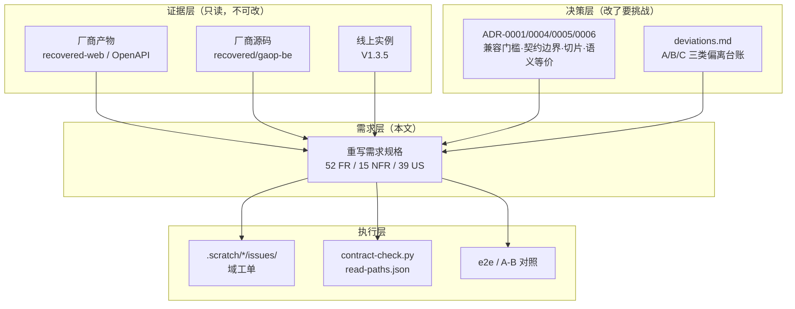

*图 1-1　本文与上游文档、下游工单的关系。证据层只提供事实，决策层只提供约束，需求层负责把它们翻译成"要做什么"，执行层负责证明"做到了"。*

一句话概括四层分工：

- **证据层**回答"厂商实际上是什么样"，不允许有观点；
- **决策层**回答"哪些不能改、按什么顺序做、怎么判定等价"，改它要写 ADR；
- **需求层（本文）**回答"重写要交付什么、怎么算完成"；
- **执行层**回答"这一条具体怎么实现、怎么验"。

## 1.3 证据等级

本文每一句话都应当能回答"你凭什么这么说"。为此全文使用统一标记：

| 标记 | 含义 | 可信度 | 典型来源 |
| --- | --- | --- | --- |
| 【产物】 | 厂商前端产物明文 | 最高 | i18n key、表头、表单字段、路由表、接口字面量 |
| 【源码】 | 厂商反编译源码 / 本仓代码事实 | 高 | `recovered/gaop-be`、`paas-core` 的控制器与领域服务 |
| 【契约】 | 运行时 OpenAPI 或本仓 `contracts/` | 高 | `/api/gaop/v3/api-docs`（504 paths） |
| 【实测】 | 在 172.16.209.x 集群或本机运行得到 | 高（仅代表当前环境） | 真实响应、A/B 对照、探针 |
| 【推断】 | 由上述推导，未直接验证 | 需复核 | 本文所有【推断】都由第 9 章的问题单兜底 |

*表 1-1　证据等级定义。*

**用法示例**：说"`sysinfo` 这个键名厂商写错了"，必须写成"【源码】厂商 `ServiceStatusInfo` 只标了 Gson 的 `@SerializedName`，
【实测】线上返回 `sysInfo`，【产物】前端读 `data.sysinfo`"——三段证据拼起来才是结论，缺一段就只是猜测。

## 1.4 编号规范

| 前缀 | 含义 | 格式 | 示例 |
| --- | --- | --- | --- |
| `FR-` | 功能需求 | `FR-<能力域>-<序号>` | `FR-C1` |
| `NFR-` | 非功能需求 | `NFR-<序号>` | `NFR-1` |
| `US-` | 用户故事 | `US-<Epic><序号>` | `US-C2` |
| `Q-` | 待确认问题 | `Q-<序号>` | `Q-20` |
| `R-` | 风险 | `R-<序号>` | `R-13` |
| `S` | 切片 | `S<序号>` | `S2` |
| `图` / `表` | 图表 | `<章>-<序号>` | `图 5-3`、`表 6-1` |

*表 1-2　编号规范。*

两条约定：

1. **能力域字母（A–J）一旦分配就不再变**，新增能力追加字母，不复用旧编号——否则历史提交信息里的 `FR-C2` 会指向别的东西。
2. **图表编号跟随章节**，插入新图时后续图号顺延、不跳号；图注写在图下方，表注写在表上方。
3. **需求卡与示例里的小表不单独编号**（它们是说明性内容），只有章节级表格才进表目录。

## 1.5 版本基线与漂移

这是本版最需要注意的事实：**厂商在我们梳理需求期间升级了版本**。

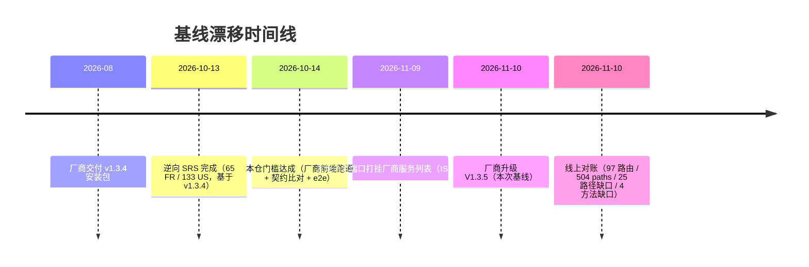

*图 1-2　基线漂移时间线与影响面。关键在于：SRS 与"259 个前端函数"的口径都建立在 v1.3.4 上。*

V1.3.4 → V1.3.5 的实际差异（两侧 OpenAPI 逐条比对）：

| 项 | v1.3.4 | V1.3.5 | 结论 |
| --- | --- | --- | --- |
| paths | 500 | 504 | +4 |
| operations | 542 | 546 | +4 |
| schemas | 930 | 945 | +15 |
| 删除的端点 | — | — | **无** |
| 新增的端点 | — | `GET /v1/prometheus/health`、`POST /v1/prometheus/repair`、`POST /v1/pub/node/terminal`、`POST /v1/software/{id}/restart` | 其中只有 `node/terminal` 被前端调用 |

*表 1-3　V1.3.4 → V1.3.5 的接口差异（【契约】【实测】）。*

**影响面**：

- SQL 侧有 **6 个文件实质不同**（`image_storage` 100→255、loki 上限 60→300、`g_language.text_key` 500→55、
  `g_mode` 删除条件、文案"席位"→"战位"、`V0.2.4` 头像 base64）→ 涉及 FR-E1、FR-H1、FR-A7、FR-I1；
- 本仓 `deploy/sql/migration` 与 `order.txt` **仍是 v1.3.4 副本** → 空库初始化会退回旧结构（R-01）；
- 前端产物 hash 全变，但**路由树 97 个节点一字未动** → 页面清单不受影响。

> **纪律**：以后每次厂商升级，先跑附录 C 的对账脚本，再看 §11.2 的差集。**没有重跑对账之前，本文的数字一律视为"上次的"**。

---

# 第 2 章 背景与产品概念

## 2.1 产品是什么

MSOP（内部代号 gaop，界面标题"机动平台微服务运行框架"）是一个**自包含的 K8s 交付与运营门户**。

它不把 K8s 直接暴露给使用者，而是用一套业务语言把 K8s 包起来：

- **软件**（Software）：一个可交付的业务系统，是目录与授权的最小单位；
- **服务**（Service）：软件里可独立部署的单元，对应一个 K8s Deployment；
- **服务端口**（ServicePort）：服务对外暴露的端口，是"能被访问到"的最终凭据；
- **战位**（Role）：组织里的岗位/席位，是软件授权的归属主体。

用户看到的不是"Deployment 副本数"，而是"这个软件有哪几个服务、跑没跑起来、我能不能用"。
**这层翻译就是产品的价值**，也是重写时最不能丢的东西——K8s 谁都会调，把 K8s 藏起来同时不丢信息才是难点。

厂商实现规模（【源码】【产物】【契约】）：1598 个 Java 类、约 604 个 handler、
前端 259 个 service 函数、97 条路由、三套语言包（1820/1816/1818 条）、87 个 Flyway 迁移、39 张表。

## 2.2 交付形态与系统上下文

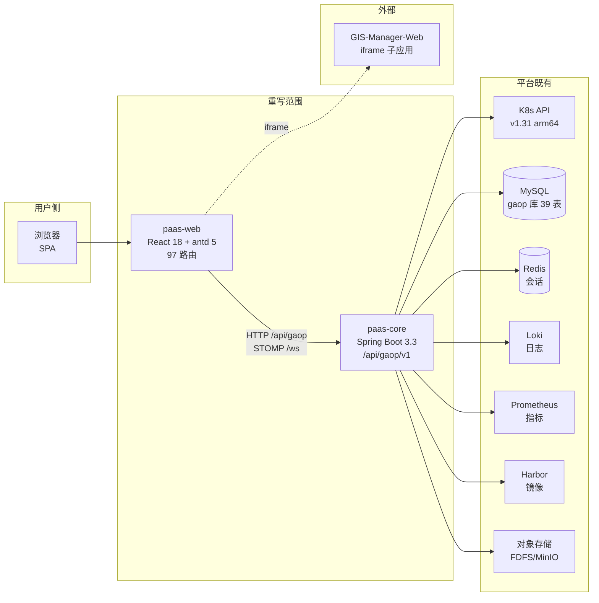

*图 2-1　系统上下文。实线是重写必须自己实现的通路；虚线是"只做承载与门禁、不做业务"的部分。*

| 组件 | 职责 | 在重写范围内 | 关键约束 |
| --- | --- | --- | --- |
| `gaop-web` → `paas-web` | 静态 SPA，UI 与交互 | ✅ 全量替换 | 布局配色逐值照搬（ADR-0004） |
| `gaop-be` → `paas-core` | 业务后端，`/api/gaop/v1/**` | ✅ 全量替换 | 契约与 39 张表不可改（ADR-0004） |
| `gaop-gateway-auth` → 待定 | 会话校验、`canAdmin` | ⚠️ 归谁未定（Q-04） | cookie `gateway-token` 不可换 |
| `gaop-auth` | 许可签发（申请码/授权码） | ❌ 只消费 | 与机器码绑定 |
| `gaop-startup` | 延迟启动闸门 | ❌ 只写注解 | 读 `gaop/serviceInitTime` |
| `gaop-fdfs` / `gaop-image-uploader` | 文件与镜像包 | ❌ 只对接 | 可换对象存储（Q-14） |
| `GIS-Manager-Web` | 地理信息业务本体 | ❌ iframe 承载 | 不在离线包内 |
| K8s / MySQL / Redis / Loki / Prometheus / Harbor | 平台设施 | ❌ | 缺失时降级不 500 |

*表 2-1　系统组件与职责。*

**这张表决定了"范围"的边界**：重写的是"门户"这一层，不是它脚下的设施，也不是挂在它旁边的专用组件。
判断一个新需求是否在范围内，问一句：**它是不是"把 K8s 翻译成业务语言"的一部分？** 是，就在；不是，就另议。

## 2.3 领域模型

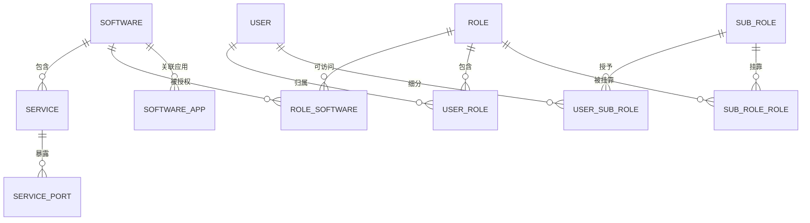

*图 2-2　领域模型（库表级）。39 张业务表里与授权链强相关的 10 张在这里；其余是字典、设置、日志与关联表。*

| 术语 | 定义 | 常见误用 |
| --- | --- | --- |
| **软件** Software | 平台纳管的业务软件，目录与授权的最小单位 | 说成"应用"或"系统" |
| **服务** Service | 软件内可独立部署的单元，与 Deployment/Service 成对 | 说成"实例"或"容器" |
| **服务端口** ServicePort | 服务对外暴露的端口与协议，是访问凭据 | 说成"端口映射" |
| **应用** Application | 一组共享 `system/appName` 标签的 Deployment 聚合视图，**只读** | 当成"软件" |
| **战位** Role | 组织里的岗位/席位，授权归属主体 | 说成"角色"或"门户" |
| **集群** Cluster | MSOP 视角的一个 K8s 集群，当前实现是单值 | 当成"节点池" |
| **子角色** SubRole | 席位之下的细粒度收窄，不放大权限 | 当成二级角色 |

*表 2-2　核心术语。完整版见附录 A 与 `GLOSSARY.md`。*

**为什么术语要抠这么细**：厂商自己在代码、库注释、界面文案里用了三套叫法（`role` / "席位" / "战位" / "门户"），
前端把 `role` 显示成"门户"，数据库注释写"战位表"。重写时如果跟着界面叫"门户"，
读代码的人会以为它是登录入口；跟着字段叫 `role`，又会被误认为 RBAC 角色。**判据是语义，不是字面**。

## 2.4 三条不变量：软件、应用、服务的区别

这是整个产品最容易混淆、也最容易做错的地方。

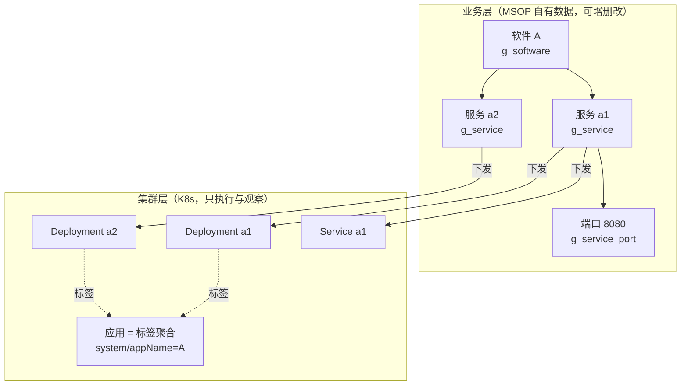

*图 2-3　软件、应用、服务三者的区别。实线是"MSOP 拥有的数据"，虚线是"MSOP 只能观察的视图"。*

三条不变量（背下来，写代码时天天用）：

1. **软件是自有数据**：存 `g_software`，可以增删改，删除前要检查下面还有没有服务。
2. **应用是聚合视图**：由 Deployment 上的标签 `system/appName` 聚出来，**MSOP 不能创建/删除应用**。
   界面上出现"应用"的地方，都是只读的列表或分组。
3. **服务对应 Deployment**：MSOP 可以创建、编辑、删除服务，并同步 K8s 对象；
   但**真相源是数据库**（`g_service`），K8s 是投影——这是厂商的设计，也是重写必须保持的语义。

> **反例**：有人会想"既然服务就是 Deployment，为什么不直接读 K8s？"——因为业务字段（三语名、优先级、延迟启动时间、
> 授权状态）不在 K8s 里；而且 K8s 对象会被别人改，直接读会让"平台记录"和"集群现状"打架。
> 正确的读法是：**库是账本，K8s 是现场**，两边都要看，冲突时以库为准并提示"现场已漂移"。

## 2.5 业务对象到 K8s 对象的映射

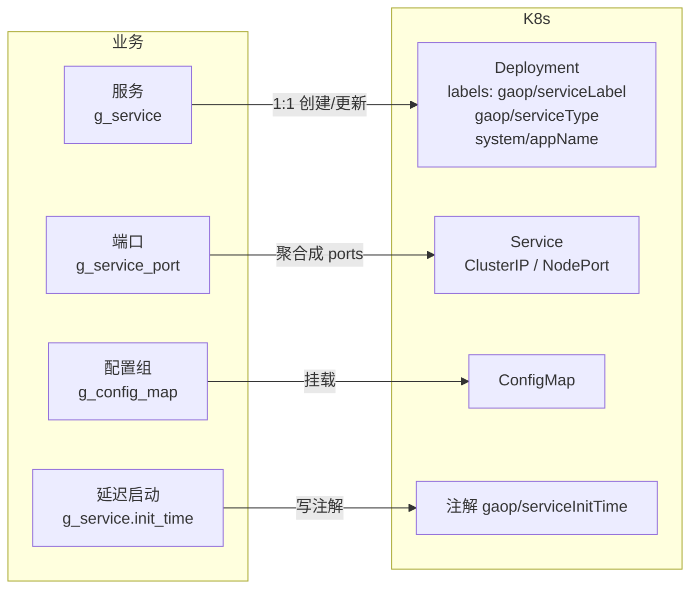

*图 2-4　业务对象到 K8s 对象的映射。`gaop/*` 标签是业务语义载体，重写时必须原样写入，否则厂商的判据会失效。*

关键标签与注解清单（写错一个，页面就查不到）：

| 标签/注解 | 含义 | 谁在读 |
| --- | --- | --- |
| `gaop/serviceLabel` | 服务标识（业务主键） | 服务列表、详情、扩缩容 |
| `gaop/serviceType` | 服务类型（business / base 等） | 基础服务页、列表过滤 |
| `gaop/updateTimestamp` | 业务侧最后更新时间 | 列表"版本更新时间"列 |
| `gaop/serviceInitTime` | 延迟启动秒数 | `gaop-startup` 闸门 |
| `system/appName` | 所属应用 | 应用聚合视图 |
| `system/svcName` | 服务名（部分端点用它判存在） | `existService` 一类判据 |

*表 2-3　业务标签与注解。*

## 2.6 技术底座对比

| 维度 | 厂商 v1.3.4 / V1.3.5 | 重写 | 差异带来的收益 |
| --- | --- | --- | --- |
| 语言/运行时 | JDK 8 | JDK 21（虚拟线程可用） | 内存与并发模型更好 |
| 框架 | Spring Boot 2.3.1 | Spring Boot 3.3.5 | 仍在支持期内 |
| K8s 客户端 | client-java 旧模型（内置 1.14 API） | fabric8 7.9.0 | 支持 `IntOrString` 命名端口，避免 ISSUE-01 |
| 持久层 | MyBatis + 手写 SQL | MyBatis 3.0.3（保留） | 迁移成本低，SQL 可对照 |
| 前端 | umi 3 + 压缩产物（无 source map） | React 18 + TS 5 + Vite 7 + antd 5 | 可维护、可重构 |
| 鉴权 | 网关 cookie + Redis 会话 | 同协议（归属待定） | 可双向互换 |
| 部署 | 8 个 JVM / 4.9 GB 节点曾 OOM | 双 Deployment 并存，限堆 | 内存账需单独算 |

*表 2-4　厂商与重写的技术底座对比。*

**换底座不是目的，是手段**：JDK 21 与 fabric8 的直接好处是"不再因为一个命名端口把整个服务列表打挂"；
前端换栈的直接好处是"改一个页面不用读压缩代码"。除此之外的"现代化"，都不构成重写理由。

---

# 第 3 章 目标、范围与验收

## 3.1 业务目标

重写不是为了"用新技术"，而是解决四个具体的现实问题。目标写成可判定的形式，避免"更好用""更现代"这类无法验收的说法。

| # | 目标 | 判据 | 依据 |
| --- | --- | --- | --- |
| **G1** | **可替代**：用自研前后端整体替换 gaop-web + gaop-be，业务能力不缩水 | 97 条路由逐页可达且行为对等；前端调用的 214 条接口全部实现 | ADR-0001、ADR-0004 |
| **G2** | **可交付**：离线气隙、arm64、4 GB 级节点可交付 | 离线包安装成功；无外网依赖；单节点不 OOM | NFR-10、NFR-4 |
| **G3** | **可维护**：摆脱"只有压缩产物、无 source map、无构建号" | 源码可读、构建可复现、变更可追溯 | NFR-8 |
| **G4** | **可演进**：门槛过后能改名、加字段、拆服务 | 每次演进先过门槛再动手 | ADR-0001 |

*表 3-1　业务目标。*

**【推断】四条业务动因**（需 Q-02 追认）：① 现有交付物不可维护（无 source map）；
② 厂商缺陷会让**整个平台的服务列表全挂**（命名端口 → 6 个端点 500，ISSUE-01）；
③ 技术底座停在 Boot 2.3 / JDK 8 / K8s 1.14 模型；④ 内存规格与离线 arm64 交付受限。
这四条是重写最硬的现实理由，也都是"再不解决就会复发"的问题。

## 3.2 工程目标与度量

| # | 目标 | 度量口径 | 当前值（2026-11-10） |
| --- | --- | --- | --- |
| E1 | 契约语义等价 | L1 形状 + L2 前端读取路径全绿，L3 逐条入账 | 已记录读路径全绿 |
| E2 | 前后端可互换 | 厂商前端跑重写后端；自研前端跑厂商后端 | 双向均已实测 |
| E3 | 分层不腐化 | 无 `persistent/` 越层包；`adapter/port` 只调 `gateway/` | 结构检查通过 |
| E4 | 测试门槛自动化 | `mvn -o test` 与 `vitest run` 离线全绿 | 后端 664 条、前端约 232 条 |
| E5 | 首屏可控 | 入口 chunk gzip ≤ 350 KB | 约 172 KB |
| E6 | 切流可回退 | 改 ingress 后端即生效 | 实测双向各约 5 秒 |

*表 3-2　工程目标与度量。*

## 3.3 范围边界

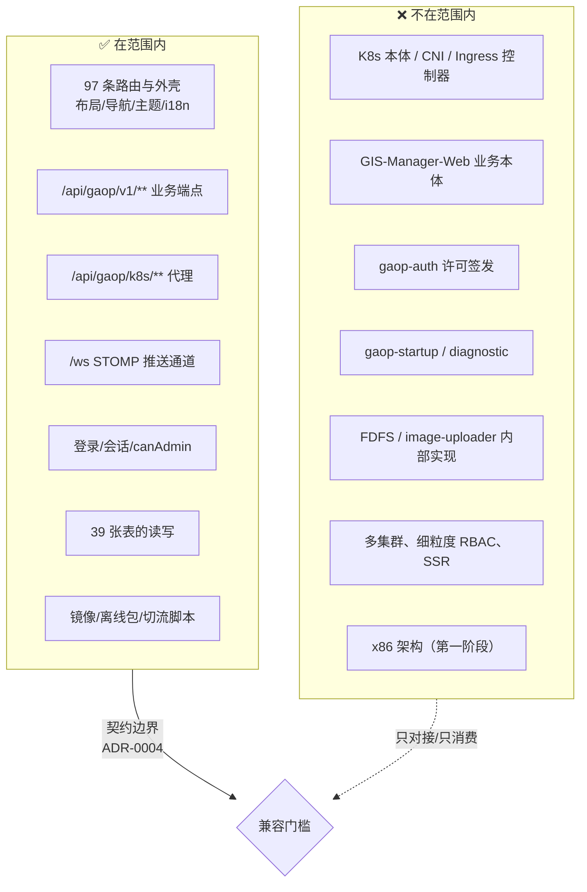

*图 3-1　范围边界。左边是"必须自己实现"的，右边是"只对接、不重写"的；中间的闸门是 ADR-0004 定义的契约边界。*

## 3.4 明确不做的事项

| # | 不做 | 理由 | 若要做 |
| --- | --- | --- | --- |
| N1 | 不改 `/api/gaop/v1/**` 契约与 39 张表结构 | 改了就没有"等效性"这个唯一对照物 | 先挑战 ADR-0004 |
| N2 | 不重写 K8s / CNI / Ingress / 存储插件 | K8s 是执行面，不是领域 | 不属于本项目 |
| N3 | 不重写 GIS 子应用 | 业务本体在外部产品内 | 另立项目 |
| N4 | 不做多集群管理 | 厂商 `clusters()` 硬编码单集群 ID | 另立 ADR |
| N5 | 不做细粒度 RBAC / 数据权限 | 厂商只有 `canAdmin` 一个权限码 | 会改变菜单可见性语义 |
| N6 | 不做 SSR、不换鉴权与推送协议 | 协议是契约的一部分 | 会破坏"可互换" |
| N7 | 第一阶段不支持 x86 | 目标环境只有 arm64 | 第二阶段评估 |
| N8 | 不复刻厂商缺陷，不把"能渲染"当验收 | A 类不复制；L3 一可见即缺陷 | — |
| N9 | 不接管 `gaop-auth` / `gaop-startup` / `gaop-diagnostic` | 只消费其语义 | Q-17 可改 |
| N10 | 不做整页视觉再设计 | 布局配色逐值照搬（ADR-0004） | 替代完成后 |

*表 3-3　明确不做的事项。*

**"不做"也是需求**：上面每一条都对应一个具体的诱惑。比如 N5——看到"开发管理员/运维管理员"两个角色，
很自然地想给它们不同权限；但厂商系统里两者的权限**完全一样**（同一个 `canAdmin`），
真做了区分，菜单可见性就和厂商不一致，"等价"这条门槛立刻失效。

## 3.5 暂缓事项

| 项 | 暂缓理由 | 触发条件 |
| --- | --- | --- |
| 多租户与多集群 | 超出兼容边界 | 产品化阶段 |
| 审计日志防篡改（WORM） | 厂商只读，未要求 | 合规要求出现 |
| GIS 子应用打包进离线包 | 体积与授权域 | 离线 GIS 交付（Q-06） |
| 前端设计系统重构 | ADR-0004 已定逐值照搬 | 替代完成后 |
| 细粒度告警策略引擎 | 厂商只有阈值 | 运维需求升级 |

*表 3-4　暂缓事项与触发条件。*

## 3.6 验收门槛

"做完了"必须可判定。项目采用**四道门 + 两个补充**，四条全绿才算一个域完成。


*图 3-2　四道验收门与切流闸门。门 1–4 来自 ADR-0004，补充 A/B 是本版新增，针对"200 但没效果"这类假通过。*

| 门 | 判什么 | 判定方法 | 反例（真实发生过） |
| --- | --- | --- | --- |
| 门 1 | 厂商前端可跑 | 原样前端 + 重写后端，页面渲染 | 页面停在"正在获取授权信息" |
| 门 2 | 契约语义等价 | `contract-check.py` + 离线回放 | L1 绿但页面少一列（读路径错） |
| 门 3 | 域内 e2e | 真实集群 + 真实前端 | 只在 H2 上跑单测 |
| 门 4 | 不退化 | 已通过用例重跑 | 改一处端点，另一页白屏 |
| 补充 A | 写路径副作用 | 可回滚探针 + 查库 | 返回 200，但什么都没写 |
| 补充 B | 降级形态 | 断依赖后看页面 | 厂商 NPE 让整页"加载失败" |

*表 3-5　验收门槛与判定方法。*

## 3.7 成功度量现状

| 维度 | 现状（2026-11-10 对账） | 目标 |
| --- | --- | --- |
| 路由可达 | 本仓 97 = 线上 97，**差集为空** | 97/97 逐页对等（结构/表头/工具栏） |
| 端点覆盖 | 28 控制器 / 255 路径 / 283 操作；覆盖前端调用面 **189/214（88%）** | 214 条全覆盖 + 方法级零缺口 |
| 方法缺口 | **4 条**（含 `POST/DELETE /v1/service`） | 清零 |
| 前端契约 | 195 条（缺 10、多 20） | 与线上对齐并注明差异 |
| 契约比对 | 已记录读路径全绿 | 全端点 L1+L2 = 0 失败 |
| 偏差台账 | A1–A14 / B1–B33 / C1–C13 | 新增偏离必须带可见性举证 |

*表 3-6　成功度量现状。*

---

# 第 4 章 角色与权限模型

## 4.1 人类角色

| 角色 | 后端标识 | 可见范围 | 核心诉求 | 频度 |
| --- | --- | --- | --- | --- |
| **匿名访客** | — | 登录页、403/404 | 登录、看许可状态 | 每会话一次 |
| **普通用户** | `普通用户` / `GENERAL_USER` | 应用大厅 + 被授权软件 | 打开有权使用的软件 | 高 |
| **开发管理员** | `开发管理员` / `DEVELOPMENT_MANAGER` | 全部一级菜单 | 登记软件、编排服务、构建镜像 | 高 |
| **运维管理员** | `运维管理员` / `OPERATIONS_ADMINISTRATOR` | 全部一级菜单 | 监控、备份、告警、存储网络 | 高 |
| **内置 admin** | `admin` | 全部，**跳过角色校验** | 初始化与应急 | 低 |

*表 4-1　人类角色。*

> 【产物】五个角色名逐字取自登录页与 `g_role`；【源码】`admin` 是硬编码放行分支，登录成功后额外写 `localStorage.BackupSync`。
> **注意**：开发管理员与运维管理员**在系统里权限相同**，区别只是组织语义。

## 4.2 系统参与者

| 参与者 | 交互方式 | 失败时的行为要求 |
| --- | --- | --- |
| 浏览器 SPA | HTTP + STOMP，单一基址 `/api/gaop` | 不白屏、给可读错误 |
| 集群 Watch 源 | STOMP 推送 5 个 topic | 断线可见、可重连、HTTP 兜底 |
| Loki / Prometheus | 后端代理查询 | 按"无数据/空日志"处理，不 500 |
| GIS 子应用 | iframe | 跨域拿不到 error，用加载超时兜底 |

*表 4-2　系统参与者。*

## 4.3 权限模型

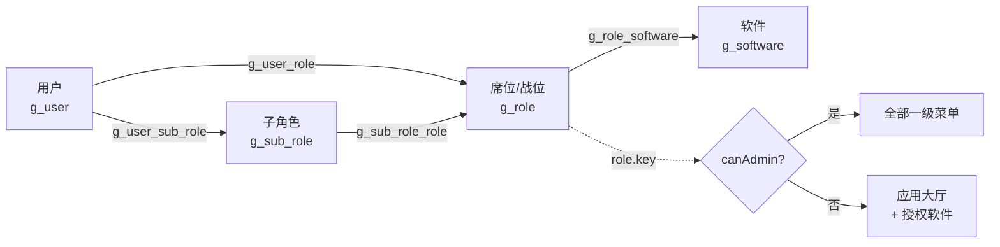

*图 4-1　用户—席位—软件—子角色权限模型。实线是授权关系，虚线是判定路径。*

三条规则：

1. **席位是授权的归属主体**：给某人权限，本质是"把他放进某个席位"，而不是"给他打标记"。
2. **软件挂在席位上**：`g_role_software` 一行 = 该席位可用某软件。
3. **子角色只收窄**：挂在席位上，进一步限定"这个席位里的哪些人能用"，不放大权限。

## 4.4 `canAdmin` 判定链

这是"能不能进管理页"的唯一开关，也是最容易实现错的一段。

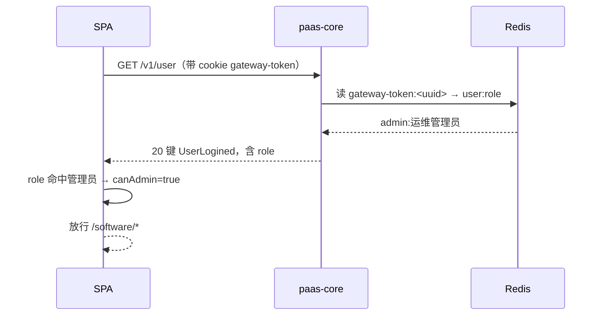

*图 4-2　`canAdmin` 判定链。关键在最后两步：前端读的是 `/v1/user` 的 `role`，不是 `/v1/user/info`。*

真实响应示例（【实测】V1.3.5，节选）：

```json
{
  "msg": "OK",
  "code": 0,
  "data": {
    "id": "1",
    "username": "admin",
    "role": "运维管理员",
    "roles": ["运维管理员"],
    "lastLoginRole": "admin",
    "token": null,
    "status": 1
  }
}
```

**三个已踩过的坑**（每一条都真的让页面挂过）：

1. **裸数组 vs 分页信封**：`/v1/user/info` 是 `{list:[…],total:1}`，不是对象；按裸对象解析会让 `canAdmin` 恒 false，
   管理页全部跳 `/no-auth`。`/v1/role`、`/v1/user/get` 同样踩过——**契约里凡写成 `X[]` 的，必须用真实响应核一遍**。
2. **字段名不是直觉**：`/v1/user/info` 没有 `role` 字段，门户 key 在 `lastLoginRole`，而 `roles` 是中文门户名数组。
3. **超时不等于未登录**：把会话探测超时压到 5 秒、又把任何失败判成匿名，后果是"后端一慢，刷新就等于被登出"。
   只有 `unauthenticated` 才判匿名，`timeout/network` 落到 `unknown` 并给重试。

## 4.5 角色 × 能力矩阵

| 能力 | 普通用户 | 开发管理员 | 运维管理员 | admin |
| --- | --- | --- | --- | --- |
| 应用大厅 / 打开授权软件 | ✅ | ✅ | ✅ | ✅ |
| 查看软件与服务列表 | 仅授权 | ✅ | ✅ | ✅ |
| 登记软件 / 编排服务 / 起停 | ❌ | ✅ | ✅ | ✅ |
| 镜像构建 / 上传 | ❌ | ✅ | ✅ | ✅ |
| 备份还原 / 告警 / 白名单 | ❌ | ✅ | ✅ | ✅ |
| 用户 / 席位 / 子角色维护 | ❌ | ✅ | ✅ | ✅ |
| 服务授权（申请码/授权码） | ❌ | ✅ | ✅ | ✅ |
| 强制下线 / 删席位 / 批量停止 | ❌ | ✅ | ✅ | ✅ |

*表 4-3　角色 × 能力矩阵（按 `canAdmin` 单码推导）。*

## 4.6 设计说明

- **为什么只有一个权限码**：厂商前端把 `access:"canAdmin"` 写在路由表上，97 条路由里除登录、大厅、版本页外全部受它控制。
  重写若引入更细的权限，路由守卫就要改，而厂商前端仍然只认 `canAdmin`——**双向可互换**立刻不成立。
- **`admin` 是硬编码**：`"admin" === username` 直接放行，不查角色。这是应急通道，重写必须保留同样语义（否则初始化会卡住）。
- **"开发/运维"只是席位名**：`g_role` 里两条内置记录，权限位相同。想真正区分，属于 N5 范围外。

---

# 第 5 章 核心业务流程

## 5.1 七条流程与它们的关系

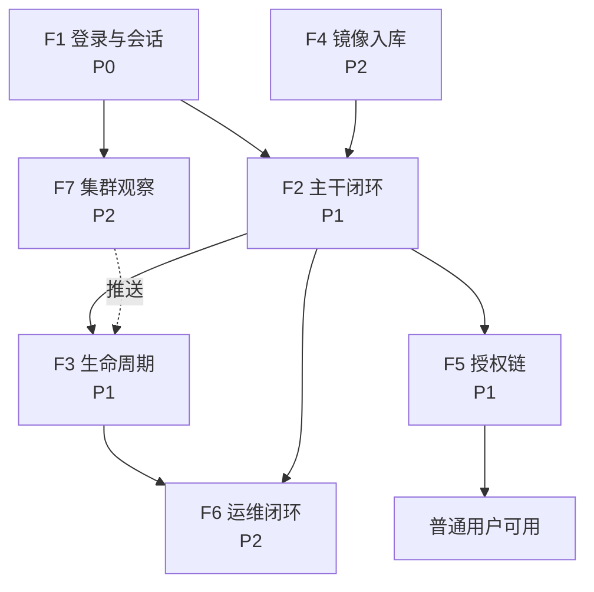

*图 5-1　七条核心流程的关系。F1 是所有流程的入口，F2 是主干，F4 为 F2 提供镜像输入，F3/F5/F6/F7 围绕主干展开。*

读这张图的顺序：**先 F1（没有会话什么都做不了）→ 再 F2（主干）→ 然后按角色分叉：开发侧走 F3/F4，
管理侧走 F5/F6，值班侧走 F7**。每条流程在后面各占一节，结构统一为"目的 → 触发 → 主步骤 → 失败路径 → 承载 FR"。

## 5.2 F1 登录、席位选择与权限态建立（P0）

**目的**：用"账号 + 口令 + 席位"三要素换取会话，并让前端知道"这个人能看什么"。

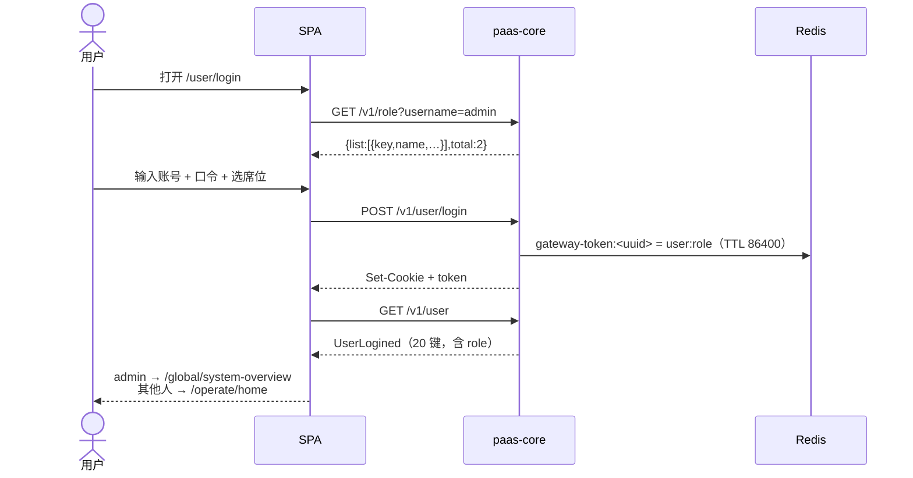

*图 5-2　F1 登录与会话建立时序。注意席位候选是在登录**之前**拉的，所以 `/v1/role` 必须允许匿名访问。*

请求与响应示例（【实测】）：

```http
POST /api/gaop/v1/user/login
Content-Type: application/json

{"username":"admin","password":"******","role":"admin"}
```

```http
HTTP/1.1 200 OK
Set-Cookie: gateway-token=8f3c…; Path=/; HttpOnly
Content-Type: application/json

{"msg":"OK","code":0,"data":{"token":"8f3c…","role":"运维管理员"}}
```

失败路径：

| 情况 | 表现 | 注意 |
| --- | --- | --- |
| 口令错误 | 200 + `code` 非 0，前端不跳转 | 文案随语言切换 |
| 账号/口令为空 | 前端拦截，不发请求 | 厂商只在页面校验 |
| 超过 `max-login` | 踢掉最早会话 | 默认 1（单点登录） |
| 会话过期 | 401 `{"msg":"未认证","code":401}` | 不能当成"500"处理 |
| 后端超时 | 页面保持登录 + 重试 | **不得**判为匿名 |

*表 5-1　登录失败路径。*

**承载**：FR-A1、FR-A2、FR-A7。

## 5.3 F2 主干闭环：从登记软件到用户可用（P1）

这是产品的价值链条，也是验收的主战场。九个步骤，每一步都有明确的产物与真相源。

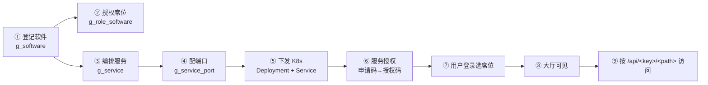

*图 5-3　F2 主干闭环。①–④ 是平台账本，⑤ 是投影到集群，⑥–⑨ 是"能不能被用"的开关。*

| 步 | 做什么 | 写哪里 | 关键接口 | 失败会怎样 |
| --- | --- | --- | --- | --- |
| ① | 登记软件：三语名、`key`、版本、图标 | `g_software` | `POST /v1/software` | `key` 重复被拒 |
| ② | 给席位勾选软件 | `g_role_software` | `POST /v1/software/softwareRelateRole` | 解除后大厅立刻不可见 |
| ③ | 编排服务：镜像、命令、环境变量、卷 | `g_service` | `POST /v1/service` | 同名标识被拒 |
| ④ | 配端口：协议、端口、nodePort | `g_service_port` | `POST /v1/service/servicePort` | 冲突在提交前拦截 |
| ⑤ | 下发：Deployment + Service + 标签 | K8s | 同 ③④ | 集群不可达 → 明确错误，不留半套 |
| ⑥ | 服务授权：导出申请码、上传授权码 | `g_auth` | `/auth/gene_identifier`、`/auth/updateAuthInfo` | 未授权 → 访问被拒 |
| ⑦ | 用户登录并选席位 | Redis 会话 | `POST /v1/user/login` | 席位为空无法登录 |
| ⑧ | 大厅按席位∩软件展示 | 只读 | `GET /v1/role/software` | 空态，不报错 |
| ⑨ | 访问入口地址 | — | `GET /v1/software` 的 `url` | 服务未起 → 502 |

*表 5-2　主干流程每步的产物与真相源。*

**这一步为什么难**：①–④ 在数据库，⑤ 在集群，⑥ 在许可文件，⑦ 在 Redis，⑧ 是聚合视图，⑨ 是网络。
**一次"点一下能用了"的背后跨了五个存储**，任何一处不一致都会表现成"页面能开、但用不了"。

当前实现状态（【源码】【实测】，必须知道）：`POST /v1/service`（③ 创建）与 `DELETE /v1/service`（删除）
**在本仓尚未实现**，只有 GET 列表。也就是说这条链在重写后端上目前**断在第③步**——这正是 §11.2 方法级对账查出来的 4 条缺口之一。

**承载**：FR-B1、FR-B2、FR-C1、FR-C2、FR-G1、FR-J4。

## 5.4 F3 服务生命周期与批量操作（P1）

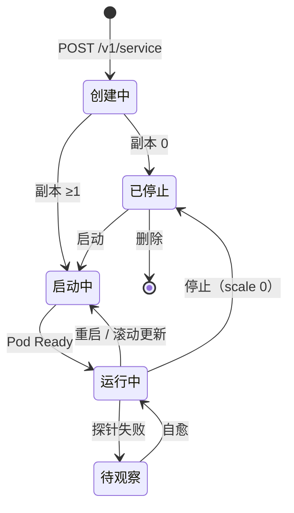

*图 5-4　服务生命周期状态机。状态不是 MSOP 自造的枚举，而是由 Deployment 的 `replicas` + Pod 状态推导。*

| 动作 | 接口 | 语义要点 |
| --- | --- | --- |
| 启动 | `PUT /v1/service/start` | 置副本 ≥1；延迟启动时先写注解 |
| 停止 | `PUT /v1/service/stop` | 置副本 0；**不删对象** |
| 重启 | `PUT /v1/service/reStart` | 删 Pod 让其重建 |
| 批量 | `PUT /v1/service/batch-{start,stop,restart}` | **逐条反馈**，不是一句"成功" |
| 扩缩容 | `PUT /v1/service/scale` | 失败保留 fabric8 原始消息 |
| 滚动更新 | `PUT /v1/service/rollingUpdate` | 依赖就绪探针 |
| 删除 | `DELETE /v1/service` | 二次确认 + 影响面提示（**本仓未实现**） |

*表 5-3　生命周期动作与接口。*

**约束**：`spec.replicas` 可能为 null（不得拆箱 NPE）；命名端口的工作负载不得让列表崩（ISSUE-01）；
批量动作必须逐条返回结果——因为"停 5 个成功 4 个"是常态，一句"操作成功"会掩盖故障。

## 5.5 F4 镜像入库到服务引用（P2）

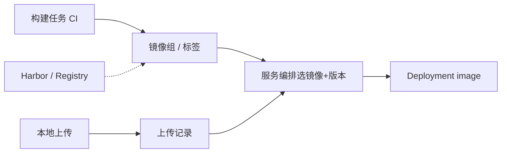

*图 5-5　F4 镜像入库到服务引用。虚线是外部仓库，不可达时必须给"不可达"状态而不是 500。*

**失败路径**：构建失败可重试且有日志；仓库不可达 → 列表显示"不可达"；上传大文件要有进度（厂商未见断点续传证据，本仓按 NFR-7 要求）。
**承载**：FR-E1、FR-E2、FR-E3。

## 5.6 F5 授权链：用户 → 席位 → 软件 → 子角色（P1）

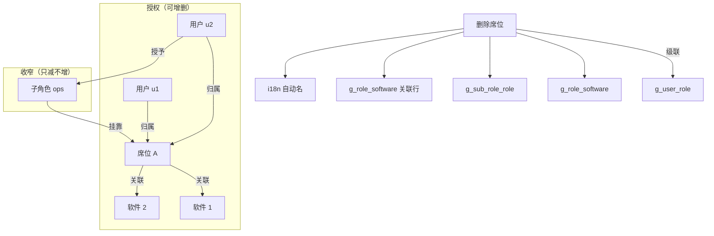

*图 5-6　F5 授权链与级联删除。左边是"谁能用什么"，右边是删一个席位要连带清掉的五处。*

| 表 | 作用 | 删除席位时 |
| --- | --- | --- |
| `g_user_role` | 用户 ↔ 席位 | 删 |
| `g_role_software` | 席位 ↔ 软件 | 删 |
| `g_sub_role_role` | 子角色 ↔ 席位 | 删 |
| `g_role` | 席位本体 | 删 |
| i18n 自动名 | 三语名称 | 删（本环境 no-op，待回补） |

*表 5-4　授权链涉及的表与级联。*

**两条必须照抄的反直觉行为**（都有实测证据）：

1. **假成功**：既不是 `admin`、也没有 admin 席位的调用者去删用户，厂商返回 **200 + `data:true`，但什么都没删**。
   不是 403，不是错误——重写必须一样，否则前端的提示逻辑会变。
2. **整体回滚**：`DELETE /v1/role?roleId=a,b` 中第二个是内置席位时，**一条都不删**。
   所以事务边界必须在用例层，不能下沉到 DAO。

**承载**：FR-A3、FR-A4、FR-A5、FR-B2。

## 5.7 F6 运维闭环（P2）

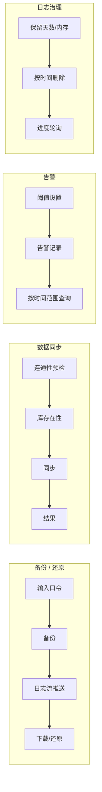

*图 5-7　F6 运维闭环。四块共同点：都是长任务，都需要进度与可取消，都不能"点了没反应"。*

**承载**：FR-H1、FR-H4、FR-H5、FR-H6。

## 5.8 F7 集群观察：概览、工作负载与驾驶舱（P2）

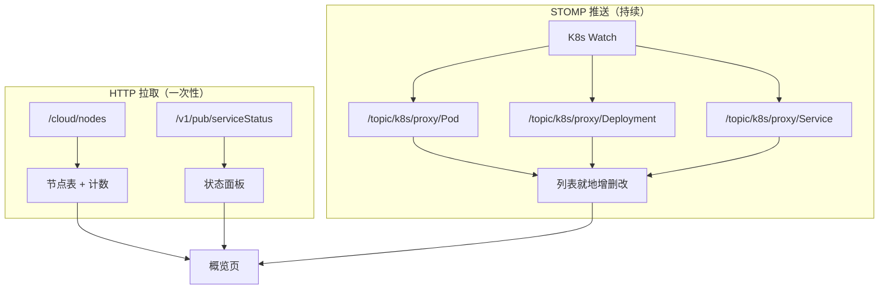

*图 5-8　F7 集群观察的数据流。拉取负责"首屏有数"，推送负责"变化可见"，两者并存、互为兜底。*

**降级要求**：推送断开 → 显示断线 + 提供 HTTP 刷新；取不到状态 → 显示"未知"（灰点），**绝不显示"正常"**。
后者是厂商的真实缺陷（A13）：`sysinfo`/`sysInfo` 键名不一致，导致面板永远全绿——重写必须让它真实可见。

**承载**：FR-D1～FR-D6、FR-J2。

## 5.9 流程 → 能力映射

| 流程 | P0 | P1 | P2 |
| --- | --- | --- | --- |
| F1 登录 | A1 A2 A7 | — | — |
| F2 主干 | — | B1 B2 C1 C2 G1 J1 J4 | — |
| F3 生命周期 | — | C3 C4 C8 | D5 |
| F4 镜像 | — | — | E1 E2 E3 |
| F5 授权链 | — | A3 A4 A5 | — |
| F6 运维 | — | H1 | H4 H5 H6 H7 |
| F7 观察 | — | D1 | D2 D3 D4 D5 D6 |

*表 5-5　流程 → 能力映射。*

---

# 第 6 章 功能需求

## 6.1 组织方式、优先级与需求卡样板

### 6.1.1 为什么按"能力"而不是按"菜单"编号

厂商前端有 97 条路由，但**同一个页面组件会被多个菜单复用**：

- `/software/application/base-service` 与 `/ops/base-service` 是同一个组件；
- `/mirror/group` 与 `/ops/base-service/images/:name` 是同一个组件；
- `/ops/base-service/record` 与 `/mirror/record` 是同一个组件。

按菜单编号会把一个能力写成三条需求，验收时又要判断"这三条是不是同一个"。所以本文按**业务能力**分 10 组（A–J），
菜单路径只作为"入口"标注。对应关系见 §11.5 的追踪矩阵。

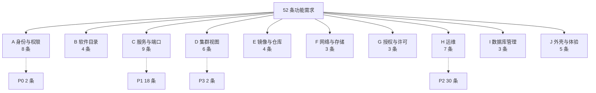

*图 6-1　功能需求的分组与优先级分布。P0 全部落在 A 组，P1 集中在 C 组——这与"入口先做、主干其次"的切片原则一致。*

| 能力域 | 条数 | P0 | P1 | P2 | P3 |
| --- | --- | --- | --- | --- | --- |
| A 身份与权限 | 8 | 2 | 3 | 3 | 0 |
| B 软件目录 | 4 | 0 | 2 | 2 | 0 |
| C 服务与端口 | 9 | 0 | 5 | 4 | 0 |
| D 集群视图 | 6 | 0 | 1 | 4 | 1 |
| E 镜像与仓库 | 4 | 0 | 0 | 4 | 0 |
| F 网络与存储 | 3 | 0 | 0 | 3 | 0 |
| G 授权与许可 | 3 | 0 | 2 | 1 | 0 |
| H 运维 | 7 | 0 | 1 | 6 | 0 |
| I 数据库管理 | 3 | 0 | 0 | 2 | 1 |
| J 外壳与体验 | 5 | 0 | 4 | 1 | 0 |
| **合计** | **52** | **2** | **18** | **30** | **2** |

*表 6-1　功能需求总量与优先级。*

优先级判据只有一条——**不做会不会阻断切流**：

优先级判据只有一条——**不做会不会阻断切流**：

- **P0**：不绿就不能切流 → 先于任何写路径业务完成；
- **P1**：主干闭环（软件→服务→端口→授权→访问）→ 与 P0 同一切片内交付；
- **P2**：全量对等（97 条路由逐页可达）→ 按模块批量推进；
- **P3**：可延后 / 可降级 / 环境不可达 → 明确降级形态，不做假入口。

### 6.1.2 需求卡模板（以 FR-C1 为例）

后面的表格给出"是什么、多重要、怎么算过"；只有关键需求才展开成**需求卡**，写清规则、接口、示例与失败路径。
样板如下——**新写需求卡请照这个结构**。

> #### 需求卡：FR-C1 服务编排
>
> **一句话**：把一个服务（K8s Deployment）从"只有镜像"配置到"能跑起来"，并保证业务字段与集群对象一致。
>
> **目的**：这是产品的核心编辑器。没有它，软件只是一个名字，端口只是数字。
>
> **规则**（按表单顺序）：
> 1. 必填：三语服务名（`serviceLabel/Us/Fr`）、镜像 + 版本、至少一个端口、所属软件；
> 2. 服务标识全局唯一，重复即拒；
> 3. 端口协议只允许 TCP/UDP；端口号 1–65535；同一服务内不得重复；
> 4. 环境变量、命令、参数、卷按"有序列表"处理，**顺序必须稳定**（重排会导致容器行为变化）；
> 5. 未实现的字段（健康检查、滚动策略、负载均衡组）必须在界面上标注"未实现"，**不得静默省略**。
>
> **接口**（【契约】）：
> ```
> POST /v1/service            创建（当前本仓未实现，见 §11.2）
> PUT  /v1/service/patchService   修改端口等
> GET  /v1/service?page&size      列表
> GET  /v1/service/{serviceName}  详情
> ```
>
> **请求示例**（字段为真实契约字段，值已脱敏）：
> ```json
> {
>   "serviceLabel": "test-nginx",
>   "serviceLabelUs": "test-nginx",
>   "serviceLabelFr": "test-nginx",
>   "softwareKey": "demo",
>   "image": "nginx",
>   "imageVersion": "1.25-alpine",
>   "TCP": [{"port": 8080, "targetPort": 80}],
>   "env": [{"key": "TZ", "value": "Asia/Shanghai"}],
>   "commands": ["/docker-entrypoint.sh"],
>   "argList": ["nginx", "-g", "daemon off;"],
>   "selectedNode": "k8s-master",
>   "servicePriority": 5
> }
> ```
>
> **成功判据**：Deployment 存在，且 `gaop/serviceLabel`、`gaop/serviceType`、`system/appName` 三个标签正确；
> 列表能查到该服务，状态由副本数推导。
>
> **失败路径**（每条都要有明确文案，不能吞）：
> | 情况 | 期望 |
> | --- | --- |
> | 镜像不存在 | 提交前提示，不发请求 |
> | 端口冲突 | 指出占用者 |
> | 同名标识 | 拒绝并提示 |
> | K8s 拒绝（422/403） | 保留原始原因，不显示"系统错误" |
>
> **验收**：见 US-C1 的四条 AC；真实集群验证"创建 → 列表可见 → 端口可访问"。
>
> **依赖**：FR-B1（软件先存在）、FR-E1（镜像可选）；**风险**：25 字段巨型表单，一次做全易失真，先做最小可运行集。

### 6.1.3 与状态相关的两个约定

1. **需求表里的"验收标准"只写可判定的结果**，不写"体验良好"这类话；体验类要求进 NFR 或用户故事。
2. **风险栏只写"这条需求本身的风险"**，环境/排期风险统一进第 10 章，避免同一件事记两遍。

## 6.2 FR-A 身份与权限

| ID | 需求 | P | 验收标准 | 依赖 | 风险 |
| --- | --- | --- | --- | --- | --- |
| **FR-A1** | 登录三要素：账号 2–36、口令 6–36、席位必填；账号联想候选随输入刷新；CapsLock 提示；成功后按 `admin`/普通分流落地页 | P0 | ① 三种空值各给对应中文提示且随语言切换；② 含空格/特殊字符前端拦截不发请求；③ `admin` → `/global/system-overview`，其他 → `/operate/home`；④ 失败不跳转 | FR-A3、FR-G2 | 文案与厂商逐字一致，易被"优化"改坏 |
| **FR-A2** | 会话与权限态：cookie `gateway-token`；Redis TTL 86400；`max-login=1` 踢最早；`GET /v1/user` 返回 **20 键 `UserLogined`**（含 `role`）；401 走 `{"msg":"未认证","code":401}` | P0 | ① 带 cookie 200、无 cookie 401；② 第二处登录后第一处失效；③ `role` 缺失时管理页全部 403（属缺陷，不得上线）；④ **超时不得判匿名** | 无 | 厂商 `PUT` 会把 TTL 砍到 600（A11，不复制） |
| **FR-A3** | 席位维护：CRUD + 关联软件/用户/子角色；删除级联 5 张表；保留字 `admin`/`dev` 不可删（`cicd`/`root` 可删，照抄） | P1 | ① `key` 唯一（DB 唯一索引兜底）；② 批量删中第二个为内置 → 整体回滚；③ 级联后关系表为 0；④ 列表 9 列，"更新时间"在"已登录用户"之前 | FR-A4、FR-B1 | 事务边界必须在用例层 |
| **FR-A4** | 用户账号：CRUD + 席位/子角色关联 + 禁用（`qy`）+ 头像 + Excel 导入导出模板 + 批量删除 | P1 | ① 用户名唯一；② 无 admin 权限者删除 → 200 假成功；③ 缺 `roleListKey` 不留半成品；④ `birth` 时区与厂商一致；⑤ 导出 8 列、前三列宽 2560 | FR-A3 | 导出第 7 列是口令哈希（B12）→ Q-08 |
| **FR-A5** | 子角色：CRUD + 关联用户/席位 + 导入导出；删除前解除关联 | P1 | ① `key` 唯一；② id 不存在 → 400 `sub.role.storage.not.found`；③ 关联写入不改用户 `created_at` | FR-A3、FR-A4 | 厂商 `HashSet` 导致多子角色顺序不定 |
| **FR-A6** | 行为审计：只读列表 + 时间范围筛选 + 导出；接口 `GET /audit`、`/audit/dictionaryList`（**当前后端未覆盖**） | P2 | ① 无修改/删除入口（前后端都无）；② 行为类型本地化；③ 导出与列表一致 | FR-A4 | 厂商审计枚举硬编码 13 个动作 |
| **FR-A7** | 国际化：三语；零硬编码；引用 key 100% 有翻译；后端语言包可热覆盖（`/v1/lang/import`、`/v1/lang/remove`、`/v1/lang/detail`） | P2 | ① 1346 个 key 无缺失；② 切换后当前页即时生效；③ 扩展包只装厂商没有的键 | 无 | 三语维护责任未定（Q-19） |
| **FR-A8** | 全局设置：`/settings` 键值下发 + 用户侧全局设置入口 | P2 | ① 返回 `[{key,val,desc}]` 且信封正确；② `settingGlobal` 在厂商是空 chunk → 如实呈现，不编功能 | 无 | 空页面是否保留（Q-16） |

*表 6-2　FR-A 身份与权限。*

**为什么 FR-A2 是 P0 而不是"登录页的事"**：它决定的不只是能不能登录，而是**所有管理页能不能渲染**。
前端守卫读的是 `GET /v1/user` 的 `role`；这个字段少一个键，97 条路由里有 80 多条直接 403。
把"登录"当页面需求、把"权限态"当后端细节，是这类项目最常见的拆分错误。

## 6.3 FR-B 软件目录

| ID | 需求 | P | 验收标准 | 依赖 | 风险 |
| --- | --- | --- | --- | --- | --- |
| **FR-B1** | 软件登记：23 字段（三语名/key/版本/描述/图标/截图/执行名/框架/端口/路径/状态/关联席位/远端接入/排序/置顶/关键字）；列表 20 列；导入口 `/v1/software/import`、`/v1/pub/import`、`/v1/pub/cicd_v2` | P1 | ① `key` 唯一；② 三语名称按语言显示、缺省回退；③ 删除前校验是否仍有服务；④ 图标/截图上传后列表与大厅同步；⑤ 三种导入有进度与重试 | FR-A3 | `remotePassword` 照抄（A7），前端据此免密打开 CS |
| **FR-B2** | 软件-席位授权关联：席位勾选软件即决定可见集合（`POST/PUT /v1/role/{id}/software`，**当前本仓仅 GET**） | P1 | ① 解除后该席位用户刷新即看不到；② 大厅卡片 = 关联 ∩ 用户可见 | FR-A3、FR-B1 | 与 F5 强耦合，改一处影响两页 |
| **FR-B3** | 软件文件管理：上传/下载/删除/新建目录/搜索；接口 `/v1/pub/file_project`、`/v1/pub/file/upload/{projectId}`、`/v1/pub/file/download/{id}` | P2 | ① 大文件有进度与重试；② 删非空目录要确认；③ 存储可配置 | 对象存储 | 厂商 `/v1/pub/file/list`、`/storage` 线上 404（厂商自身缺口） |
| **FR-B4** | 软件详情与列表视图：编码、版本、服务数、运行状态；作为服务编排入口 | P2 | ① 20 列表头逐列一致；② 0 服务时空态不报错 | FR-B1 | 表头 key 易混（`MIRROR_TEXT` vs `MIRROR_NAME`） |

*表 6-3　FR-B 软件目录。*

**关于 FR-B3 的一个真实坑**：厂商文件管理的 6 个接口里，`/v1/pub/file_project`（列表/建/删）线上 200 可用，
但 `/v1/pub/file/list`、`/v1/pub/file/storage` 是 **404**——前端仍在调用它们。这说明厂商页面在 V1.3.5 上
"文件管理"有一部分是坏的。重写要做的不是"照抄 404"，而是**确认这三个路径的真实归属**（可能已迁到 fdfs），
确认前按"不可用 + 明确提示"处理。

## 6.4 FR-C 服务与端口（主干）

> **现状警示（2026-11-10 对账）**：本仓 `/v1/service` **只有 GET**，厂商有 **POST（创建）/ DELETE（删除）**；
> 即 FR-C1 与"删除服务"**当前不可能通过验收**。这是方法级缺口里唯一卡主干的一条，优先级高于本篇其余 P1。

| ID | 需求 | P | 验收标准 | 依赖 | 风险 |
| --- | --- | --- | --- | --- | --- |
| **FR-C1** | 服务编排：镜像/版本、TCP·UDP/端口、环境变量、命令与参数、卷与配置目录、调度节点、区域、`localtime`、三语名、优先级 | P1 | 详见需求卡 6.1.2 | FR-B1、FR-E1 | 25 字段巨型表单 |
| **FR-C2** | 端口与访问：`g_service_port` 为真相源；nodePort 分配；冲突拦截；**命名端口必须原样保留** | P1 | ① 命名端口的 Deployment/Service 进列表不崩（3 个端点均 200）；② 冲突提交前拦截；③ nodePort ∈ [10000,75534] 且不冲突 | FR-C1 | **ISSUE-01**：一处命名端口打挂 6 个端点 |
| **FR-C3** | 生命周期：启动/停止/重启、批量三连、扩缩容、滚动更新、删除 | P1 | ① 批量逐条反馈；② `replicas` null 不 NPE；③ `scale` 失败保留原始消息；④ 全部停止需确认并列影响面 | FR-C1 | 删除服务本仓未实现 |
| **FR-C4** | 容器实例：Pod 列表、删除、强制删除、重新调度、终端（`/v1/pub/node/terminal`）、按名搜索 | P1 | ① 服务未启动禁用删除/终端并提示；② 两种删除确认文案不同；③ 订阅推送就地更新 | FR-D5 | 终端依赖 exec，可 P3 降级 |
| **FR-C5** | 配置组：组与文件两级；导入/导出/备份；服务挂载引用 | P2 | ① 组名唯一；② 导入后可立即挂载；③ 空 `portList` 时**先校验再删**（B14） | FR-C1 | 厂商先删后报错，白删端口 |
| **FR-C6** | 延迟启动：设置/取消 `gaop/serviceInitTime` | P2 | ① 非法值拒绝；② 注解出现在 Deployment；③ 与闸门联动 | FR-C1 | 依赖外部启动闸门 |
| **FR-C7** | 自动伸缩：min/max/阈值数组/启停 | P2 | ① `min ≤ max`；② 多阈值可配；③ 关闭不删副本 | FR-C1 | 阈值口径需与监控一致 |
| **FR-C8** | 基础服务：框架中间件列表与批量上下线（两入口复用） | P1 | ① 全部停止需确认 + 逐条结果；② 提示对业务的影响；③ `/v1/service/gaop` 只返回框架服务 | FR-C3 | 环境无标签时恒空（A4，可解释的 0） |
| **FR-C9** | 部署文件：Deployment YAML 列表/详情/编辑/保存；语法错误可定位 | P2 | ① 保存失败保留输入；② 给行号；③ 保存前后 diff 可见 | FR-D5 | 本环境保存受限 → 禁用并说明 |

*表 6-4　FR-C 服务与端口。*

### 6.4.1 端口与访问的三层结构（FR-C2 详述）

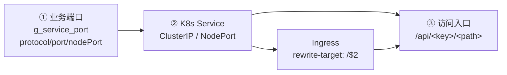

*图 6-2　端口与访问的三层结构。① 是账本，② 是集群对象，③ 是用户真正点开的地址；三层任一断裂都表现为"服务在跑但打不开"。*

规则与示例：

- **协议**只允许 TCP/UDP；同一服务内 `(protocol, port)` 唯一。
- **nodePort 缺省**时随机分配（[10000, 75534]，最多重试 10 次），因此**结果不可复现**——对拉时只比区间与不冲突，不比具体值。
- **命名端口**（`targetPort: "http"`）是合法 K8s 写法，但厂商旧模型把它声明为 `Integer`，
  一遇到就抛 `InvalidFormatException`，异常被吞 → 对象置 null → 列表 NPE → **6 个端点整体 500**。
  重写用 fabric8 的 `IntOrString` 解析，原样保留字符串。
- **验收要点**：在集群里临时建一个带命名端口的工作负载，跑 `/v1/service`、`/v1/software/overView`、
  `/v1/pub/service_status` 三个端点，必须都是 200；用完即删。

## 6.5 FR-D 集群视图

| ID | 需求 | P | 验收标准 | 依赖 | 风险 |
| --- | --- | --- | --- | --- | --- |
| **FR-D1** | 系统概览：节点表 + 计数条 + 状态面板（`sysinfo`/`appstatus`/`radondbInfo`）。数据源 `/cloud/nodes`、`/cloud/nodesummary`、`/cloud/summary`、`/v1/pub/serviceStatus`（**均未覆盖**） | P1 | ① 节点字段按 `data.nodes.nodes`（**两层**）取；② 计数取 `listMeta.total` 或数组长度；③ 匹配不到显示"未知" | 无 | 契约写成 `ClusterNode[]` 是错的 |
| **FR-D2** | 资源统计：16 列 + 筛选 + 批量动作。数据源 `/cloud/nodes/resource-consumption`、`/sorted_pods`、`/label-summary`、`/volumes` | P2 | ① 16 列一致；② 按钮可用或禁用并说明；③ 无自加标题条 | FR-D1 | 725/788 两种表格高度，只实现有声明来源的 725 |
| **FR-D3** | 节点服务 / 系统服务（DaemonSet 视图） | P2 | ① 按节点过滤；② 单 master 下空值可解释 | FR-D1 | `serviceInfoByNode` 依赖外部监控（未实现） |
| **FR-D4** | 驾驶舱：只读大屏 | P3 | ① 无写入口；② 无数据占位不报错 | FR-D1 | 厂商假设 `limits` 必含 cpu/memory，缺 cpu 就 NPE |
| **FR-D5** | 推送通道：`/ws` SockJS + STOMP；5 个 topic + `/topic/userInfo` | P2 | ① 收到 MESSAGE 帧；② 断线可见可重连；③ 与 HTTP 兜底并存；④ 坏消息不抛错 | 无 | 协议不能换（可互换要求） |
| **FR-D6** | 容器概览：Top5 CPU/内存/网络/磁盘 | P2 | ① 空集群空态；② 单位与厂商一致 | Prometheus | 参考环境无 Prometheus，未在线验证 |

*表 6-5　FR-D 集群视图。*

### 6.5.1 节点表的"两层信封"（FR-D1 详述）

这是最容易写错的一个响应。真实结构（【实测】V1.3.5）：

```json
{
  "msg": "OK",
  "code": 0,
  "data": {
    "nodes": {
      "listMeta": { "total": 1 },
      "nodes": [
        {
          "name": "k8s-master",
          "ready": true,
          "schedulable": true,
          "cpu_total": 4000,
          "memory_total_kb": 8123456,
          "pod_cap": 110,
          "conditions": [{"type": "Ready", "status": "True"}],
          "versions": {"kubeletVersion": "v1.31.9"}
        }
      ]
    }
  }
}
```

三个易错点：

1. **两层**：`data.nodes.nodes`，不是 `data.nodes`；
2. **字段名是下划线风格**（`cpu_total`），不是页面列名（`CPU`）；
3. **计数在 `listMeta.total`**，不是数组长度（分页时两者不同）。

前端若按契约写成 `nodes: ClusterNode[]`，结果就是"表头在、数据全空、计数恒 0"——**页面不报错，所以最难发现**。

## 6.6 FR-E 镜像与仓库

| ID | 需求 | P | 验收标准 | 依赖 | 风险 |
| --- | --- | --- | --- | --- | --- |
| **FR-E1** | 镜像组与标签：浏览、删除、展开标签；仓库地址取自 `/register/ip/harbor` | P2 | ① 分页与搜索；② 被引用的镜像删除前提示；③ 不可达显示"不可达" | Harbor/Registry | Registry API 参考环境不可达 |
| **FR-E2** | 镜像构建（CI）：任务列表、触发、日志、记录 | P2 | ① 状态可见；② 失败可重试；③ 日志可下载 | 构建侧 | 依赖外部流水线，边界待定 |
| **FR-E3** | 镜像上传记录 | P2 | ① 文件/大小/结果/时间；② 失败原因可读 | 对象存储 | 同上 |
| **FR-E4** | 基础服务镜像（运维入口复用镜像组组件） | P2 | ① 两入口行为一致；② 空列表两处都空态 | FR-E1 | 改一处影响两页 |

*表 6-6　FR-E 镜像与仓库。*

## 6.7 FR-F 网络与存储

| ID | 需求 | P | 验收标准 | 依赖 | 风险 |
| --- | --- | --- | --- | --- | --- |
| **FR-F1** | 服务发现：Service 列表（Ingress 来源）+ 只读 YAML | P2 | ① 无 `spec.ports` 的 Service **不得白屏**；② 列一致；③ 详情只读 | 无 | 厂商 NFR-ROBUST-1 的原始事故 |
| **FR-F2** | 虚拟 IP：VIP 列表与维护 | P2 | ① 与网关 VIP 一致；② 变更二次确认 | 网关 | 环境相关 |
| **FR-F3** | 存储：本地存储 / PV / PVC 三页（只读） | P2 | ① 列头一致；② 容量单位一致；③ 无写入口 | 无 | 厂商这三页可能不是 antd 表格 |

*表 6-7　FR-F 网络与存储。*

## 6.8 FR-G 授权与许可

| ID | 需求 | P | 验收标准 | 依赖 | 风险 |
| --- | --- | --- | --- | --- | --- |
| **FR-G1** | 服务授权：申请码导出 → 授权码上传 → 状态同步；取消授权；管理员直接授权；批量取消全选 | P1 | ① 申请码/授权码成对，跨服务不可复用；② 过期后访问被拒且状态同步；③ 支持"取消全选" | FR-C1 | JWT 验签 + 机器码交集是不变量 |
| **FR-G2** | 平台许可：`/v1/licence/info`（到期/试用/`authStatus`）、授权码导入、登录页展示、强制下线 | P1 | ① 失效明确提示且不进业务页；② 导入后无需重启即生效；③ 与厂商 `endIso8601` 同值 | 无 | 签发组件归属未定（Q-17） |
| **FR-G3** | GIS 门禁：`gisCode`/`gisEVWebGL`/`gisEVServer` 三码校验；22 条路由地址翻译；不可达超时提示 | P2 | ① 未授权不进 iframe；② 四种形态翻译正确；③ 不可达给提示 | FR-G2 | 子应用不在离线包（Q-06） |

*表 6-8　FR-G 授权与许可。*

许可响应的真实形状（【实测】，可以直接拿去做契约用例）：

```json
{"msg":"OK","code":0,"data":{
  "end":4102358400000,
  "endIso8601":"2099-12-31T08:00:00",
  "code":"MWQ0YzRkNTYt…",
  "expired":false,
  "authStatus":true,
  "currentTime":1794310037447,
  "trialPeriod":1796838778443
}}
```

注意 `end` 是**毫秒时间戳**、`endIso8601` 是**不带时区的本地时间字符串**，两者不是同一口径；
`trialPeriod` 的语义是"试用截止时间"而不是"天数"。这三处都曾经被误读。

## 6.9 FR-H 运维

| ID | 需求 | P | 验收标准 | 依赖 | 风险 |
| --- | --- | --- | --- | --- | --- |
| **FR-H1** | 资源概览与日志治理：Loki 保留天数/内存上限/按时间删除/进度轮询（5 个 `/loki/logs/*`，**全未覆盖**） | P1 | ① 删除需二次确认；② 进度可见；③ Loki 不可达按"无数据"处理 | Loki | V1.3.5 上限 60→300 |
| **FR-H2** | 标签管理（只读）：`/cloud/label-summary` 返回 `{nodes,summary}` | P2 | ① 只读；② 形状按真实响应 | 无 | 契约写成数组是错的 |
| **FR-H3** | 系统服务管理与详情：按容器与时间范围取日志 | P2 | ① 时间范围必填；② 无日志空态；③ 可下钻 | Loki | 同 H1 |
| **FR-H4** | 平台备份还原：口令、推送日志流、可取消、还原前展示影响 | P2 | ① 文件可下载；② 还原前展示"将覆盖"；③ 取消不留半套 | FR-D5、对象存储 | 恢复演练无证据 |
| **FR-H5** | 数据同步：启动前连通性 + 库存在性预检 | P2 | ① 预检失败不发车；② 有进度；③ 版本不匹配明确提示 | MySQL | 厂商无预检，属主动增强 |
| **FR-H6** | 告警：资源/日志的设置与记录（四页两组件）；`/cloud/alert*` + `get/setNodeAlertSetting` | P2 | ① 时间范围必填、起止校验；② 与 `/settings` 键一致；③ 可分页导出 | FR-A8、Loki | 厂商可三条件全空拉全表 |
| **FR-H7** | 白名单：免鉴权路径增删（**高危**） | P2 | 见下方详述 | FR-A6、FR-A2 | 一条 `/*` 等于关闭鉴权 |

*表 6-9　FR-H 运维。*

### 6.9.1 白名单为什么是高危（FR-H7 详述）

白名单的语义是"这些路径不需要登录"。所以它不是一个普通 CRUD，而是**一个能关闭鉴权的开关**：

- 加一条 `/*` → 全站免登录；
- 加一条 `/v1/user/*` → 用户管理接口裸奔；
- 加一条 `/api/gaop/*` → 等于没鉴权。

要求：

1. **双端拦截**：前端拒绝 `/`、`/*`、`/v1/*` 这类输入；后端**二次校验**，不信任前端；
2. **强提示**：页面常驻警示"白名单会跳过登录校验"；
3. **二次确认 + 审计**：每次新增/删除写审计，记录操作人与原值；
4. **验收**：输入 `/*` 必须被拒；正常路径（如 `/v1/licence/info`）加进去后，确实免登录可访问。

## 6.10 FR-I 数据库管理

| ID | 需求 | P | 验收标准 | 依赖 | 风险 |
| --- | --- | --- | --- | --- | --- |
| **FR-I1** | 数据库信息：实例/版本/连接数/容量 | P2 | ① 字段一致；② 连不上显示"不可达" | MySQL | 环境依赖 |
| **FR-I2** | 数据库用户：列表与管理 | P2 | ① **密码列默认脱敏**、点击展开；② 增删改二次确认 | FR-I1 | 厂商明文展示（D7） |
| **FR-I3** | SQL 日志：`GET /v1/database_record`（分页，`updated_at DESC`） | P3 | ① 时间/关键字筛选；② 分页；③ 空态 | FR-I1 | 厂商只提供分页，筛选要前端做 |

*表 6-10　FR-I 数据库管理。*

## 6.11 FR-J 外壳与体验

| ID | 需求 | P | 验收标准 | 依赖 | 风险 |
| --- | --- | --- | --- | --- | --- |
| **FR-J1** | 布局与导航：**顶栏=模块级**、侧栏=当前模块子页；9 个带标题菜单组各一层；直接访问分组落到落地页 | P1 | ① 层级与厂商截图一致；② 模块次序=路由树遍历序；③ 带参详情页不进导航 | 无 | 同名项合并（`/ops/base-service`） |
| **FR-J2** | 主题与视觉：默认 dark；18 色值 + 7 尺寸同源；表格固定高度内部滚动；全局序号列 | P1 | ① 主题测试全绿；② 工具栏在页面底色、表格在卡片底色；③ 无自加标题条；④ 序号列最前、width 80 居中 | 无 | 厂商是"两块"结构 |
| **FR-J3** | 异常兜底：403/404、渲染错误不白屏、首屏静态占位 | P1 | ① 未知路径 404（后端也是 404）；② 初始化失败仍挂载；③ 无权跳 `/no-auth` 并说明 | 无 | `main.tsx` 曾整页白屏 |
| **FR-J4** | 应用大厅：按可见范围展示软件卡片 + 登出 + 许可 + 告警提示 | P1 | ① 无授权空态；② 卡片进对应服务；③ 来源=席位关联 | FR-A2、FR-B2 | `shutdownServer` 在这一页（Q-09） |
| **FR-J5** | 版本与引导：版本展示（不得旧号）、四步引导、状态持久 | P2 | ① 版本与包一致；② 引导可跳过 | 无 | 版本来源需单一 |

*表 6-11　FR-J 外壳与体验。*

## 6.12 本章小结：哪些需求最容易被低估

| 需求 | 为什么容易被低估 | 后果 |
| --- | --- | --- |
| FR-A2 权限态 | 看起来是"登录的一部分" | 80+ 条路由 403 |
| FR-C2 命名端口 | 看起来是"端口的一个字段" | 6 个端点整体 500 |
| FR-D1 两层信封 | 看起来是"取个数组" | 表头在、数据空、不报错 |
| FR-H7 白名单 | 看起来是"普通 CRUD" | 一条 `/*` 关掉全站鉴权 |
| FR-J3 异常兜底 | 看起来是"404 页面" | 一个 mock 失败就整页白屏 |

*表 6-12　最易被低估的五条需求。*

---

# 第 7 章 非功能需求

## 7.1 NFR 清单与相互约束

非功能需求不是"附加项"，它们之间互相拉扯。先把关系画清楚，再看逐条要求。

```mermaid
flowchart TB
  N1["NFR-1 契约等价"] --> N2["NFR-2 双向可替换"]
  N2 --> N6["NFR-6 健壮性"]
  N3["NFR-3 首屏性能"] --> N10["NFR-10 离线/arm64"]
  N4["NFR-4 内存容量"] --> N10
  N5["NFR-5 安全"] --> N14["NFR-14 可回退"]
  N8["NFR-8 可维护"] --> N15["NFR-15 可观测"]
  N11["NFR-11 数据兼容"] --> N14
  N6 --> N13["NFR-13 时区"]
```

*图 7-1　非功能需求之间的约束关系。最硬的约束是 NFR-1/2：它们决定了"能不能切"，其余决定"切了以后稳不稳"。*

| ID | 要求 | 指标 / 口径 | 验收方法 | 现状差距 |
| --- | --- | --- | --- | --- |
| **NFR-1** | 契约语义等价 | L1 信封 + L2 前端读取路径全绿；L3 逐条入账且带可见性举证 | `contract-check.py` + `mvn test` 离线回放 | 已记录读路径全绿；新端点须补 read-path |
| **NFR-2** | 前后端可互换 | 厂商前端不改跑通；自研前端跑厂商后端 | A/B 双后端 + 真实浏览器 | 双向均已实测 |
| **NFR-3** | 首屏性能 | 局域网 ≤ 3 s；入口 gzip ≤ 350 KB；路由懒加载 | 体积断言 + Lighthouse | 约 172 KB |
| **NFR-4** | 内存与容量 | 单节点 4 GB 级可跑（含双后端并存）；堆上限显式 | 部署后 RSS/堆画像 | 厂商 8 JVM 曾 OOM |
| **NFR-5** | 安全 | BCrypt；凭据只走 cookie；白名单受控；口令哈希/远端口令不下发；库用户密码脱敏 | 代码审查 + 接口取证 + 用例 | 已有 B4 收紧；导出仍含哈希（B12） |
| **NFR-6** | 健壮性 | 字段缺失不白屏；单条异常不拖垮整页；**禁止解析失败置 null 继续算** | 行级容错用例 + 契约样本 | A14 是反面教材 |
| **NFR-7** | 大文件与长任务 | 上传有进度；导入/纳管/备份分档超时（30/10/5 min） | 手工验证 + 配置断言 | 厂商无断点续传证据 |
| **NFR-8** | 可维护性 | 六边形分层；禁 `persistent/`；ADR 约束；测试门槛 | `mvn test` / `vitest run` + 分层检查 | 后端 664、前端约 232 条 |
| **NFR-9** | 国际化完整性 | 三语；引用 key 100% 有翻译；禁止硬编码 | key 完整性单测 | 厂商缺 1 个 key |
| **NFR-10** | 离线与架构 | 气隙安装；仅 arm64；无外网依赖 | 离线包自检（解包重构建 + 指纹） | 已具备；store 模式未验证 |
| **NFR-11** | 数据兼容 | 39 张表不变；87 迁移冻结 V0.8.6；新变更 V0.9.0+ 且只加不改 | 迁移清单 + schema diff | 本仓迁移仍是 v1.3.4 副本（R-01） |
| **NFR-12** | 浏览器 | ES2015+；Chromium 优先 | 手工验证 | 厂商 IE9 注释是误导 |
| **NFR-13** | 时区 | 集群 UTC；界面按 `localtime`；DATE 显式建模 | 对拉用例（`birth` 8 小时坑） | 已修（`LocalDate`） |
| **NFR-14** | 可回退 | 改 ingress 后端即切；回退秒级、不重部署、不回滚库 | 切换演练留证 | 已演练（约 5 s） |
| **NFR-15** | 可观测性 | 结构化日志带 traceId；关键操作审计；错误码可读 | 日志抽查 + 审计页 | 厂商日志规范弱 |

*表 7-1　非功能需求。*

## 7.2 必须正面解决的厂商缺陷

有些非功能要求不是"做得更好"，而是"不能把厂商的坑一起搬过来"。

| # | 缺陷 | 重写要求 | 关联 |
| --- | --- | --- | --- |
| D-A14 | 命名端口 → `allService` NPE → 6 个端点 500 | 用 fabric8 `IntOrString`；禁止置 null 降级；fail-soft 落用例 | FR-C2、NFR-6 |
| D-ROBUST1 | 无 `ports` 的 Service 让网络页白屏 | 行级容错 + 可选链；样本覆盖 ExternalName | FR-F1 |
| D-A13 | `sysinfo`/`sysInfo` 键名不一致导致状态面板恒绿 | 按前端实际读取键名输出；取不到显示"未知" | FR-D1 |
| D-NPE 群 | 20+ 处 `Integer` 拆箱 / `get(0)` / `substring` NPE | 空值按业务语义处理，不复制成 500 | NFR-6 |
| D-A12 | `updateServiceRole` 是死代码（注解写完被覆盖） | 不实现无副作用语义；错误路径对齐 | FR-C1 |
| D-D5 | 版本号默认旧值（V1.3.3） | 版本单一来源 | FR-J5 |
| D-D11 | 无 source map | 源码交付 + 构建可复现 | NFR-8 |

*表 7-2　必须正面解决的厂商缺陷。*

## 7.3 契约语义等价的三层判定

这是全篇最需要讲清原理的一节。**"接口一样"到底是什么意思？**

```mermaid
flowchart TB
  A["同一请求<br/>厂商 vs 重写"] --> B{"L1 信封与键<br/>是否齐全？"}
  B -->|否| X["缺陷，必须修"]
  B -->|是| C{"L2 前端读取的<br/>字段路径与值？"}
  C -->|不一致| Y["缺陷，必须修"]
  C -->|一致| D{"L3 已知偏离<br/>是否前端可见？"}
  D -->|可见| Y
  D -->|不可见| OK["记录在案，通过"]
```

*图 7-2　契约比对的判定流程。三层不是"从严到松"，而是"从形状到语义再到例外"。*

| 层 | 判什么 | 不绿算什么 | 例 |
| --- | --- | --- | --- |
| **L1 形状** | 信封 `{msg,code,data}`；前端会读的每个键存在；类型按值判 | 缺陷 | 少一个 `role` → 管理页 403 |
| **L2 读取路径** | `read-paths.json` 里列出的路径 + 值（含写路径表单字段） | 缺陷 | `nodes` 少一层 → 表空 |
| **L3 已知偏离** | client-java 的 `null` 噪声、厂商自造键、fabric8 新字段 | 记录在案 | `restartCount` 口径不同但显示一致 |

*表 7-3　契约三层判定的内容与判定结果。*

两条关键规则：

1. **L3 不是"可以不管"的抽屉**：任何 L3 偏离，一旦证明前端可见（读了它、或导致渲染变化），立刻升级为 L1/L2 缺陷。
2. **举证责任在重写方**：说"我们不一样但没关系"，必须指出前端哪一行读它、以及为什么页面表现不变，否则不许写进 `allowDeviation`。

**真实例子**：`restartCount` 两侧算法不同（厂商在 client-java 侧算，我们按 Pod 状态统计），
但前端只把它渲染成一个数字，语义相同 → 判 `display-equivalent`，追认。
反过来，`mappingInfo` 我们比厂商更全 → 判 `at-least-as-complete`，**反向不允许**（我们给空而厂商给值，就是缺陷）。

## 7.4 性能与容量口径

**首屏**：厂商入口 4.46 MB 未压缩、18 MB/328 文件；重写入口约 172 KB gzip，路由级懒加载。
指标不是"越小越好"，而是"局域网 3 秒内可交互"——所以真正要盯的是**首屏关键路径**，不是总体积。

**列表接口**：P95 ≤ 1 s。厂商给 13 条接口设 5 秒超时、节点用量类 10 秒；重写沿用分档，但要在日志里能看出慢在哪一段。

**长任务**：导入 30 min、纳管/备份 10 min、上传/重置 5 min。**超时时间本身是契约的一部分**，
改短会导致大文件导入失败（厂商前端会中断）。

**内存账**（这是最容易翻车的一项）：

| 场景 | 规格 | 说明 |
| --- | --- | --- |
| 单后端 | 4 GB 节点 | 重写后端限堆（如 `-Xmx512m`）+ MySQL/Redis |
| 双后端并存 | 8 GB 更稳 | 厂商 `gaop-be` 限堆 320m、Metaspace 128m，8 个 JVM 在 4.9 GB 会 OOM |
| 现状 | 4 核 / 4.9 GB | 曾触发 oom-killer，连带重启 CoreDNS |

*表 7-4　内存口径。*

## 7.5 安全底线

五条不可妥协：

1. **口令 BCrypt 存储**，任何接口都不返回哈希（`/v1/user` 的厂商实现会返回，我们置 null，属安全向偏离，已入 L3 账）；
2. **凭据只走 cookie**，不进 URL、不落 `localStorage`；
3. **白名单受控**（FR-H7）：双端拦截 + 审计；
4. **库用户密码脱敏**（FR-I2）：厂商明文展示，重写默认圆点；
5. **导出不含敏感字段**：厂商 `/v1/user/export` 第 7 列是口令哈希（B12）——当前照抄，已在 Q-08 挂账。

> 这五条里，第 5 条与"兼容"直接冲突。处理原则：**先照抄保证契约，再单独立项脱敏**，
> 不允许"顺手改了"——因为改了之后，厂商前端的行为会变，而我们还说不出为什么。

---

# 第 8 章 用户故事

## 8.1 组织方式与依赖关系

39 条故事按 10 个 Epic 组织，与第 6 章的能力域一一对应。每条故事标注：优先级、关联 FR、证据来源、**依赖/阻塞**、待确认问题。

```mermaid
flowchart LR
  subgraph 门槛["门槛（P0）"]
    A1["US-A1 登录"]
    A2["US-A2 权限态"]
  end
  subgraph 主干["主干（P1）"]
    B1["US-B1 登记软件"]
    B2["US-B2 授权席位"]
    C1["US-C1 编排服务"]
    C2["US-C2 端口"]
    G1["US-G1 服务授权"]
    J1["US-J1 应用大厅"]
  end
  subgraph 支撑["支撑"]
    A3["US-A3 席位"]
    E1["US-E1 镜像"]
    D2["US-D2 推送"]
    C5["US-C5 看 Pod"]
  end
  A3 --> A1 --> A2
  A2 --> B1
  B1 --> B2
  B1 --> C1
  E1 --> C1
  C1 --> C2
  C2 --> G1
  B2 --> J1
  A2 --> J1
  D2 --> C5
  C1 --> C5
```

*图 8-1　用户故事依赖图与关键路径。粗读法：从 A3 出发沿箭头走到底，就是最小可切流路径。*

**关键路径**：`US-A3 → US-A1 → US-A2 → US-B1 → US-C1 → US-C2 → US-G1 → US-J1`。
这条链上任何一环不绿，切流都无从谈起；它同时也是切片 S1→S2 的顺序依据。

**两条零前置的起点**：`US-A3`（权限侧）与 `US-D2`（实时侧），可以并行开工。

## 8.2 Epic A：身份与权限

**US-A1 用账号、口令、席位登录** · P0 · FR-A1/A2 · 【产物】【实测】
> 作为 任何用户，我要用三要素登录，以便进入我被授权的范围。

- **AC1** Given 账号存在、口令正确、席位已关联 When 提交 Then 200、下发 `gateway-token`，`admin` 落 `/global/system-overview`、其他人落 `/operate/home`。
- **AC2** Given 口令错误 When 提交 Then 不跳转、给可读提示、语言切换后提示同步切换。
- **AC3** Given 同一账号已在别处登录 When 我在第二处登录 Then 第一处会话失效（`max-login=1`）。
- **AC4** Given 后端 5 秒无响应 When 刷新页面 Then 仍保持登录并提示重试，**不得**判为匿名。
- **关系**：依赖 US-A3；阻塞 US-A2、US-J1。**待确认**：Q-04。

**US-A2 管理页可见性由权限态决定** · P0 · FR-A2 · 【实测】
> 作为 管理员，我要管理菜单只对管理员出现，以便普通用户不会误入无权页面。

- **AC1** Given `/v1/user` 的 `role` 为管理员席位 When 打开 `/software/*` Then 正常渲染。
- **AC2** Given `role` 缺失或为普通用户 When 打开管理页 Then 跳 `/no-auth` 并说明，不是白屏也不是 500。
- **AC3** Given 用 `/v1/user/info` 取权限 When 解析 Then 从 `data.list[0].lastLoginRole` 取，不依赖不存在的 `role`。
- **关系**：依赖 US-A1；阻塞全部管理页故事。**备注**：这条已踩过三次"裸数组 vs 分页信封"。

**US-A3 维护席位并安全删除** · P1 · FR-A3 · 【源码】【实测】
> 作为 管理员，我要维护席位及其关联，以便权限主体与软件集合始终一致。

- **AC1** Given 批量删除中第二个是内置席位 When 提交 Then 整体回滚，一条不删。
- **AC2** Given 删除普通席位 When 完成 Then 5 张关系表该席位记录为 0。
- **AC3** Given 删除 `cicd` 或 `root` When 提交 Then 允许（厂商只护 `admin`/`dev`）。
- **关系**：零前置；阻塞 US-A1、US-B2。

**US-A4 维护用户与批量导入导出** · P1 · FR-A4 · 【实测】
> 作为 管理员，我要能建号、改号、停用、批量导入，以便人员变动时不逐个点。

- **AC1** Given 缺 `roleListKey` 的新用户 When 保存 Then 要么成功且完整、要么失败且无残留。
- **AC2** Given 无 admin 权限者 When 删除用户 Then 200 假成功，用户仍在。
- **AC3** Given 导出 When 打开 Excel Then 8 列顺序、前三列宽 2560、日期样式一致。
- **AC4** Given 只含 admin 行的表 When 导入 Then 不新增、不报错。
- **关系**：依赖 US-A3；阻塞 US-A5、US-A6。**待确认**：Q-08。

**US-A5 用子角色收窄权限** · P1 · FR-A5 · 【源码】
> 作为 管理员，我要在席位内再分子角色，以便同一席位下的人看到不同范围。

- **AC1** Given id 不存在 When 更新 Then 400 `sub.role.storage.not.found`（不是 500）。
- **AC2** Given 加子角色 When 完成 Then 用户 `created_at` 不变。
- **AC3** Given 关联写入失败 When 事务结束 Then 用户与席位关联均回滚。
- **关系**：依赖 US-A4。

**US-A6 追溯谁做了什么** · P2 · FR-A6 · 【产物】
> 作为 审计读者，我要只读地查行为记录，以便出问题时能定位。

- **AC1** Given 按用户名 + 时间范围查 When 返回 Then 行为类型显示中文。
- **AC2** Given 任意角色 When 尝试改/删 Then 系统无入口、接口也不提供。
- **关系**：依赖 US-A4；**当前后端无 `/audit`**。

**US-A7 切换语言** · P2 · FR-A7 · 【产物】
> 作为 非中文用户，我要切换语言，以便界面与提示都是我读得懂的语言。

- **AC1** Given 当前中文 When 切 English Then 当前页即时更新、刷新保持。
- **AC2** Given 全量扫描 When 校验引用 key Then 1346 个 key 全部有翻译。
- **关系**：被所有页面的文案断言依赖。**待确认**：Q-19。

## 8.3 Epic B：软件目录

**US-B1 登记一个软件** · P1 · FR-B1/B4 · 【产物】
> 作为 开发管理员，我要把软件包登记进来，以便为它编排服务并授权给席位。

- **AC1** Given 三语名齐全 When 切英文 Then 显示英文名；缺失回退中文。
- **AC2** Given 同 `key` 已存在 When 保存 Then 拒绝。
- **AC3** Given 软件下仍有服务 When 删除 Then 拒绝或明确提示级联。
- **关系**：依赖 US-A2；阻塞 US-C1、US-B2。

**US-B2 把软件授权给席位** · P1 · FR-B2 · 【产物】
> 作为 管理员，我要给席位勾选软件，以便该席位上的用户只能看到这些软件。

- **AC1** Given 席位原关联 A、B When 解除 B Then 用户刷新后大厅不再出现 B。
- **AC2** Given 用户挂两个席位 When 打开大厅 Then 看到并集。
- **关系**：依赖 US-A3、US-B1；阻塞 US-J1；**接口 POST/PUT 本仓未实现**。

**US-B3 管理软件相关文件** · P2 · FR-B3 · 【产物】
> 作为 开发管理员，我要上传/下载/建目录，以便把交付物放到平台上。

- **AC1** Given 上传 200 MB When 完成 Then 有进度、可重试、列表出现。
- **AC2** Given 删除非空目录 When 确认 Then 提示影响并执行。
- **关系**：依赖 US-B1；依赖对象存储（Q-14）。

## 8.4 Epic C：服务与端口

**US-C1 编排并跑起一个服务** · P1 · FR-C1 · 【实测】
> 作为 开发管理员，我要填最少但完整的字段把服务跑起来，以便尽快验证交付。

- **AC1** Given 镜像 + 版本 + 一个端口 + 三语名 When 保存 Then Deployment 创建成功，三个标签正确。
- **AC2** Given 服务已创建 When 打开列表 Then 状态、镜像、授权状态、更新时间列序一致。
- **AC3** Given 用到未实现字段 When 打开表单 Then 显式标注"未实现"。
- **关系**：依赖 US-B1、US-E1；阻塞 US-C2、US-C3、US-G1；**`POST /v1/service` 本仓未实现**。

**US-C2 端口冲突与命名端口** · P1 · FR-C2 · 【实测】【源码】
> 作为 开发管理员，我要端口不冲突、命名端口也能跑，以便一个租户的写法不打挂整个平台。

- **AC1** Given 集群里有 `targetPort: http` When 打开服务列表 Then 200 且该行正常。
- **AC2** Given 端口被占用 When 提交 Then 提交前拦截并指出占用者。
- **AC3** Given 未指定 nodePort When 创建 Then 分到区间内且不冲突。
- **关系**：依赖 US-C1；阻塞 US-G1。**备注**：ISSUE-01 的验收面。

**US-C3 启停与批量操作** · P1 · FR-C3/C8 · 【产物】
> 作为 运维管理员，我要一键停一批服务，以便发布窗口内快速止损。

- **AC1** Given 选 5 个服务 When 批量停止 Then 逐条给结果与原因。
- **AC2** Given 点"全部停止" When 确认 Then 展示影响清单。
- **AC3** Given `replicas` 为 null When 停止 Then 视为"非 0"继续下发。
- **关系**：依赖 US-C1。

**US-C4 扩缩容与滚动更新** · P1 · FR-C3/C7 · 【产物】
> 作为 开发管理员，我要调整副本与滚动更新，以便扛住流量且不中断。

- **AC1** Given 2 副本 When 扩到 4 Then 新副本就绪后旧副本才退。
- **AC2** Given 扩缩容失败 When 返回 Then `msg` 带原始原因。
- **AC3** Given `min>max` When 保存 Then 拒绝。
- **关系**：依赖 US-C1。

**US-C5 排障时看容器实例** · P1 · FR-C4 · 【产物】
> 作为 运维管理员，我要看到 Pod 级状态并删掉卡住的 Pod，以便快速恢复。

- **AC1** Given 服务未启动 When 打开容器页 Then 禁用删除/终端并提示。
- **AC2** Given 停留页面 When Pod 变化 Then 列表就地增删改。
- **AC3** Given 强制删除 When 确认 Then 文案与普通删除不同。
- **关系**：依赖 US-D2（推送）、US-C1。

**US-C6 用配置组挂配置** · P2 · FR-C5 · 【产物】
> 作为 开发管理员，我要建配置组并挂到服务，以便配置与镜像解耦。

- **AC1** Given 组名已存在 When 新建 Then 拒绝。
- **AC2** Given 导入配置文件 When 保存 Then 服务可立即挂载。
- **AC3** Given `portList` 为空 When 打补丁 Then 先校验再删（B14）。
- **关系**：依赖 US-C1。

**US-C7 设置延迟启动** · P2 · FR-C6 · 【源码】
> 作为 运维管理员，我要给服务设启动延迟，以便依赖按顺序起来。

- **AC1** Given 非法时间 When 提交 Then 拒绝。
- **AC2** Given 设 60 秒 When 查 Deployment Then 注解存在且值为 60。
- **关系**：依赖 US-C1；依赖外部闸门（Q-17）。

**US-C8 直接改部署 YAML** · P2 · FR-C9 · 【产物】
> 作为 开发管理员，我要直接编辑 Deployment YAML，以便处理表单覆盖不到的场景。

- **AC1** Given YAML 语法错误 When 保存 Then 给行号且保留输入。
- **AC2** Given 保存成功 When 再打开 Then 内容一致。
- **关系**：依赖 US-C1、US-D2。

## 8.5 Epic D：集群视图

**US-D1 一眼看清集群态势** · P1 · FR-D1/D2 · 【实测】
> 作为 运维管理员，我要看节点与服务的健康度，以便判断平台是否正常。

- **AC1** Given 打开系统概览 When 加载完成 Then 节点表至少 1 行，CPU/内存/可调度有值。
- **AC2** Given `sysinfo` 缺某组件 When 渲染 Then 显示"未知"，不是"正常"。
- **AC3** Given 计数接口失败 When 打开 Then 整页可用，计数按节点表自算。
- **关系**：依赖 US-A2；**数据源 `/cloud/*` 本仓未覆盖**。

**US-D2 跟踪工作负载的实时变化** · P2 · FR-D5/D3 · 【实测】
> 作为 运维管理员，我要不刷新就看到变化，以便定位"刚刚发生了什么"。

- **AC1** Given 已连接 When 新增 Deployment Then 列表出现该行。
- **AC2** Given 断开 When 停留 30 秒 Then 显示断线 + 可重连 + HTTP 兜底。
- **AC3** Given 畸形消息 When 处理 Then 不抛错、不影响其他行。
- **关系**：零前置；被 US-C5、US-C8、US-H1 依赖。

**US-D3 用驾驶舱汇报** · P3 · FR-D4 · 【产物】
> 作为 值班人员，我要一块只读大屏，以便值守时远看。

- **AC1** Given 数据缺失 When 打开 Then 占位不报错。
- **AC2** Given 任意角色 When 操作 Then 无写入口。
- **关系**：依赖 US-D1。

**US-D4 看 Top5 资源消耗** · P2 · FR-D6 · 【产物】
> 作为 运维管理员，我要知道谁在吃资源，以便处置。

- **AC1** Given 集群为空 When 打开 Then 空态。
- **AC2** Given 有数据 When 渲染 Then 单位与厂商一致。
- **关系**：依赖 Prometheus（Q-15）。

## 8.6 Epic E：镜像

**US-E1 让镜像可被服务引用** · P2 · FR-E1/E4 · 【产物】
> 作为 开发管理员，我要选到正确的镜像与标签，以便服务能拉起来。

- **AC1** Given 镜像组存在 When 选镜像 Then 标签列表与仓库一致。
- **AC2** Given 仓库不可达 When 打开 Then 显示"不可达"而非 500。
- **AC3** Given 两个入口 When 对比 Then 数据一致。
- **关系**：阻塞 US-C1。

**US-E2 构建并追踪一次镜像构建** · P2 · FR-E2/E3 · 【产物】
> 作为 开发管理员，我要看到构建进度与失败原因，以便重试。

- **AC1** Given 触发构建 When 查看 Then 状态可见。
- **AC2** Given 失败 When 打开日志 Then 能定位失败步骤。
- **关系**：依赖 US-E1。

## 8.7 Epic F：网络与存储

**US-F1 查服务发现对象且不白屏** · P2 · FR-F1 · 【实测】
> 作为 运维管理员，我要看 Service 列表，以便确认 Ingress 的来源。

- **AC1** Given 无 `spec.ports` 的 Service When 打开 Then 整页正常，该行端口列空。
- **AC2** Given 点某行 When 打开 Then 只读 YAML。
- **关系**：无强前置。

**US-F2 巡检存储与虚拟 IP** · P2 · FR-F2/F3 · 【产物】
> 作为 运维管理员，我要只读巡检 PV/PVC 与 VIP，以便确认没有"该挂没挂"的卷。

- **AC1** Given 打开 PV 页 Then 容量/状态/绑定与集群一致。
- **AC2** Given 打开 VIP 页 Then 与网关一致。
- **AC3** Given 三页 When 操作 Then 无写入口。
- **关系**：依赖 US-A2。

## 8.8 Epic G：授权与许可

**US-G1 给一个服务授权** · P1 · FR-G1 · 【产物】
> 作为 管理员，我要导出申请码、换回授权码，以便服务合法运行。

- **AC1** Given 未授权服务 When 导出申请码 Then 得到文件且与机器码绑定。
- **AC2** Given 上传授权码 When 完成 Then 状态变为已授权、可访问。
- **AC3** Given 已过期 When 访问 Then 被拒且状态同步。
- **AC4** Given 批量选择 When 点"取消全选" Then 清零。
- **关系**：依赖 US-C2。

**US-G2 让平台许可可见可控** · P1 · FR-G2 · 【实测】
> 作为 管理员，我要知道许可何时到期，以便提前续期。

- **AC1** Given 打开登录页 Then 显示许可状态与试用剩余。
- **AC2** Given 许可过期 When 登录 Then 明确提示，不进业务页。
- **AC3** Given 导入新码 Then 无需重启即生效。
- **关系**：阻塞 US-A1。

**US-G3 GIS 只有授权才进得去** · P2 · FR-G3 · 【实测】
> 作为 管理员，我要未授权时挡住 GIS 入口，以便不出现"点进去一片白"。

- **AC1** Given `gisCode` 未激活 When 打开 `/map-setting/*` Then 不加载 iframe，给授权提示。
- **AC2** Given 子应用不可达 When 超时 Then 给"无法连接"提示。
- **AC3** Given 四种路由形态 When 翻译 Then 单测全绿。
- **关系**：依赖 US-G2；**待确认** Q-06。

## 8.9 Epic H：运维

**US-H1 备份并在必要时还原** · P2 · FR-H4 · 【产物】
> 作为 运维管理员，我要先备份再升级，以便出问题能回退。

- **AC1** Given 输入口令 When 开始 Then 日志以推送流出现，可取消。
- **AC2** Given 选择还原 When 确认 Then 先展示"将覆盖"范围。
- **AC3** Given 备份完成 When 下载 Then 文件可下载且大小合理。
- **关系**：依赖 US-D2、对象存储（Q-14）。

**US-H2 配告警并按时间追溯** · P2 · FR-H6 · 【产物】
> 作为 运维管理员，我要设阈值并回看告警，以便复盘。

- **AC1** Given 未选时间范围 When 查询 Then 提示必填。
- **AC2** Given `start > end` When 提交 Then 提示非法。
- **AC3** Given 阈值改到 90 When 保存 Then `/settings` 对应键更新。
- **关系**：依赖 US-A8。

**US-H3 治理日志占用** · P1 · FR-H1/H3 · 【产物】
> 作为 运维管理员，我要限制日志保留量与内存，以便磁盘不被写满。

- **AC1** Given 设 7 天 When 保存 Then 生效且回读一致。
- **AC2** Given 删除某时间前日志 When 确认 Then 进度可见。
- **AC3** Given Loki 非 200 When 查日志 Then 按"无日志"处理。
- **关系**：依赖 Loki（Q-15）。

**US-H4 改白名单前被拦住** · P2 · FR-H7 · 【产物】
> 作为 安全责任人，我要防止有人把鉴权关掉，以便平台不被一条通配符打穿。

- **AC1** Given 输入 `/`、`/*`、`/v1/*` When 保存 Then 双端拒绝。
- **AC2** Given 合法路径 When 保存 Then 二次确认 + 写审计。
- **关系**：依赖 US-A6、US-A2。

**US-H5 数据同步前先体检** · P2 · FR-H5 · 【产物】
> 作为 运维管理员，我要在同步前知道目标库能不能连、库在不在。

- **AC1** Given 目标库不可达 When 开始 Then 预检失败给原因，不发车。
- **AC2** Given 预检通过 When 同步 Then 有进度与结果。
- **关系**：依赖 MySQL 可达性。

## 8.10 Epic I：数据库管理

**US-I1 巡检数据库但不泄露口令** · P2 · FR-I1/I2/I3 · 【产物】
> 作为 运维管理员，我要看库状态与库用户，以便处置异常；但口令不该出现在屏幕上。

- **AC1** Given 打开库用户列表 Then 密码列默认圆点，点击展开。
- **AC2** Given 库不可达 When 打开 Then 显示"不可达"。
- **AC3** Given 查 SQL 日志 When 无数据 Then 空态。
- **关系**：无强前置；**与厂商明文展示的差异须入台账**。

## 8.11 Epic J：外壳与体验

**US-J1 普通用户从大厅进入自己的软件** · P1 · FR-J4 · 【产物】
> 作为 普通用户，我要在大厅看到能用的软件，以便直接开始干活。

- **AC1** Given 无授权 When 打开 Then 空态引导，不报错。
- **AC2** Given 3 个授权 When 打开 Then 3 张卡片，点击进入对应服务。
- **AC3** Given 席位被解除某软件 When 刷新 Then 卡片消失。
- **关系**：依赖 US-A2、US-B2。

**US-J2 在熟悉的导航里找到页面** · P1 · FR-J1/J2 · 【实测】
> 作为 管理员，我要按厂商同样的层级找功能，以便不用重新学。

- **AC1** Given 任意模块 When 看侧栏 Then 分组层级一致（9 个菜单组各一层）。
- **AC2** Given 直接访问分组路径 Then 落到落地页，不是 404。
- **AC3** Given 任意列表 When 看表格 Then 首列序号、表头固定、内部滚动。
- **AC4** Given 对比截图 When 量色值 Then 18 色值 + 7 尺寸断言全绿。
- **关系**：被所有页面依赖。

**US-J3 出错时看到可读的原因** · P1 · FR-J3 · 【实测】
> 作为 任何用户，我要在出错时知道发生了什么，而不是白屏。

- **AC1** Given 不存在路径 When 加载 Then 404 页（后端也 404）。
- **AC2** Given 无权 When 跳转 Then `/no-auth` 说明原因。
- **AC3** Given 初始化失败 When 打开首页 Then 仍挂载 + 静态占位。
- **关系**：被所有页面依赖。

**US-J4 确认平台版本与上手引导** · P2 · FR-J5 · 【产物】
> 作为 新用户，我要看到正确版本与四步引导，以便确认装的是哪一版。

- **AC1** Given 打开版本页 Then 版本与安装包一致（不得 V1.3.3）。
- **AC2** Given 完成引导 Then 之后不再弹。
- **关系**：依赖 US-A8。

## 8.12 故事依赖与阻塞汇总

| 故事 | 依赖（需要先有） | 阻塞（不完成则做不了） |
| --- | --- | --- |
| US-A3 | — | US-A1、US-A4、US-B2 |
| US-A1 | US-A3 | US-A2、US-J1 |
| US-A2 | US-A1 | 全部管理页故事 |
| US-A4 | US-A3 | US-A5、US-A6 |
| US-B1 | US-A2 | US-C1、US-B2 |
| US-B2 | US-A3、US-B1 | US-J1 |
| US-C1 | US-B1、US-E1 | US-C2、US-C3、US-C4、US-C6、US-C8、US-G1 |
| US-C2 | US-C1 | US-G1 |
| US-D2 | — | US-C5、US-C8、US-H1 |
| US-G1 | US-C2 | — |
| US-J1 | US-A2、US-B2 | — |

*表 8-1　故事依赖与阻塞汇总。*

**读法**：`US-A3` 与 `US-D2` 是零前置的两个起点，一个在权限侧、一个在实时侧；主干链从 `US-A1` 起。

---

# 第 9 章 待确认问题

## 9.1 问题清单与决策路径

21 个问题里，只有 6 个真正需要开会拍板；其余按"建议"默认执行，被推翻时回来改这一行即可。

```mermaid
flowchart LR
  Q["发现问题"] --> C1{"影响切流吗？"}
  C1 -->|否| D1["按建议执行<br/>记入变更记录"]
  C1 -->|是| C2{"有证据可判吗？"}
  C2 -->|有| D2["按证据裁决<br/>写进 ADR/台账"]
  C2 -->|无| C3{"能补实验吗？"}
  C3 -->|能| D3["补实验后再定"]
  C3 -->|不能| D4["标为【推断】<br/>指定决策人"]
```

*图 9-1　待确认问题的决策路径。关键不是"问题多不多"，而是"每个问题有没有指定谁在什么时候回答"。*

| ID | 问题 | 为什么现在定 | 建议 / 选项 | 决策人 | 阻塞 |
| --- | --- | --- | --- | --- | --- |
| **Q-01** | 需求基线是否整体切到 V1.3.5？SRS 与 259 函数口径都基于 v1.3.4 | 厂商已升级，6 个 SQL 文件实质不同；按旧基线验收等于验错版本 | ① 切基线并重跑契约比对（推荐）；② 锁 v1.3.4 | 项目负责人 | 全部 P2 |
| **Q-02** | 业务动因与优先级排序是否认可（§3.1 的四条推断） | 动因决定"哪个模块可以降级" | 认可四条，P3 只保留"环境不可达/破坏性" | 项目负责人 | 全部优先级 |
| **Q-03** | 是否采纳补充验收 A/B（写路径副作用、降级形态） | 只看 200 会漏"假成功/白删" | 采纳 | 项目负责人 | §3.6 |
| **Q-04** | 认证归属：自带还是继续用 `gaop-gateway-auth` | 决定会话与 `canAdmin` 写在哪侧 | 自带（已实测互认 cookie） | 架构 | FR-A1/A2 |
| **Q-05** | 端点口径：259 函数 / 283 被调 / 321 无调用者 / 546 操作，以哪个为准 | 口径不同，验收范围差 60+ | 以 259 为"必须实现" | 架构 | NFR-1 |
| **Q-06** | GIS 长期 iframe 还是最终替换？离线是否打包子应用 | 影响 M12 的 22 条路由 | 短期 iframe + 门禁 | 产品 | FR-G3、R-08 |
| **Q-07** | 白名单通配符：前端拒绝够不够 | 白名单是鉴权旁路 | 双端都拦 + 审计 | 安全 | FR-H7 |
| **Q-08** | 导出里的口令哈希照抄还是脱敏 | 照抄=合规风险，脱敏=偏离契约 | 照抄 + 台账，产品化阶段移除 | 安全/法务 | FR-A4 |
| **Q-09** | `shutdownServer` 是否保留在普通用户大厅 | 越权高危动作在最低权限页 | 移到管理员页 + 校验 | 安全 | FR-J4 |
| **Q-10** | 双后端共库持续多久？迁移边界怎么守 | 共库期间厂商也要容忍新迁移 | 共库至切流完成 | 架构 | NFR-11、R-03 |
| **Q-11** | 写路径事务边界：哪些用例必须整体事务 | 厂商多处"半删/半插/假成功" | 删除/批量/级联一律用例层事务 | 架构 | FR-A3、FR-C1 |
| **Q-12** | `runningDeployment` 取全量还是分页后（ISSUE-02） | 分页时两侧口径不一致 | 按厂商语义取**全量** | 后端 | FR-D1 |
| **Q-13** | 命名端口 fail-soft：单条降级还是整体 500 | ISSUE-01 根因就是"降级成 null" | 单条降级 + 可解释告警 | 后端 | FR-C2、NFR-6 |
| **Q-14** | 文件/镜像存储：FDFS/MinIO 还是换对象存储 | 决定 B3/E3/H4 实现与离线体积 | 沿用 MinIO 兼容接口，抽 Port | 架构 | FR-B3、US-H1 |
| **Q-15** | Loki / Prometheus 是否必需？缺失降级到哪 | C 类偏离多来自这两个设施 | 非必需，缺失即"无数据" | 运维 | FR-H1/H3/D6 |
| **Q-16** | `/usermanage/settingGlobal` 空页面：保留/隐藏/补功能 | 厂商产物是空 chunk | 隐藏菜单 | 产品 | FR-A8 |
| **Q-17** | 许可签发（`paas-licence`）是否纳入重写 | 决定 G1/G2 边界 | 本阶段只消费 | 项目负责人 | FR-G1/G2 |
| **Q-18** | 部署下限：4 GB 还是 8 GB？并存期怎么限堆 | 4.9 GB 跑 8 JVM 已 OOM | 两套规格：单后端 4 GB / 并存 8 GB | 运维 | NFR-4、R-04 |
| **Q-19** | 三语维护流程：谁翻、谁校、缺 key 怎么拦 | 缺 key 直接显示字面量 | 完整性单测阻断合并 | 前端 | FR-A7 |
| **Q-20** | `POST/DELETE /v1/service` 等 25+4 条缺口怎么处置 | 22 条落在已有页面的模块上 | 22 条必须补；terminal 可降级；prometheus 先判死代码 | 项目负责人 | FR-A6、C1、D1、H1 |
| **Q-21** | V1.3.5 新增的 `prometheus/health` 与 `prometheus/repair` 要不要做 | 页面不用，但文档里有 | 先判死代码再决定 | 后端 | §11.2 |

*表 9-1　待确认问题。*

---

# 第 10 章 风险登记

## 10.1 风险清单

| ID | 风险 | 触发信号 | 影响 | 应对 | 归属 |
| --- | --- | --- | --- | --- | --- |
| **R-01** | **基线漂移**：SRS/契约基于 v1.3.4，且本仓迁移仍是旧副本 | 空库初始化后 `image_storage` 仍 100、loki 上限 60 | 验收结论对错版本；升级后结构回退 | 取新包 j2 重建迁移；重跑对账 | 后端 |
| **R-02** | **契约回归**：改动落在前端会读的端点上 | 契约比对出现 ❌；表格少列 | 白屏/数据缺失，单测发现不了 | 改前端会读的端点必须重跑 e2e | 双方 |
| **R-03** | **双后端共库写冲突** | 关系表出现孤儿行/重复行 | 数据错乱，回退也救不回 | 切流前冻结写窗口；只加不改 | 运维 |
| **R-04** | **内存不足**：4.9 GB + 双后端 | `OOMKilled`、CoreDNS 连带重启 | 切流演练失败 | 限堆 + 短并存期；补 `limits.cpu` | 运维 |
| **R-05** | **照抄缺陷形成技术债**：A 类 14 条 | 代码出现拆箱、`get(0)` | 线上 500，且"兼容"成为不修的借口 | 每条 A 类必须带处置说明 | 后端 |
| **R-06** | **文件类端点无法在线对拉**：厂商 Metaspace 128 MB | 对拉稳定 500 `OutOfMemoryError` | import/recovery 只能离线单测 | 代码路径级实现 + 逐格断言 | 后端 |
| **R-07** | **"形似神不似"**：16/16 路由结构与工具栏不同 | 比对报告"两块 vs 一块" | 用户一眼看出不是同一产品 | 表头先对齐，工具栏功能集逐页确认 | 前端 |
| **R-08** | **GIS 离线不可用** | M12 在气隙环境全白 | 22 条路由形同虚设 | 门禁 + 明确提示；打包另立工单 | 前端/交付 |
| **R-09** | **离线构建链不稳**：pnpm store 模式失败 | 自检卡在拉包 | 交付延期 | 默认 `node-modules` 模式 | 前端 |
| **R-10** | **翻译缺口**：新增 key 未三语齐备 | 界面出现 `SOME_KEY` | 体验缺陷，不易自动化发现 | 完整性单测 + 评审卡口 | 前端 |
| **R-11** | **规模与带宽**：259 函数 / 546 操作 / 97 路由 | 切片越做越长 | 交付不可预期 | 按切片推进；P3 明确降级 | 项目 |
| **R-12** | **知识产权边界** | 法务质疑 | 交付物不能用 | 独立实现 + 仅以契约为对照；保留证据链 | 项目/法务 |
| **R-13** | **接口面缺口**：189/214，缺写方法 | 页面能开但表格空、或请求 404 | "页面在、功能没有"，比白屏更难发现 | 按 Q-20 分档补齐；每条缺口有 e2e 或降级说明 | 后端 |

*表 10-1　风险登记。*

## 10.2 风险矩阵

```mermaid
quadrantChart
  title 风险概率 × 影响
  x-axis 低概率 --> 高概率
  y-axis 低影响 --> 高影响
  quadrant-1 优先处置
  quadrant-2 持续监控
  quadrant-3 接受
  quadrant-4 制定预案
  R-13 接口缺口: [0.85, 0.80]
  R-02 契约回归: [0.70, 0.85]
  R-04 内存: [0.60, 0.75]
  R-01 基线漂移: [0.55, 0.70]
  R-07 形似神不似: [0.80, 0.45]
  R-05 缺陷债: [0.50, 0.55]
  R-06 文件对拉: [0.45, 0.40]
  R-08 GIS 离线: [0.35, 0.50]
  R-09 构建链: [0.30, 0.30]
  R-10 翻译: [0.60, 0.25]
  R-11 规模: [0.65, 0.60]
  R-12 合规: [0.15, 0.90]
  R-03 共库: [0.25, 0.85]
```

*图 10-1　风险—影响矩阵。右上角是"必须本周处理"的：接口缺口、契约回归、内存、基线漂移。*

---

# 第 11 章 实施、对账与验收

## 11.1 切片顺序

```mermaid
flowchart LR
  S0["S0 骨架与契约基线<br/>✅"] --> S1["S1 身份与权限<br/>✅ 主体"]
  S1 --> S2["S2 软件与服务端口<br/>进行中"]
  S2 --> S3["S3 集群视图与推送<br/>基本完成"]
  S3 --> S4["S4 周边模块<br/>前端 97/97"]
  S4 --> S5["S5 切流与收尾<br/>演练过一轮"]
```

*图 11-1　切片顺序与依赖。顺序由 ADR-0005 定死：入口先做、防腐层后做。*

| 切片 | 内容 | 出口条件（全绿才算完） | 状态 |
| --- | --- | --- | --- |
| **S0** | 工程骨架、契约层、比对器、样本、A/B harness | 契约比对可跑；厂商前端能启动 | ✅ |
| **S1** | 登录/会话/`canAdmin`、用户、席位、子角色、审计、i18n | 两页 e2e 无 404；5 个读端点逐字节相等；级联删除真实库验证 | ✅ 主体（余 `/import` 与文件类） |
| **S2** | 软件登记、服务编排、端口、生命周期、配置组、延迟启动、伸缩 | 服务页 9 行真实数据；命名端口不崩；**`POST/DELETE /v1/service` 补齐** | 进行中 |
| **S3** | 概览、资源统计、工作负载、Pod、驾驶舱、STOMP | 推送收到 MESSAGE；断线降级可见 | 基本完成 |
| **S4** | 镜像、网络、存储、运维、数据库、GIS | 97/97 逐页对等；**25 条接口缺口清零或降级备案** | 前端完成，后端欠账 |
| **S5** | 离线包、双后端并存、切换演练、回退演练 | 切换→观察→切回全程留证 | 演练已过一轮 |

*表 11-1　切片与出口条件。*

## 11.2 契约对账：为什么要两个来源

```mermaid
flowchart TB
  A["线上 OpenAPI<br/>504 paths / 546 ops"] --> M["合并集合"]
  B["前端产物字面量<br/>196 chunk / 214 调用"] --> M
  C["本仓注解扫描<br/>255 路径 / 283 操作"] --> N["归一化<br/>参数占位·去尾斜杠"]
  N --> M
  M --> D1["路径级差集"]
  M --> D2["方法级差集"]
  D1 --> E["25 条整路径缺口"]
  D2 --> F["4 条方法缺口"]
```

*图 11-2　契约对账的双源合并方法。只用一个来源都会得出错误结论。*

### 11.2.1 为什么不能只信 OpenAPI

`/v1/pub/file_project` 线上 **200 可用**，却**不在** 504 条路径里（被 springdoc 排除）。
只信 OpenAPI，就会把它当成"不存在"。

### 11.2.2 为什么不能只信产物字面量

厂商大量用 `"/v1/software/".concat(id).concat("/restart")` 拼路径，
字面量只留半截。用"互相为前缀"判命中，会把 `/v1/software/{id}/restart` 误判成"已覆盖"。
V1.3.5 新增的 4 个端点里，这条就是这么被漏掉的。

### 11.2.3 对账结果

| 项 | 数值 | 说明 |
| --- | --- | --- |
| OpenAPI 路径 / 操作 | 504 / 546 | V1.3.5 |
| 本仓路径 / 操作 | 255 / 283 | 28 个控制器 |
| 精确同路径 | 242 | 用于方法级比对 |
| 前端调用字面量 | 214 | 去噪后 |
| 路径级覆盖 | 189 / 214 = **88%** | 缺 25 条 |
| 方法缺口 | **4 条** | 见下 |
| 前端契约 | 195 条 | 缺 10、多 20 |

*表 11-2　对账结果（2026-11-10）。*

**整路径缺口 25 条**（前端在调、后端没有）：

```
/audit                                  /cloud/nodes/resource-consumption
/audit/dictionaryList                   /cloud/nodes/sorted_pods
/cloud/alert                            /cloud/nodesummary
/cloud/alert/enable                     /cloud/services
/cloud/alert/exist                      /cloud/summary
/cloud/alert/record                     /cloud/volumes
/cloud/alert/rule                       /loki/logs/deleteLogs
/cloud/label-summary                    /loki/logs/getDeleteStatus
/cloud/native/Deployment                /loki/logs/getLogsAssertInfo
/cloud/nodes                            /loki/logs/setLogMaxMemory
/register/ip/harbor                     /loki/logs/setLokiLogRetainMaxDay
/v1/prometheus/health                   /v1/prometheus/repair
/v1/pub/node/terminal
```

**方法缺口 4 条**（路径在、方法不全）：

| 路径 | 厂商 | 本仓 | 业务含义 |
| --- | --- | --- | --- |
| `/v1/service` | GET / **POST** / **DELETE** | GET | **创建/删除服务未实现** |
| `/v1/role/{roleId}/software` | GET / **POST** / **PUT** | GET | 席位↔软件关联未实现 |
| `/v1/software/{id}/relate_service` | GET / **POST** / DELETE | DELETE | 软件↔服务关联未实现 |
| `/v1/cs_software/upload` | POST / GET | POST | 影响小 |

> **结论**：88% 是**路径级**数字，不能读成"功能完成 88%"。主干链上缺的恰恰是写方法——
> `POST /v1/service` 缺失时，F2"登记 → 编排 → 部署"在重写后端上根本走不通，只是 GET 列表能渲染。

## 11.3 切流与回退

```mermaid
flowchart LR
  U["用户"] --> I["Higress Ingress<br/>/gaop"]
  I -->|"按路径前缀 /api/gaop/**"| SW{"上游指向"}
  SW -->|"当前"| V["gaop-be<br/>Deployment"]
  SW -->|"切换"| N["paas-core<br/>Deployment"]
  V -.->|"共用"| DB[("MySQL gaop<br/>39 表")]
  N -.->|"共用"| DB
  V -.-> R[("Redis")]
  N -.-> R
```

*图 11-3　切流拓扑与回退路径。切换 = 改 ingress 的 `backend.service.name`，回退 = 改回去，秒级生效。*

| 步 | 动作 | 判据 | 回退 |
| --- | --- | --- | --- |
| 1 | 并存部署 `paas-core` | Pod 就绪、`/internal/health` 200 | 删 Deployment |
| 2 | 契约比对 | L1+L2 全绿 | 不切 |
| 3 | 切流（改后端名） | 5 秒内生效 | 改回 |
| 4 | 观察 15 分钟 | 错误率、页面可用、关键接口 P95 | 改回 |
| 5 | 回退演练 | 切回后功能正常 | — |

*表 11-3　切流与回退步骤。*

**三条铁律**：

1. **不按权重切**：一半请求走旧后端的状态不可排障；按路径前缀切。
2. **共用同一库与 Redis**：否则会话不互认，A/B 对照失效。
3. **回退不需要回滚数据库**：所以新迁移只能加表/加列/加索引，不能改类型、不能删列。

## 11.4 验收操作手册

```bash
# 后端离线门槛（约 40s，664 条用例）
cd paas-core && mvn -o -q test

# 前端门槛（约 5.5 分钟，约 232 条；不要用 pnpm test，沙箱会拦 store 链接）
cd paas-web && ./node_modules/.bin/vitest run

# 在线契约比对（需集群 + 已启动重写后端）
python3 tools/contract-check.py "GET /v1/service"

# A/B 渲染对照（厂商前端 × 两个后端）
python3 tools/frontend-e2e-harness.py

# 离线包自检（解包重构建 + 入口指纹比对）
cd paas-web && deploy/build-offline-package.sh --no-dist
```

*代码块 11-1　常用验收命令。长命令请用后台 + 日志文件，前台可能被 SIGTERM。*

## 11.5 追踪矩阵

| 能力域 | 厂商模块 | 路由前缀 | 主要故事 | 切片 |
| --- | --- | --- | --- | --- |
| A 身份与权限 | M01 M09 | `/user` `/usermanage` `/authpaas` | US-A1…A7 | S1 |
| B 软件目录 | M05 | `/software/application/config` `/software/file` | US-B1…B3 | S2 |
| C 服务与端口 | M05 | `/software/application/*` `/software/workloads/*` | US-C1…C8 | S2 |
| D 集群视图 | M03 | `/global/*` `/software/overview` | US-D1…D4 | S3 |
| E 镜像与仓库 | M04 M10 | `/mirror/*` `/ops/base-service/*` | US-E1/E2 | S4 |
| F 网络与存储 | M06 M07 | `/netmanager/*` `/storage/*` | US-F1/F2 | S4 |
| G 授权与许可 | M08 M14 M12 | `/auth-manager` `/auth` `/map-setting/*` | US-G1…G3 | S1/S4 |
| H 运维 | M10 | `/ops/*` | US-H1…H5 | S4 |
| I 数据库管理 | M11 | `/database-setting/*` | US-I1 | S4 |
| J 外壳与体验 | M02 M13 M15 + 布局 | `/operate/home` `/setting/version` `/no-auth` `/` | US-J1…J4 | S1/S3 |

*表 11-4　能力 → 模块 → 路由 → 故事追踪。*

> 逐条 FR → 厂商 SRS 编号的完整映射见厂商 SRS 第 7 章；本表只做到"能力—路由—故事"这一层，
> 因为**端点是实现细节，会随重写演进，而能力与故事相对稳定**。

---

# 附录 A 术语表

| 术语 | 定义 | 不要混用 |
| --- | --- | --- |
| **软件** Software | 平台纳管的业务软件，目录与授权的最小单位 | 应用、系统、服务 |
| **服务** Service | 软件内可独立部署的单元，与 Deployment/Service 成对 | 实例、进程、容器 |
| **服务端口** ServicePort | 服务对外暴露的端口与协议，是"能被访问到"的凭据 | 端口映射、映射端口 |
| **应用** Application | 一组共享 `system/appName` 标签的 Deployment 聚合视图，**只读** | 软件、系统 |
| **战位** Role | 组织里的岗位/席位，授权的归属主体 | 角色、席位、门户 |
| **子角色** SubRole | 席位之下的细粒度收窄 | 二级角色、角色组 |
| **集群** Cluster | MSOP 视角的一个 K8s 集群，当前实现是单值 | 节点池、环境 |
| **兼容边界** | 契约与 schema 中不允许改动的部分 | 兼容性、向后兼容 |
| **门槛** | 四条验收门的集合，过了才能切流 | 目标、里程碑 |
| **偏离** Deviation | 重写相对厂商的已知差异，分 A/B/C 三类 | 缺陷（A 类才是缺陷） |

# 附录 B 与厂商 SRS 的差异

| # | 厂商 SRS 的写法 | 本文件的写法 | 原因 |
| --- | --- | --- | --- |
| 1 | 描述"产品现状"，65 条 FR 以页面组件为锚 | 按能力合并/拆分，52 条 FR | 页面被复用，按页面计会重复 |
| 2 | 不设优先级 | P0–P3，判据是"是否阻断切流" | 133 条故事不可能同时做 |
| 3 | 缺陷记在 D1–D14 汇总表 | 转成"必须正面解决"的门槛项 | 缺陷不是"知道就行"，要进验收 |
| 4 | 验收要点是 `[ ]` 清单，无口径 | 每条给可判定标准 + 验证手段 | 避免"看着像做完了" |
| 5 | 未处理 SRS 自身过期（v1.3.4） | 显式标基线、列 6 处 SQL 差异 | 厂商已升 V1.3.5 |
| 6 | 不含故事关系 | 依赖/阻塞表 + 关键路径 | 排期需要 |
| 7 | 不区分"照抄"与"收紧" | 对齐 `deviations.md` 的 A/B/C | 决策必须留痕 |
| 8 | 不含接口覆盖现状 | 含 25 路径缺口 + 4 方法缺口 | "文档完整"必须先证明 |

# 附录 C 复现命令

```bash
# 0) OpenAPI（冷启动约 6 s，超时要给足；用 -m 15 会误判成"没有文档"）
mkdir -p /tmp/v135 && cd /tmp/v135
curl -s -m 90 http://172.16.209.170/api/gaop/v3/api-docs -o api-docs.json

# 1) 前端入口与资源清单（308 资产 / 196 JS）
curl -s http://172.16.209.170/gaop/ -o index.html
curl -s http://172.16.209.170/gaop/asset-manifest.json -o manifest.json
python3 -c "import json;m=json.load(open('manifest.json'));print('\n'.join(sorted({u for u in m.values() if u.endswith('.js')})))" > js.txt
mkdir -p assets && cd assets && cat ../js.txt | sed 's#^/gaop/##' | xargs -P 8 -I{} curl -s -o {} "http://172.16.209.170/gaop/{}"

# 2) 抽路由与接口字面量
python3 - <<'PY'
import re,glob
routes=set(); apis=set()
for f in glob.glob('/tmp/v135/assets/*.js'):
    t=open(f,encoding='utf-8',errors='ignore').read()
    routes|={p for p in re.findall(r'path:"(/[^"\\]*)"',t)}
    apis|={u for u in re.findall(r'["\'`](/(?:v1|v2|v3|api|cloud|audit|loki|register|settings)[A-Za-z0-9_\-/:.{}$]*)["\'`]',t)}
print(len(routes),len(apis))
PY

# 3) 抽后端映射（三个必须做对的点）
#    ① 全限定注解名：@(?:[\w.]+\.)?(?:Get|Post|Put|Delete|Patch)Mapping
#    ② 裸 @GetMapping（路径在类级）要回填 base
#    ③ 只认 value=/path= 后的引号串；否则 @PostMapping(consumes="multipart/form-data")
#       会把 MIME 当路径，凭空造出假缺口
```

**判定规则**：路径归一化（`{param}`/`:param` → `{}`、折叠重复斜杠、去尾斜杠）后，
**先精确匹配做方法级比对**，再"互相为前缀"做路径级覆盖；噪声过滤 `^/(etc|gaop|static|assets|usr|vscode)`、
`socket\.io`、静态扩展名。**两套规则都会漏"同义不同名"**，所以每条缺口都要用 OpenAPI 交叉确认 + Java 关键字复搜。

**已归档的证据**（`docs/requirements/evidence/`）：

| 文件 | 内容 |
| --- | --- |
| `v135-api-docs.json` | 线上 OpenAPI 原文（781 KB） |
| `v135-api-docs-summary.json` | 504 条路径 + 方法 |
| `v135-asset-manifest.json` | 308 个资产 |
| `v135-routes.json` / `v135-api-literals.json` | 产物抽取结果 |
| `v135-reconciliation.md` | 对账说明与脚本坑 |

# 附录 D 变更记录

| 版本 | 日期 | 变更 | 触发 |
| --- | --- | --- | --- |
| v1.0 | 2026-11-10 | 建立 52 FR / 15 NFR / 39 US / 19 Q / 12 R | 重写立项 |
| v1.1 | 2026-11-10 | 补 §0.5 线上对账：路由 97=97；接口 189/214，25 条缺口 | 用户质疑完整性 |
| v1.2 | 2026-11-10 | 用 Swagger 重做对账：504/546/945；方法级 4 条缺口；主干写路径缺失 | 用户指出线上有 Swagger |
| **v2.0** | 2026-11-10 | 全面扩写：背景与概念、流程原理、真实示例、25 张图、图表编号、需求卡模板、验收手册 | 本版要求"更详细、更完整、可视化" |

---

**维护约定**：本文件随切片推进更新，改 FR 优先级或验收标准必须在提交信息里写明"为什么"；
新增偏离一律进 `docs/deviations.md` 并在对应 FR 行加引用，不在此处平行记账。
**每次厂商升级后必须重跑附录 C**，并把 §11.2 的差集更新——这是"文档是否还成立"的唯一判据。


