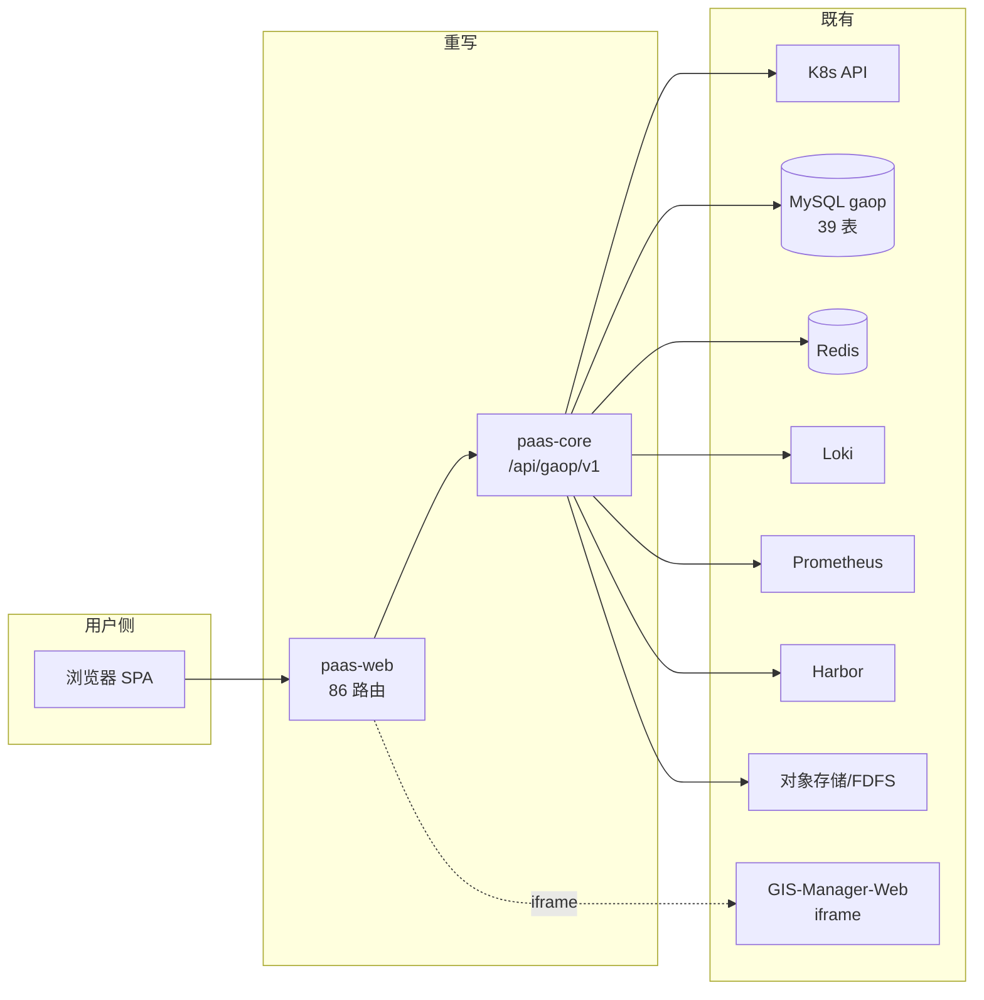
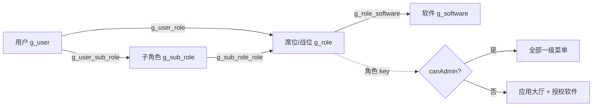
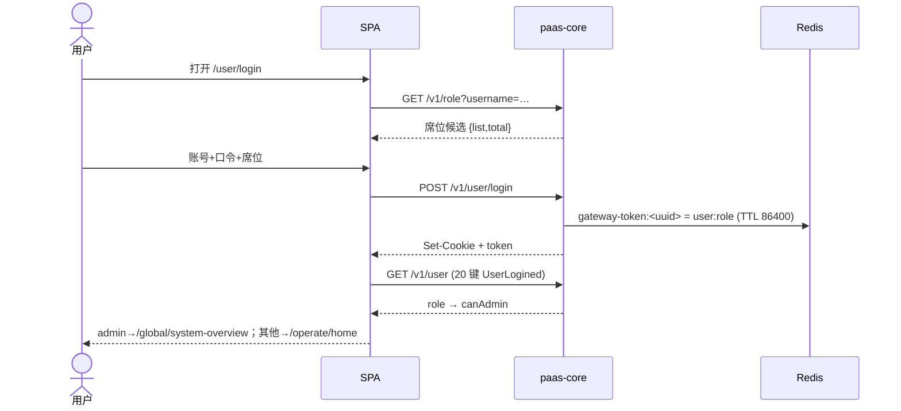
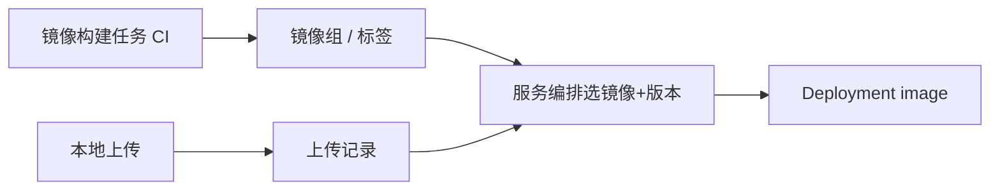
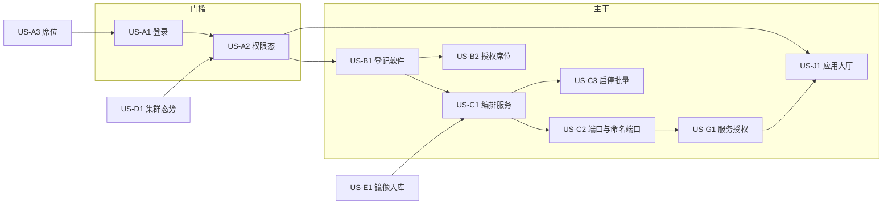

# MSOP 前后端重写 · 需求规格与用户故事

> **文档性质**：重写（rewrite）视角的需求基线，不是厂商产品说明书的复述。
> **适用对象**：`paas-core`（后端）与 `paas-web`（前端）两个仓的排期、切流判定与验收。
> **版本**：v1.0 / 2026-11-10 · 基线 MSOP **V1.3.5**（集群已升级，见 §0.4）。
> **上游输入**：厂商逆向 SRS（`/Users/csm/Desktop/Project/msop/docs/srs/`，65 条 FR / 133 条故事，基线 V1.3.4）、
> ADR-0001/0004/0005/0006、`paas-core/docs/deviations.md`、两仓的 `map.md`。

---

## 0 文档定位与证据基线

### 0.1 这份文档回答什么

| 问题 | 章节 |
| --- | --- |
| 重写要达成什么、什么算"做完了" | §1、§10.1 |
| 做哪些、明确不做哪些 | §2 |
| 谁在用、各自要什么 | §3 |
| 业务是怎么跑的（7 条主流程） | §4 |
| 有哪些功能需求，优先级/验收/依赖/风险 | §5 |
| 非功能底线（性能、安全、兼容、可维护） | §6 |
| 按角色与主流程的用户故事、故事间关系 | §7 |
| 还没定的问题、可能翻车的风险 | §8、§9 |

### 0.2 证据等级（全文统一，沿用项目纪律）

| 标记 | 含义 |
| --- | --- |
| 【产物】 | 厂商前端产物明文（i18n key、列头、字段、路由、接口字面量） |
| 【源码】 | 厂商反编译源码 / 本仓代码事实 |
| 【实测】 | 在 172.16.209.x 集群或本机运行得到的响应 |
| 【契约】 | 运行时 OpenAPI（`/v3/api-docs`）或本仓 `contracts/` |
| 【推断】 | 由上述推导，需复核；本文所有【推断】都可被 §8 的问题单追认或推翻 |

### 0.3 编号与优先级口径

- **FR-&lt;能力域&gt;-&lt;序号&gt;**：功能需求按**业务能力**编号，不按菜单路径（同一能力可能在两个菜单下各有一个入口，如"基础服务镜像"）。
- **US-**：用户故事，与 FR 双向可追。
- **NFR-**：非功能需求。
- **Q-**：待确认问题；**R-**：风险；**S**：切片（slice）。
- 优先级四档，判据只有一条——**不做会不会阻断切流**：

| 优先级 | 含义 | 处置 |
| --- | --- | --- |
| **P0** | 不绿就不能切流（门槛） | 必须先于任何写路径业务完成 |
| **P1** | 主干闭环（软件→服务→端口→授权→访问） | 与 P0 同一切片内交付 |
| **P2** | 全量对等（86 条路由逐页可达） | 按模块批量推进 |
| **P3** | 可延后 / 可降级 / 环境不可达 | 明确标注降级形态，不做假入口 |

### 0.4 本次基线变更（**必读**）

| 事实 | 影响 |
| --- | --- |
| 厂商已于 2026-11-10 升级到 **V1.3.5**（`gaop-be:V1.3.5-20260803-1522-arm64` / `gaop-web:V1.3.5-20260805-1146-arm64`），`gaop` 库按新包 89 项 SQL 重建为 **39 张表**【实测】 | 上游 SRS 的 65 条 FR 与 259 个 service 函数口径**建立在 V1.3.4 上**；本文件凡引用 SRS 处一律标"（v1.3.4 基线）" |
| V1.3.4 → V1.3.5 有 **6 个 SQL 文件实质不同**（`image_storage` 100→255、loki 上限 60→300、`g_language.text_key` 500→55、`g_mode` 删除条件、文案"席位"→"战位"、`V0.2.4` 头像 base64）【代码事实】 | 依赖这些列的 FR（镜像存储、日志治理、语言包、模式列表）**必须按 V1.3.5 复核** |
| 本仓 `deploy/sql/migration` 与 `order.txt` 仍是 **v1.3.4 副本**【实测】 | 空库初始化会退回旧结构 → 见 R-01 |
| 厂商前后端在线：`http://172.16.209.170/gaop/` → **200**；`/api/gaop/settings` → `{msg:"OK",code:0,data:[…]}`；`/api/gaop/v1/licence/info` → `authStatus:true`【实测 2026-11-10】 | 所有"待核实"的需求都有可用的对拉现场 |

> **纪律**：本文不把 SRS 当需求源，而把它当**证据索引**。凡是 SRS 描述的是"厂商现状"而非"重写应然"的地方，本文重新表述并标注差异（附录 B）。

### 0.5 完整性核对：与**当前部署的 V1.3.5** 对账（2026-11-10）

**方法**（可复现，脚本口径见附录 C）：抓 `http://172.16.209.170/gaop/` 首页 + `asset-manifest.json`，
下载 **308 个资产 / 196 个 JS chunk（11 MB）**，从产物里正则抽取路由字面量与接口字面量，
再与「本仓路由表」「本仓契约层」「后端 257 条映射」做集合比对。**不依赖 SRS，也不依赖口头结论。**
原始快照（资源清单 / 路由字面量 / 接口字面量）与完整清单：`docs/requirements/evidence/v135-reconciliation.md`。

| 维度 | 线上 V1.3.5 | 本仓 | 结论 |
| --- | --- | --- | --- |
| 路由节点 | 97（`path:"…"` 去噪后） | 97（86 页面 + 11 菜单组） | ✅ **一条不缺、一条不多**（差集为空） |
| 路由版本漂移 | v1.3.4 的 `routes.json` 树 **97 个节点**与线上完全一致 | — | ✅ V1.3.4 → V1.3.5 **没有增删页面** |
| 业务接口字面量 | **214** 条（`/v1` `/auth` `/audit` `/cloud` `/loki` `/register` `/settings`） | 后端映射 **257** 条；契约层 **195** 条 | ⚠️ 后端覆盖 **189/214 = 88%**，缺口 **25 条** |
| K8s 代理 / 推送 | `/api/v1/*`、`/apis/*`、5 个 topic | 契约用 `/k8s/api/v1/*` 前缀 | ⚠️ 前缀形态不同，**语义等价**，但契约里无字面量（20 条"契约有、线上无"多属此类） |

**缺口 25 条（线上有、后端没有；已确认不是换了路径实现）**

| 族 | 条数 | 端点 | 影响 |
| --- | --- | --- | --- |
| `/cloud/*` | 14 | `nodes`、`nodes/resource-consumption`、`nodes/sorted_pods`、`nodesummary`、`summary`、`volumes`、`services`、`native/Deployment`、`label-summary`、`alert`、`alert/enable`、`alert/exist`、`alert/record`、`alert/rule` | **M03 全局概览 + M10 告警**的数据源；不补则 FR-D1/D2、FR-H6 无法真实渲染 |
| `/loki/logs/*` | 5 | `setLokiLogRetainMaxDay`、`setLogMaxMemory`、`deleteLogs`、`getDeleteStatus`、`getLogsAssertInfo` | **FR-H1 日志治理**整块不可用 |
| `/audit*` | 2 | `GET /audit`、`GET /audit/dictionaryList` | **FR-A6 行为审计**无数据 |
| `/v1/prometheus/*` | 2 | `health`、`repair` | 仅主包定义、**无页面 chunk 引用** → 疑似死接口，见 Q-21 |
| `/register/ip/harbor` | 1 | Harbor 注册地址 | FR-E1 镜像入口的下拉/跳转 |
| `/v1/pub/node/terminal` | 1 | 节点终端 | FR-C4 终端登录（本就可 P3 降级） |

**契约层缺 10 条（后端有/线上有，但前端契约没写）**：`/v1/lang/import`、`/v1/pub/import`、`/v1/pub/cicd_v2`、
`/v1/pub/getNodeAlertSetting`、`/v1/pub/setNodeAlertSetting`、`/v1/pub/node/terminal`、
`/cloud/services`、`/cloud/native/Deployment`、`/v1/prometheus/health`、`/v1/prometheus/repair`。
→ 前三条已列入 FR-A7/FR-B1，节点告警两条入 FR-H6，其余随 §5 对应 FR 补齐。

**两条附带发现**

1. 厂商有一处字面量**缺前导斜杠**（`url:"v1/pub/versionInfo"`），靠 baseURL 拼接才成立；本仓契约补了斜杠，语义等价，不入偏离账。
2. 线上路由里 `/mirror/group/`（尾斜杠）与 `/mirror/group` 并存，属厂商重复定义；本仓只保留无尾斜杠版本，**不影响可达性**。

> **结论（直说）**：这份需求文档的**页面清单是完整的**（与线上逐条对得上），但**接口清单原先不完整**——
> 25 条线上端点没有任何 FR 明确要求实现，其中 22 条（`/cloud` 14 + `/loki` 5 + `/audit` 2 + `/register` 1）落在
> 已经有页面的模块上。这不是文档措辞问题，是**验收会漏**的问题，已按下面三处修正：
> §1.4 现状数字、§5 对应 FR 的接口清单、§8 的 Q-20/Q-21。

---

## 1 目标

### 1.1 业务目标

| # | 目标 | 判据 | 证据/来源 |
| --- | --- | --- | --- |
| **G1** | **可替代**：用自研前后端整体替换厂商 gaop-web + gaop-be，业务能力不缩水 | 86 条路由逐页可达且行为对等；259 个前端函数命中的端点全部有实现 | ADR-0001、ADR-0004 |
| **G2** | **可交付**：能在离线气隙、arm64、4 GB 级节点上交付 | 离线包安装成功；无外网依赖；单节点不 OOM | NFR-10、NFR-4 |
| **G3** | **可维护**：摆脱"只有压缩产物、无 source map、无构建号"的交付形态 | 源码可读、构建可复现、变更可追溯 | NFR-8、SRS D11 |
| **G4** | **可演进**：门槛过后能改名、加字段、拆服务，不被厂商历史命名永久绑定 | 每次演进先过门槛再动手 | ADR-0001 |

> **【推断】业务动因**（需 Q-02 追认）：现有交付物不可维护（无 source map）、厂商缺陷会让**整个平台的服务列表全挂**（命名端口 → 6 个端点 500，见 ISSUE-01）、技术底座停在 Boot 2.3/JDK 8/K8s 1.14 模型、内存规格与离线 arm64 交付受限。这四条是重写最硬的现实理由。

### 1.2 工程目标（可度量）

| # | 目标 | 度量 |
| --- | --- | --- |
| E1 | 契约语义等价 | 每条已记录读路径 L1+L2 全绿，L3 逐条入账（ADR-0006） |
| E2 | 前后端可互换 | 厂商前端一行不改跑在重写后端上；自研前端跑在厂商后端上（双向） |
| E3 | 分层不腐化 | 无 `persistent/` 越层包；`adapter/port` 只调 `gateway/` |
| E4 | 测试门槛自动化 | 后端 `mvn -o test` 离线全绿（当前 **664** 条）；前端 `vitest run` 全绿（当前 **约 232** 条） |
| E5 | 首屏可控 | 入口 chunk gzip ≤ 350 KB（当前约 172 KB，厂商 4.46 MB 未压缩） |
| E6 | 切流可回退 | 改 ingress 后端即生效，回退秒级、不重新部署、不回滚库 |

### 1.3 验收目标（"重写成功"的定义）

沿用 ADR-0004 四条门槛，**四条全绿才算域完成**，另加两条本文件建议（待 Q-03 追认）：

1. 厂商前端一行不改即可跑通；
2. 契约比对全绿（L1 形状 + L2 前端读取路径）；
3. 「软件-服务-端口」域在真实集群 e2e 通过；
4. 具名端口回归通过；
5. **（建议）每个域至少一条"写路径真实副作用"证据**——可回滚探针，不接受只看 200；
6. **（建议）每个域的降级形态明确**：厂商缺陷/环境不可达时，页面给出可读状态而不是 500 或白屏。

### 1.4 成功度量

| 维度 | 现状（2026-11-10，对 V1.3.5 实测） | 目标 |
| --- | --- | --- |
| 路由可达 | 本仓 97 条 = 线上 97 条，**差集为空** | 97/97 逐页对等（结构/表头/工具栏三段） |
| 端点映射 | 28 个控制器 / **257** 条映射；覆盖线上 **189/214（88%）** | 214 条全覆盖（按 259 函数口径复核后 ≥ 该数） |
| 前端契约 | **195** 条；缺 10 条、多 20 条（多为 k8s 代理前缀形态） | 与线上 214 条对齐，差异逐条注明 |
| 契约比对 | 已记录读路径全绿（含 L3 入账） | 全端点 L1+L2 = 0 失败 |
| 偏差台账 | A1–A14 / B1–B33 / C1–C13 | 新增偏离必须带 front-end 可见性举证 |

---

## 2 范围

### 2.1 在范围内

| 层 | 内容 | 说明 |
| --- | --- | --- |
| **前端** | M01–M15 全部页面与外壳（布局、导航、主题、i18n、异常兜底、推送通道） | 86 条路由 + 9 个带标题的菜单组节点 |
| **后端** | `/api/gaop/v1/**` 业务端点、`/api/gaop/k8s/**` 代理、`/ws` STOMP 通道、`/settings` 等外壳端点 | 259 个前端函数命中的端点 + 页面启动前置端点 |
| **认证** | 登录、会话（cookie `gateway-token`）、`canAdmin` 判定、登出、单点登录上限 | 原由 `gaop-gateway-auth` 承担，重写后归属待 Q-04 |
| **数据** | 厂商 39 张表的读写；87 个迁移冻结在 V0.8.6；新变更从 V0.9.0 起 | 只加表/列/索引，不改列类型、不删列 |
| **交付** | 镜像、Helm/清单、离线包、切流与回退脚本 | 第一阶段 arm64 |
| **验收工具** | 契约比对器、运行时样本、e2e harness、A/B 对照 | 工具本身属于交付物 |

### 2.2 不在范围内（**不做**）

| # | 不做 | 理由 |
| --- | --- | --- |
| N1 | **不改** `/api/gaop/v1/**` 契约与 39 张表结构 | 门槛硬边界（ADR-0004）；改了就没有"等效性"这个唯一对照物 |
| N2 | 不重写 K8s 本体、CNI、Ingress 控制器、存储插件 | 只做 API 客户端与视图；K8s 是执行面不是领域 |
| N3 | 不重写 GIS 子应用 `GIS-Manager-Web` | 业务本体在外部产品内，不在离线包；本仓只做承载 + 门禁 |
| N4 | 不做多集群管理 | 厂商 `clusters()` 硬编码单集群 ID；多集群属另立 ADR |
| N5 | 不做细粒度 RBAC / 数据权限 | 厂商只有一个权限码 `canAdmin`；扩权会改变菜单可见性语义 |
| N6 | 不做 SSR、不换鉴权协议、不换推送协议 | 门槛要求前后端可互换，协议是契约的一部分 |
| N7 | 第一阶段不支持 x86 | 目标运行环境只有 arm64 |
| N8 | 不复刻厂商缺陷，不把"能渲染"当验收 | A 类不复制；L3 偏离一旦前端可见即升级为缺陷（ADR-0006） |
| N9 | 不接管 `gaop-auth`（许可签发）/`gaop-startup`（启动闸门）/`gaop-diagnostic` | 除非 Q-17 明确要求替代；当前只消费其语义 |
| N10 | 不做"整页视觉再设计" | 布局配色逐值照搬厂商（ADR-0004），只修厂商的结构性缺陷 |

### 2.3 暂缓 / 需单独立项

| 项 | 暂缓理由 | 触发条件 |
| --- | --- | --- |
| 多租户与多集群 | 超出兼容边界 | 产品化阶段 |
| 审计日志的防篡改（WORM） | 厂商只读，未要求 | 合规要求出现 |
| GIS 子应用打包进离线包 | 体积与授权域 | 离线 GIS 交付（Q-06） |
| 前端设计系统重构 | ADR-0004 已定"逐值照搬" | 替代完成后 |
| 细粒度告警策略引擎 | 厂商只有阈值 | 运维需求升级 |

### 2.4 系统上下文



---

## 3 角色与权限模型

### 3.1 人类角色

| 角色 | 后端标识 | 可见范围 | 核心诉求 | 频度 |
| --- | --- | --- | --- | --- |
| **匿名访客** | — | 登录页、403/404 | 登录、看许可状态 | 每会话一次 |
| **普通用户** | `普通用户` / `GENERAL_USER` | 应用大厅 + 被授权软件 | 打开有权使用的软件 | 高 |
| **开发管理员** | `开发管理员` / `DEVELOPMENT_MANAGER` | 全部一级菜单（`canAdmin`） | 登记软件、编排服务、构建镜像 | 高 |
| **运维管理员** | `运维管理员` / `OPERATIONS_ADMINISTRATOR` | 全部一级菜单（`canAdmin`） | 监控、备份、告警、存储网络 | 高 |
| **内置 admin** | `admin` | 全部，**跳过角色校验** | 初始化与应急 | 低 |

> 【产物】五个角色名逐字取自登录页与 `g_role`；【源码】`admin` 是硬编码放行分支，并额外写 `localStorage.BackupSync`。
> 注意：**"开发管理员"与"运维管理员"在权限上没有区别**——同一个 `canAdmin`。说它们是两个角色，是组织语义不是系统语义。

### 3.2 系统参与者（非人类）

| 参与者 | 交互 | 约束 |
| --- | --- | --- |
| 浏览器 SPA | HTTP + STOMP | 只与 `/api/gaop` 一个基址通信 |
| 集群 Watch 源 | STOMP 推送 | 5 个 topic，断线需可见降级 |
| 监控后端（Loki/Prometheus） | 后端代理查询 | 不可达时按"空日志/无数据"处理，不 500 |
| GIS 子应用 | iframe | 跨域，拿不到 error 事件 → 用加载超时兜底 |

### 3.3 权限模型与 `canAdmin` 判定链



- **登录三要素**：`username` + `password` + `role`（门户/席位 key），三者必填；口令 BCrypt 校验。
- **权限态来源**（决定能不能进管理页）：`GET /v1/user` 返回的 **20 键 `UserLogined`**，其中 `role` 用于判 `canAdmin`；
  `GET /v1/user/info` 是**分页信封** `{list,total}` 且**没有 `role` 字段**，门户 key 在 `lastLoginRole`（`roles` 是中文门户名）。
  → 这是**已踩过三次的坑**（裸数组 vs 分页信封），见 NFR-1。
- **会话**：cookie `gateway-token`（不是 header）+ Redis `gateway-token:<uuid>` = `user:role`；`max-login` 默认 **1**，超出踢最早。
- **子角色**：只做收窄，不放大；一个用户可以挂多个子角色，子角色挂在席位上。

### 3.4 角色 × 能力矩阵

| 能力 | 普通用户 | 开发管理员 | 运维管理员 | admin |
| --- | --- | --- | --- | --- |
| 应用大厅 / 打开授权软件 | ✅ | ✅ | ✅ | ✅ |
| 查看软件与服务列表 | 仅授权 | ✅ | ✅ | ✅ |
| 登记软件 / 编排服务 / 起停 | ❌ | ✅ | ✅ | ✅ |
| 镜像构建 / 上传 | ❌ | ✅ | ✅ | ✅ |
| 备份还原 / 告警 / 白名单 | ❌ | ✅ | ✅ | ✅ |
| 用户 / 席位 / 子角色维护 | ❌ | ✅ | ✅ | ✅ |
| 服务授权（申请码/授权码） | ❌ | ✅ | ✅ | ✅ |
| 强制下线、删席位、批量停止 | ❌ | ✅ | ✅ | ✅ |

> 【推断】矩阵按 `canAdmin` 单码推导，厂商未做更细区分；若产品化要区分开发/运维，需另立 ADR（N5 当前不做）。

---

## 4 核心业务流程

> 每条流程标注：触发 → 主步骤 → 失败/降级路径 → 承载 FR。流程是**验收场景的骨架**，§7 的故事都挂在这里。

### F1 登录、席位选择与权限态建立（P0）



- **失败路径**：口令错 → 可读错误不跳转；超过 `max-login` → 踢最早会话；会话过期 → 401 `未认证` 文案；**网络超时 ≠ 未登录**（必须区分 `unauthenticated` 与 `timeout`，否则一慢就"被登出"）。
- **承载**：FR-A1、FR-A2、FR-A7。

### F2 主干：软件登记 → 服务编排 → 部署 → 端口暴露 → 授权 → 可访问（P1）


- **三条不变量**（整个域的地基）：
  1. **软件**是 MSOP 自有数据（库表），可增删改；
  2. **应用**是 K8s 标签 `system/appName` 的聚合视图，**只能观察，不能创建/删除**；
  3. **服务**对应 Deployment，MSOP 可创建/编辑/删除；**端口**是"软件能被访问到"的最终凭据。
- **失败路径**：软件 `key` 重复 → 拒绝；端口冲突 → 提交前拦截（`/v1/pub/nodePortUsed`）；服务未授权 → 访问被拒且列表状态同步；服务删除前仍有 Pod → 先停后删并提示影响面。
- **承载**：FR-B1、FR-B2、FR-C1、FR-C2、FR-G1、FR-J1、FR-J4。

### F3 服务生命周期与批量操作（P1）

- **动作集**：启动 / 停止 / 重启 / 扩缩容 / 滚动更新 / 批量 start-stop-restart / 强制删除 Pod / 重新调度到节点。
- **约束**：批量动作必须**逐条反馈结果**（不是一句"操作成功"）；`replicas` 可能为 null（不得拆箱 NPE）；命名端口的工作负载不得让列表崩（ISSUE-01）。
- **降级**：K8s 返回 422/403 时保留原始消息（`scale` 失败保留 fabric8 文案，B8），不能吞成 `msg:""`。
- **承载**：FR-C3、FR-C4、FR-D5。

### F4 镜像入库 → 服务引用（P2）



- **失败路径**：构建失败可重试、有日志；镜像仓库不可达 → 列表给"不可达"状态而不是 500；上传大文件有进度与断点（厂商未见证据，本仓按 NFR-7 要求）。
- **承载**：FR-E1、FR-E2、FR-E3。

### F5 授权链：用户 → 席位 → 软件 → 子角色（P1）

- **规则**：用户必须至少挂一个席位才能登录（"席位不能为空"）；席位关联软件即"这席位上的人能用哪些软件"；子角色在该集合内进一步收窄。
- **失败路径**：删除席位 → 级联 6 张表，事务边界在用例层（删两个、第二个是内置席位 → 整体回滚）；删除用户 → 无 admin 权限的调用者得到 **200 + `data:true` 但什么都不删**（厂商"假成功"，必须照抄）。
- **承载**：FR-A3、FR-A4、FR-A5、FR-B2。

### F6 运维闭环：备份 / 还原 / 同步 / 告警 / 日志治理（P2）

- **备份**：支持库与文件，需口令，日志以**推送流**呈现，可取消；还原前二次确认并展示影响（会覆盖什么）。
- **同步**：启动前做**连通性 + 库存在性预检**，失败不发车。
- **告警**：资源/日志两类，设置与记录分离；查询**时间范围必填**（B33），无范围不得拉全表。
- **日志治理**：保留天数、内存上限、按时间删除，删除进度需轮询可见。
- **承载**：FR-H1、FR-H4、FR-H5、FR-H6。

### F7 集群观察：概览 / 工作负载 / 驾驶舱（P2）

- **数据源两种**：HTTP 拉取（节点、资源统计）+ STOMP 推送（Pod/Deployment/Service Watch）。
- **降级**：推送断开 → 页面显示断线并提供 HTTP 兜底刷新；**取不到就显示"未知"，不显示"正常"**。
- **承载**：FR-D1～FR-D6、FR-J2。

### 4.8 流程 → 能力映射

| 流程 | P0 | P1 | P2 |
| --- | --- | --- | --- |
| F1 登录 | A1 A2 A7 | — | — |
| F2 主干 | — | B1 B2 C1 C2 G1 J1 J4 | — |
| F3 生命周期 | — | C3 C4 | D5 |
| F4 镜像 | — | — | E1 E2 E3 |
| F5 授权链 | — | A3 A4 A5 | — |
| F6 运维 | — | — | H1 H4 H5 H6 |
| F7 观察 | — | — | D1–D4 D6 |

---

## 5 功能需求

### 5.0 总量与分布

| 能力域 | 条数 | P0 | P1 | P2 | P3 |
| --- | --- | --- | --- | --- | --- |
| A 身份与权限 | 8 | 2 | 3 | 3 | 0 |
| B 软件目录 | 4 | 0 | 2 | 2 | 0 |
| C 服务与端口 | 9 | 0 | 5 | 4 | 0 |
| D 集群视图 | 6 | 0 | 1 | 4 | 1 |
| E 镜像与仓库 | 4 | 0 | 0 | 4 | 0 |
| F 网络与存储 | 3 | 0 | 0 | 3 | 0 |
| G 授权与许可 | 3 | 0 | 2 | 1 | 0 |
| H 运维 | 7 | 0 | 1 | 6 | 0 |
| I 数据库管理 | 3 | 0 | 0 | 2 | 1 |
| J 外壳与体验 | 5 | 0 | 4 | 1 | 0 |
| **合计** | **52** | **2** | **18** | **30** | **2** |

> 与厂商 SRS 的 65 条 FR 不是一一对应：本表按**能力**合并了被两个菜单复用的页面（基础服务、镜像组、基础服务镜像），
> 并新增了厂商 SRS 里没有的**外壳/契约/降级**类需求（J 组、C2 的命名端口、A2 的"超时≠未登录"）。

### 5.1 FR-A 身份与权限

| ID | 需求 | P | 验收标准 | 依赖 | 风险 |
| --- | --- | --- | --- | --- | --- |
| **FR-A1** | 登录三要素：账号 2–36、口令 6–36、席位必填；账号联想候选随输入刷新；大小写锁定提示；登录成功后按 `admin`/普通分流落地页 | P0 | ① 三种空值各给对应中文提示且随语言切换；② 含空格/特殊字符前端拦截不发请求；③ `admin` → `/global/system-overview`，其他 → `/operate/home`；④ 失败不跳转 | 席位候选（A3）、许可（G2） | 提示文案与厂商逐字一致，易被"优化"改坏 |
| **FR-A2** | 会话与权限态：cookie `gateway-token`；Redis 会话 TTL 86400；`max-login=1` 踢最早；`GET /v1/user` 必须返回 **20 键 `UserLogined`**（含 `role`）；401 走 `{"msg":"未认证","code":401}` | P0 | ① 带 cookie 200、无 cookie 401；② 第二个会话登录后第一个失效；③ `role` 缺失时管理页全部 403（此为缺陷，不得上线）；④ **网络超时不得判为匿名**，落到 `unknown` 并给重试 | 无 | 厂商 `PUT` 会把 TTL 砍到 600（A11，不复制） |
| **FR-A3** | 席位（战位）维护：CRUD + 关联软件/用户/子角色；删除级联 6 张表；内置保留字 `admin`/`dev` 不可删（`cicd`/`root` 可删，照抄） | P1 | ① `key` 唯一（DB 唯一索引兜底）；② `DELETE /v1/role?roleId=a,b` 中第二个为内置 → 整体回滚，一条不删；③ 级联后 5 张关系表为 0；④ 列表 9 列含"更新时间"且在"已登录用户"之前 | FR-A4、FR-B1 | 事务边界必须下沉到用例层（DAO 层会漏提交） |
| **FR-A4** | 用户账号：CRUD + 席位/子角色关联 + 禁用（`qy`）+ 头像 + Excel 导入/导出/模板 + 批量删除 | P1 | ① 用户名唯一；② 删除无 admin 权限的调用者 → **200 + `data:true` 但不删**（照抄）；③ 新增缺 `roleListKey` 不得留半成品用户（厂商 NPE 后已插入，B1 修正）；④ `birth` 时区与厂商一致（`2000-01-01T16:00:00.000Z`）；⑤ 导出 8 列顺序与列宽 2560 一致 | FR-A3 | 导出第 7 列是口令哈希（B12 照抄）→ Q-10 |
| **FR-A5** | 子角色：CRUD + 关联用户/席位 + 导入导出；删除前解除关联 | P1 | ① `key` 唯一；② id 不存在 → 400 `sub.role.storage.not.found`（厂商是 500，B24）；③ 关联写入不得覆盖用户 `created_at`（B27） | FR-A3、FR-A4 | 厂商 `HashSet` 导致多子角色顺序不定 |
| **FR-A6** | 行为审计：只读列表（用户名/席位/行为/类型/主机 IP）+ 时间范围筛选 + 导出；行为类型走字典。接口：`GET /audit`、`GET /audit/dictionaryList`（**当前后端未覆盖**，见 §0.5） | P2 | ① 无任何修改/删除入口（前端与后端都无）；② 行为类型本地化；③ 导出内容与列表一致 | FR-A4 | 厂商审计枚举硬编码 13 个动作 |
| **FR-A7** | 国际化：简体中文/English/Français；界面零硬编码文案；引用 key 100% 有翻译；后端语言包可热覆盖（`/v1/lang/import`、`/v1/lang/remove`、`/v1/lang/detail`） | P2 | ① 1346 个引用 key 无缺失（厂商缺 `MODIFICATION_TIME` → 本仓补齐）；② 切换语言后当前页即时生效；③ 扩展包只装厂商没有的键 | 无 | 三语维护责任未定（Q-19） |
| **FR-A8** | 全局设置：`/settings` 键值下发（告警阈值等）+ 用户侧全局设置入口 | P2 | ① `GET /settings` 返回 `[{key,val,desc}]` 且信封为 `{msg,code,data}`；② `/usermanage/settingGlobal` 在厂商是空 chunk → 本仓如实呈现取证结论，不编功能 | 无 | 空页面是否保留（Q-16） |

### 5.2 FR-B 软件目录

| ID | 需求 | P | 验收标准 | 依赖 | 风险 |
| --- | --- | --- | --- | --- | --- |
| **FR-B1** | 软件登记：23 字段（三语名/key/版本/描述/图标/截图/执行名/框架/端口/路径/状态/关联席位/远端接入/排序/置顶/关键字）；列表 20 列；三方导入口 `/v1/software/import`、`/v1/pub/import`、`/v1/pub/cicd_v2` | P1 | ① `key` 唯一；② 三语名称按当前语言显示、缺省回退；③ 删除前校验其下是否仍有服务；④ 图标/截图上传后列表与大厅同步；⑤ 三种导入各有进度与失败重试 | FR-A3 | 远端接入含 `remotePassword`（A7 照抄，前端据此免密打开 CS） |
| **FR-B2** | 软件-席位授权关联：席位勾选软件即决定"该席位可见的软件集合" | P1 | ① 解除关联后该席位用户刷新即看不到；② 大厅卡片数 = 关联数 ∩ 用户可见 | FR-A3、FR-B1 | 与 F5 授权链强耦合 |
| **FR-B3** | 软件文件管理：文件/文件夹的上传、下载、删除、新建目录、按名搜索 | P2 | ① 大文件有进度与失败重试；② 删除非空目录需确认；③ 与对象存储（FDFS/MinIO）对接可配置 | 对象存储 | 厂商 C6 未实现，属"边界待定"（Q-14） |
| **FR-B4** | 软件详情与列表视图：软件编码、版本、服务数、运行状态；作为"服务编排"的入口 | P2 | ① 20 列表头与厂商逐列一致；② 0 服务时显示空态不报错 | FR-B1 | 表头 key 易混（`MIRROR_TEXT` vs `MIRROR_NAME`） |

### 5.3 FR-C 服务与端口（主干）

| ID | 需求 | P | 验收标准 | 依赖 | 风险 |
| --- | --- | --- | --- | --- | --- |
| **FR-C1** | 服务编排：镜像/版本、TCP·UDP/端口、环境变量、命令与参数、卷与配置目录、调度节点、区域、`localtime`、三语服务名、优先级（25 字段的最小可运行集） | P1 | ① 创建后 Deployment 出现且 `gaop/serviceLabel`/`gaop/serviceType` 正确；② 未实现的字段（健康检查/滚动策略/负载均衡组）在界面**显式标注**，不静默省略；③ 同名服务标识拒绝 | FR-B1、FR-E1 | 25 字段巨型表单，一次做全易失真 |
| **FR-C2** | 端口与访问：`g_service_port` 为真相源；nodePort 分配；端口冲突拦截；**命名端口**（`targetPort: "http"`）必须原样保留 | P1 | ① 端口冲突提交前拦截；② 命名端口的 Deployment/Service 进列表不崩（`/v1/service`、`/v1/software/overView`、`/v1/pub/service_status` 三个端点均 200）；③ `nodePort` 随机分配落在 [10000,75534] 且不冲突 | FR-C1 | **ISSUE-01**：厂商一处命名端口打挂 6 个端点 |
| **FR-C3** | 生命周期：启动/停止/重启、批量 start·stop·restart、扩缩容、滚动更新 | P1 | ① 批量操作**逐条**反馈结果；② `replicas` 为 null 不 NPE；③ `scale` 失败保留原始消息；④ 全部停止需二次确认并列影响面 | FR-C1 | 厂商"全部停止"无影响提示（SRS 要求补） |
| **FR-C4** | 容器实例：Pod 列表（6 列）、删除、强制删除、重新调度、终端登录（`/v1/pub/node/terminal`）、按名搜索 | P1 | ① 服务未启动时禁用删除/终端并提示；② 强制删除与普通删除确认文案不同；③ Pod 列表订阅推送就地增删改 | FR-D5 | 终端登录依赖容器 exec，环境可能受限（P3 降级） |
| **FR-C5** | 配置组：组与配置文件两级；导入/导出/备份；服务挂载引用 | P2 | ① 组名唯一；② 导入后服务可立即挂载；③ 空 `portList` 时**先校验再删**（B14） | FR-C1 | 厂商先删后报 400，会白删端口映射 |
| **FR-C6** | 延迟启动：设置/取消 `gaop/serviceInitTime` 注解 | P2 | ① 非法时间拒绝；② 注解出现在 Deployment 上；③ 与 `gaop-startup` 闸门联动（未到时间 initContainer 阻塞） | FR-C1 | 依赖外部启动闸门（N9） |
| **FR-C7** | 自动伸缩：min/max/阈值（`spec.metrics` 数组）/启停 | P2 | ① `min ≤ max`；② 多阈值可配；③ 关闭策略不删已有副本 | FR-C1 | 阈值语义（CPU 百分比）需与监控口径一致 |
| **FR-C8** | 基础服务：MySQL/Redis/MinIO 等框架服务的列表与批量上下线（复用同一组件两个入口） | P1 | ① "全部停止"二次确认 + 逐条结果；② 停止时提示对业务服务的影响；③ `/v1/service/gaop` 只返回框架服务 | FR-C3 | 厂商该端点靠 label 合取，环境无标签时恒空（A4，可解释的 0） |
| **FR-C9** | 部署文件：Deployment YAML 列表/详情/编辑/保存；YAML 语法错误可定位 | P2 | ① 保存失败保留用户输入；② 语法错误给行号提示；③ 保存前后 diff 可见 | FR-D5 | 厂商保存 YAML 在本环境受限 → 可禁用但须说明（不做假入口） |

### 5.4 FR-D 集群视图

| ID | 需求 | P | 验收标准 | 依赖 | 风险 |
| --- | --- | --- | --- | --- | --- |
| **FR-D1** | 系统概览：节点表（name/ready/cpu_total/memory_total_kb/pod_cap/schedulable/conditions/versions）+ 计数条 + 底部状态面板（`sysinfo`/`appstatus`/`radondbInfo`）。数据源 `/cloud/nodes`、`/cloud/nodesummary`、`/cloud/summary`、`/v1/pub/serviceStatus`（**当前后端均未覆盖**） | P1 | ① 节点表字段按真实响应取值（`data.nodes.nodes`，**两层**）；② 计数条取 `listMeta.total` 或数组长度，不为恒 0；③ 匹配不到实例显示"未知"（灰点）而不是"正常" | 无 | 契约写成 `ClusterNode[]` 是错的（前端已踩） |
| **FR-D2** | 资源统计：16 列 + 筛选 + 批量动作（告警设置/刷新）。数据源 `/cloud/nodes/resource-consumption`、`/cloud/nodes/sorted_pods`、`/cloud/label-summary`、`/cloud/volumes` | P2 | ① 16 列表头与厂商一致；② 工具栏按钮**功能可用或禁用并说明**；③ 页面无自加标题条（厂商无） | FR-D1 | 厂商此处有 725/788 两种表格高度，只实现有声明来源的 725 |
| **FR-D3** | 节点服务 / 系统服务（DaemonSet 视图） | P2 | ① 按节点过滤；② 单 master 集群下空值可解释 | FR-D1 | 厂商 `serviceInfoByNode` 依赖外部监控（C13 未实现） |
| **FR-D4** | 驾驶舱：只读大屏（集群/服务/资源态势） | P3 | ① 只读无写入口；② 无数据时占位不报错 | FR-D1 | 厂商 cockpit 假设 `limits` 必含 cpu/memory，缺 cpu 就 NPE |
| **FR-D5** | 推送通道：`/ws` SockJS + STOMP；5 个 topic（`/topic/k8s/proxy/{Service,Deployment,Pod}`、`/topic/{backupLog,recoveryLog}`）+ `/topic/userInfo` | P2 | ① CONNECTED 后订阅收到 MESSAGE 帧；② 断线状态可见并可重连；③ 推送与 HTTP 兜底并存；④ 坏消息不抛错 | 无 | 协议不能换（门槛要求前后端可互换）→ 承担 sockjs-client |
| **FR-D6** | 容器概览：Top5 CPU/内存/网络/磁盘榜单 | P2 | ① 集群为空显示空态；② 指标单位与厂商一致 | Prometheus | C10：参考环境无 Prometheus，未在线验证 |

### 5.5 FR-E 镜像与仓库

| ID | 需求 | P | 验收标准 | 依赖 | 风险 |
| --- | --- | --- | --- | --- | --- |
| **FR-E1** | 镜像组与标签：浏览、删除、展开标签；仓库地址取自 `/register/ip/harbor` | P2 | ① 组/标签分页与搜索；② 被服务引用的镜像删除前提示；③ 仓库不可达时显示"不可达"而非 500 | Harbor/Registry | C2c：Registry API 参考环境不可达 |
| **FR-E2** | 镜像构建（CI）：构建任务列表、触发、日志、记录 | P2 | ① 任务状态可见（排队/构建/成功/失败）；② 失败可重试；③ 日志可下载 | 构建侧 | 厂商 CI 依赖外部流水线，边界待定 |
| **FR-E3** | 镜像上传记录：上传历史与结果 | P2 | ① 记录含文件、大小、结果、时间；② 失败原因可读 | 对象存储 | 同上 |
| **FR-E4** | 基础服务镜像（运维入口复用镜像组组件） | P2 | ① 同一组件两个入口行为一致；② 返回空列表时两个入口都空态 | FR-E1 | 跨模块复用，改一处影响两页 |

### 5.6 FR-F 网络与存储

| ID | 需求 | P | 验收标准 | 依赖 | 风险 |
| --- | --- | --- | --- | --- | --- |
| **FR-F1** | 服务发现：K8s Service 列表（Ingress 规则的来源）+ YAML 详情 | P2 | ① 无 `spec.ports` 的 Service（ExternalName）**不得整页白屏**；② 列表列与厂商一致；③ 详情 YAML 只读 | 无 | 厂商 NFR-ROBUST-1 的原始事故 |
| **FR-F2** | 虚拟 IP：VIP 列表与维护 | P2 | ① 与 Higress/网关 VIP 一致；② 变更需二次确认 | 网关 | 环境相关（VIP 172.16.209.170） |
| **FR-F3** | 存储：本地存储 / PV / PVC 三页（只读） | P2 | ① 三页列头与厂商一致；② 容量单位与厂商一致；③ 只读无写入口 | 无 | 厂商这三页无 `thead`（可能是非 antd 表格），需单独确认 |

### 5.7 FR-G 授权与许可

| ID | 需求 | P | 验收标准 | 依赖 | 风险 |
| --- | --- | --- | --- | --- | --- |
| **FR-G1** | 服务授权：申请码导出 → 授权码上传 → 授权状态同步；取消授权；管理员直接授权；批量取消全选 | P1 | ① 申请码/授权码成对，跨服务不可复用；② 过期后服务访问被拒且列表状态同步；③ 批量支持"取消全选" | FR-C1 | JWT 验签 + 机器码交集是不变量（ADR-0005 切片 4） |
| **FR-G2** | 平台许可：`/v1/licence/info`（到期/试用/`authStatus`）、授权码导入、登录页展示、强制下线全部用户 | P1 | ① 许可失效明确提示且不进入业务页；② 导入后无需重启即生效；③ 与厂商 `endIso8601` 同值 | 无 | 许可签发组件归属未定（Q-17） |
| **FR-G3** | GIS 门禁：`gisCode`/`gisEVWebGL`/`gisEVServer` 三码校验；22 条路由 → 子应用地址翻译；不可达超时提示 | P2 | ① 未授权不进入 iframe；② 四种路由形态翻译正确（纯函数单测）；③ 子应用不可达给提示（厂商是静默白屏，D13） | FR-G2 | GIS 子应用不在离线包（Q-06） |

### 5.8 FR-H 运维

| ID | 需求 | P | 验收标准 | 依赖 | 风险 |
| --- | --- | --- | --- | --- | --- |
| **FR-H1** | 资源概览与日志治理：Loki 保留天数/内存上限/按时间删除 + 删除进度轮询。接口 `/loki/logs/setLokiLogRetainMaxDay`、`setLogMaxMemory`、`deleteLogs`、`getDeleteStatus`、`getLogsAssertInfo`（**当前后端全未覆盖**） | P1 | ① 删除不可逆需二次确认；② 进度可见直至完成；③ Loki 不可达按"无数据"处理不 500（B32） | Loki | V1.3.5 把 loki 上限从 60 改成 300，需复核 |
| **FR-H2** | 标签管理（只读）：节点/工作负载标签汇总 | P2 | ① 只读；② 真实返回 `{nodes,summary}`（契约不是数组） | 无 | 契约与真实响应不一致（已踩） |
| **FR-H3** | 系统服务管理与详情：按容器与时间范围取日志 | P2 | ① 日志时间范围必填；② 无日志显示空态；③ 详情可从列表下钻 | Loki | 同 H1 |
| **FR-H4** | 平台备份还原：需口令、推送日志流、可取消、还原前确认影响 | P2 | ① 备份文件可下载；② 还原前展示"将覆盖"清单；③ 取消后不留半套状态 | FR-D5、对象存储 | 恢复演练无证据（SRS 要求补） |
| **FR-H5** | 数据同步：启动前连通性 + 库存在性预检 | P2 | ① 预检失败不发车并给可读原因；② 同步过程有进度；③ 目标库版本不匹配时明确提示 | MySQL | 厂商无预检，属主动增强 |
| **FR-H6** | 告警：资源告警设置/记录、日志告警设置/记录（四页两组件）。接口 `/cloud/alert*`（列表/规则/记录/启停/存在性）+ `/v1/pub/getNodeAlertSetting`、`/setNodeAlertSetting` | P2 | ① 记录查询**时间范围必填**、`start > end` 提示（B33）；② 设置项与 `/settings` 键一致；③ 记录可分页导出 | FR-A8、Loki | 厂商可三条件全空拉全表 |
| **FR-H7** | 白名单：免鉴权路径的增删（**高危**） | P2 | ① 仅 `canAdmin`；② 前端拒绝 `/`、`/*`、`/v1/*` 等通配输入且后端二次校验；③ 常驻警示 + 二次确认；④ 写审计 | FR-A6 | 白名单是鉴权旁路，一条 `/*` 等于关闭鉴权（NFR-5） |

### 5.9 FR-I 数据库管理

| ID | 需求 | P | 验收标准 | 依赖 | 风险 |
| --- | --- | --- | --- | --- | --- |
| **FR-I1** | 数据库信息：实例/版本/连接数/容量 | P2 | ① 字段与厂商一致；② 连不上时给"不可达"而非 500 | MySQL | 环境依赖 |
| **FR-I2** | 数据库用户：库用户列表与管理 | P2 | ① **密码列默认脱敏**、点击展开（NFR-5）；② 增删改有二次确认 | FR-I1 | 厂商明文展示（D7） |
| **FR-I3** | SQL 日志：`GET /v1/database_record`（分页，`updated_at DESC`） | P3 | ① 按时间与关键字筛选；② 大数据量分页；③ 无日志空态 | FR-I1 | 厂商该端点只有分页，筛选需前端做 |

### 5.10 FR-J 外壳与体验

| ID | 需求 | P | 验收标准 | 依赖 | 风险 |
| --- | --- | --- | --- | --- | --- |
| **FR-J1** | 布局与导航：**顶栏=模块级**、侧栏=当前模块子页；9 个带标题菜单组节点各有一层；直接访问菜单组落到落地页 | P1 | ① 侧栏层级与厂商截图一致（分组不被平铺）；② 顶栏模块次序=厂商路由树遍历序（非拼音序）；③ 带参详情页不进导航 | 无 | 侧栏同名项合并（`/ops/base-service` 既是平铺项又是分组） |
| **FR-J2** | 主题与视觉：默认 dark；18 个色值 + 7 个尺寸与厂商同源；表格固定高度内部滚动；序号列全局约定 | P1 | ① `vendor-theme.test` 断言全绿；② 含表格卡片背景透明、表格自身 `#182445`；③ 页面无自加标题条（厂商无）；④ 所有列表首列"序号" width 80 居中 | 无 | 厂商 4 个页面是"工具栏在页面底色、表格在卡片底色"两块结构 |
| **FR-J3** | 异常兜底：403 `/no-auth`、404、任意渲染错误不白屏、首屏静态占位 | P1 | ① 未知路径 404（后端也是 404 而非 500/-1）；② mock/接口失败仍挂载 React；③ 无权限跳 `/no-auth` 并说明 | 无 | `main.tsx` 曾因 mock 失败整页白屏 |
| **FR-J4** | 应用大厅：按用户可见范围展示软件卡片 + 登出入口 + 许可状态 + 告警提示（`/loki/logs/getLogsAssertInfo`、`getDeleteStatus`） | P1 | ① 未授权用户看空态不报错；② 卡片点击进入该软件的服务/详情；③ 卡片来源=席位关联软件 | FR-A2、FR-B2 | 厂商把 `shutdownServer` 放在此页（Q-09） |
| **FR-J5** | 版本与引导：平台版本展示（不得显示旧号）、四步快速入门、`localStorage` 记忆 | P2 | ① 版本与包版本一致（厂商默认 V1.3.3 与 V1.3.4 不一致，D5）；② 引导可跳过且状态持久 | 无 | 版本号来源需单一（`/settings` 的 `version.system`） |

---

## 6 非功能需求

### 6.1 NFR 清单

| ID | 要求 | 指标 / 口径 | 验收方法 | 现状差距 |
| --- | --- | --- | --- | --- |
| **NFR-1** | **契约语义等价** | L1 信封 + L2 前端读取路径全绿；L3 逐条入账且带 front-end 可见性举证 | `tools/contract-check.py` + `mvn test` 离线回放 | 已记录读路径全绿；新端点须补 read-path |
| **NFR-2** | **前后端可互换** | 厂商前端不改跑通；自研前端跑厂商后端 | A/B 双后端 + 真实浏览器 | 双向均已实测过一轮 |
| **NFR-3** | 首屏性能 | 局域网首屏可交互 ≤ 3 s；入口 chunk gzip ≤ 350 KB；路由级懒加载 | Lighthouse/产物体积断言 | 当前约 172 KB，达标 |
| **NFR-4** | 内存与容量 | 单节点 4 GB 级可跑（含双后端并存期）；堆上限显式配置 | 部署后 RSS/堆画像 | 厂商 8 JVM 在 4.9 GB 会 OOM；重写需单独算账 |
| **NFR-5** | 安全 | 口令 BCrypt；凭据只走 cookie 不进 URL；白名单受控；口令哈希/远端口令不下发；库用户密码脱敏 | 代码审查 + 接口取证 + 用例 | 已有 B4 收紧；导出仍含哈希（B12） |
| **NFR-6** | 健壮性 | 字段缺失不白屏；单条资源异常不拖垮整页；后端**禁止**"解析失败置 null 继续算" | 行级容错用例 + 契约样本 | 厂商 A14 是反面教材 |
| **NFR-7** | 大文件与长任务 | 上传有进度；导入/纳管/备份分档超时（30 min / 10 min / 5 min） | 手工验证 + 超时配置断言 | 厂商无断点续传证据 |
| **NFR-8** | 可维护性 | 六边形分层；禁 `persistent/`；ADR 约束；测试门槛自动化 | `mvn test` / `vitest run` + 分层检查 | 后端 664 条、前端约 232 条 |
| **NFR-9** | 国际化完整性 | 三语；引用 key 100% 有翻译；不得硬编码中文 | key 完整性单测 | 厂商缺 1 个 key |
| **NFR-10** | 离线与架构 | 气隙安装；第一阶段仅 arm64；无外网依赖 | 离线包自检（解包重构建 + 指纹比对） | 已具备；pnpm store 模式未验证 |
| **NFR-11** | 数据兼容 | 39 张表不变；87 迁移冻结 V0.8.6；新变更 V0.9.0+ 且只加不改 | 迁移清单 + schema diff | 本仓迁移仍是 v1.3.4 副本（R-01） |
| **NFR-12** | 浏览器 | ES2015+；Chromium 内核优先 | 手工验证 | 厂商 IE9 注释是误导 |
| **NFR-13** | 时区 | 集群 UTC；界面按 `localtime` 本地化；DATE 列显式建模 | 对拉用例（`birth` 8 小时坑） | 已修（LocalDate + `serverTimezone=UTC`） |
| **NFR-14** | 可回退 | 改 ingress 后端即切；回退秒级、不重部署、不回滚库 | 切换演练留证 | 已演练（各约 5 s） |
| **NFR-15** | 可观测性 | 结构化日志带 traceId；关键操作审计；错误码可读 | 日志抽查 + 审计页 | 厂商日志规范弱（backend-review 04） |

### 6.2 必须由重写正面解决的厂商缺陷（门槛类）

| # | 缺陷 | 重写要求 | 关联 |
| --- | --- | --- | --- |
| D-A14 | 命名端口 → `allService` NPE → 6 个端点 500 | 用 fabric8 `IntOrString` 原生模型；禁止"转换失败置 null"；列表 fail-soft 落用例 | FR-C2、NFR-6 |
| D-ROBUST1 | 无 `ports` 的 Service 让网络页白屏 | 行级容错 + 可选链；契约样本覆盖 ExternalName | FR-F1 |
| D-A13 | `sysinfo`/`sysInfo` 键名不一致导致状态面板恒绿 | 按前端实际读取键名输出；状态取不到就显示"未知" | FR-D1 |
| D-NPE 群 | 20+ 处 `Integer` 拆箱 / `get(0)` / `substring` NPE（B14–B31） | 空值按业务语义处理，**不复制**成 500 | NFR-6 |
| D-A12 | `updateServiceRole` 是死代码（注解写完被覆盖） | 不实现无副作用语义；错误路径对齐 | FR-C1 |
| D-D5 | 版本号默认旧值 | 版本单一来源 | FR-J5 |
| D-D11 | 无 source map | 源码交付 + 构建可复现 | NFR-8 |

---

## 7 用户故事

### 7.0 组织方式与关系

- **Epic = 能力域**，与 §5 的 FR 组一一对应；每条故事标注：优先级、关联 FR、证据来源、**故事关系**、待确认问题。
- 故事的验收统一用 Given/When/Then；**能写成接口断言的就写成断言**，写不成的（如"页面不白屏"）注明验证手段。
- 关系只记两种：**依赖**（我需要的输入/前置）与**阻塞**（我不完成，别人做不了）。其余关系（相似、替代）不入表。



**关键路径**：`US-A3 → US-A1 → US-A2 → US-B1 → US-C1 → US-C2 → US-G1 → US-J1`。
这条链上任一环不绿，切流都无从谈起——它同时就是切片 S1→S2 的顺序依据。

### 7.1 Epic A：身份与权限

**US-A1 用账号、口令、席位登录** · P0 · FR-A1/A2 · 【产物】【实测】
> 作为 任何用户，我要用三要素登录，以便进入我被授权的范围。

- **AC1** Given 账号存在且口令正确、席位已关联 When 提交 Then 200、下发 `gateway-token` cookie，`admin` 落 `/global/system-overview`、其他人落 `/operate/home`。
- **AC2** Given 口令错误 When 提交 Then 不跳转、给可读提示、语言切换后提示同步切换。
- **AC3** Given 同一账号已在别处登录 When 我在第二处登录 Then 第一处会话失效（`max-login=1`）。
- **AC4** Given 后端 5 秒无响应 When 刷新页面 Then 仍保持登录并提示重试，**不得**判为匿名。
- **关系**：依赖 US-A3；阻塞 US-A2、US-J1。
- **待确认**：Q-04（鉴权归属）。

**US-A2 管理页可见性由权限态决定** · P0 · FR-A2 · 【实测】
> 作为 管理员，我要管理菜单只对管理员出现，以便普通用户不会误入无权页面。

- **AC1** Given `GET /v1/user` 返回 `role` 为管理员席位 When 打开任意 `/software/*` Then 正常渲染。
- **AC2** Given `role` 缺失或为普通用户 When 打开管理页 Then 跳 `/no-auth` 并说明原因，**不是白屏也不是 500**。
- **AC3** Given 我用 `/v1/user/info` 取权限 When 解析 Then 从信封 `data.list[0].lastLoginRole` 取，不得依赖不存在的 `role` 字段。
- **关系**：依赖 US-A1；阻塞 US-B1、US-D1、全部 P2 页面。
- **备注**：这条已踩过三次"裸数组 vs 分页信封"，实现时必须用真实响应核一遍。

**US-A3 维护席位并安全删除** · P1 · FR-A3 · 【源码】【实测】
> 作为 管理员，我要维护席位（战位）及其关联，以便权限主体与软件集合始终一致。

- **AC1** Given 两个席位中第二个是内置席位 When 批量删除 Then 整体回滚，一条都不删。
- **AC2** Given 删除一个普通席位 When 完成 Then 5 张关系表该席位记录为 0。
- **AC3** Given 我删除 `cicd` 或 `root` When 提交 Then **允许**（厂商只护 `admin`/`dev`，照抄）。
- **关系**：阻塞 US-A1、US-B2。
- **待确认**：Q-11（级联的事务边界写在哪一层）。

**US-A4 维护用户与批量导入导出** · P1 · FR-A4 · 【实测】
> 作为 管理员，我要能建号、改号、停用、批量导入，以便人员变动时不必逐个点。

- **AC1** Given 提交缺 `roleListKey` 的新用户 When 保存 Then 要么成功且用户完整，要么失败且无残留（不得半成品）。
- **AC2** Given 无 admin 权限的调用者 When 删除用户 Then 200 + `data:true` 但用户仍在（照抄厂商"假成功"）。
- **AC3** Given 导出用户 When 打开 Excel Then 8 列顺序、前三列宽 2560、日期样式 `yyyy-MM-dd` 与厂商一致。
- **AC4** Given 我导入一份仅 admin 行的表 When 完成 Then 不新增任何用户、不报错。
- **关系**：依赖 US-A3；阻塞 US-A5、US-A6。
- **待确认**：Q-10（导出含口令哈希是否照抄）。

**US-A5 用子角色收窄权限** · P1 · FR-A5 · 【源码】
> 作为 管理员，我要在席位内再分子角色，以便同一席位下的人看到不同范围。

- **AC1** Given 子角色 id 不存在 When 更新 Then 400 `sub.role.storage.not.found`（不是 500）。
- **AC2** Given 我给用户加子角色 When 完成 Then 该用户 `created_at` **不变**。
- **AC3** Given 子角色关联写入失败 When 事务结束 Then 用户与席位关联均回滚。
- **关系**：依赖 US-A4；被 US-A2 的可见范围间接依赖。

**US-A6 追溯谁做了什么** · P2 · FR-A6 · 【产物】
> 作为 审计/合规读者，我要只读地查行为记录，以便出问题时能定位。

- **AC1** Given 我打开审计页 When 按用户名 + 时间范围查 Then 返回记录且行为类型显示中文（不显示原始码）。
- **AC2** Given 任意角色 When 尝试修改/删除记录 Then 系统无此入口、接口也不提供。
- **关系**：依赖 US-A4。

**US-A7 切换语言** · P2 · FR-A7 · 【产物】
> 作为 非中文用户，我要切换语言，以便界面与提示都是我能读的语言。

- **AC1** Given 当前中文 When 切到 English Then 当前页即时更新、`umi_locale` 持久化、刷新后保持。
- **AC2** Given 全量扫描 When 校验引用 key Then 1346 个 key 全部有翻译（含 `MODIFICATION_TIME`）。
- **关系**：无前置；被所有页面的文案断言依赖。
- **待确认**：Q-19（三语维护流程）。

### 7.2 Epic B：软件目录

**US-B1 登记一个软件** · P1 · FR-B1/B4 · 【产物】
> 作为 开发管理员，我要把软件包登记进来，以便后续为它编排服务并授权给席位。

- **AC1** Given 三语名称齐全 When 列表按英文显示 Then 显示英文名；缺失时回退中文名。
- **AC2** Given 已存在同 `key` When 保存 Then 拒绝并提示。
- **AC3** Given 软件下仍有服务 When 删除 Then 拒绝或明确提示级联影响。
- **关系**：依赖 US-A2；阻塞 US-C1、US-B2。

**US-B2 把软件授权给席位** · P1 · FR-B2 · 【产物】
> 作为 管理员，我要给席位勾选软件，以便该席位上的用户只能看到这些软件。

- **AC1** Given 席位原来关联 A、B When 解除 B Then 该席位用户刷新后大厅不再出现 B。
- **AC2** Given 某用户挂了两个席位 When 打开大厅 Then 看到两个席位软件的并集。
- **关系**：依赖 US-A3、US-B1；阻塞 US-J1。

**US-B3 管理软件相关文件** · P2 · FR-B3 · 【产物】
> 作为 开发管理员，我要上传/下载/建目录，以便把交付物放到平台上。

- **AC1** Given 上传 200 MB 文件 When 完成 Then 有进度、失败可重试、列表出现该文件。
- **AC2** Given 删除非空目录 When 确认 Then 明确提示影响并执行。
- **关系**：依赖 US-B1；依赖对象存储可用性（Q-14）。

### 7.3 Epic C：服务与端口

**US-C1 编排并跑起一个服务** · P1 · FR-C1/C2 · 【实测】
> 作为 开发管理员，我要填最少但完整的字段把服务跑起来，以便尽快验证交付。

- **AC1** Given 镜像 + 版本 + 一个端口 + 三语服务名 When 保存 Then Deployment 创建成功，`gaop/serviceLabel`/`gaop/serviceType` 正确。
- **AC2** Given 服务已创建 When 打开列表 Then 显示状态、镜像、授权状态、更新时间（列序与厂商一致）。
- **AC3** Given 我用到的是未实现字段（健康检查/滚动策略/负载均衡组）When 打开表单 Then **显式标注"未实现"**，不是静默消失。
- **关系**：依赖 US-B1、US-E1；阻塞 US-C2、US-C3、US-G1。
- **待确认**：Q-11（写路径事务化范围）。

**US-C2 端口冲突与命名端口** · P1 · FR-C2 · 【实测】【源码】
> 作为 开发管理员，我要端口不冲突、命名端口也能跑，以便一个租户的写法不会打挂整个平台。

- **AC1** Given 集群里已有工作负载用 `targetPort: http` When 打开服务列表 Then 200 且该行正常显示（不是 500）。
- **AC2** Given 我要用的端口已被占用 When 提交 Then 提交前拦截并指出占用者。
- **AC3** Given 未指定 nodePort When 创建 Then 分到 [10000,75534] 且不与现有冲突。
- **关系**：依赖 US-C1；阻塞 US-G1（授权对象是已存在的服务）。
- **备注**：这是 **ISSUE-01**，也是 A14 的验收面。

**US-C3 启停与批量操作** · P1 · FR-C3/C8 · 【产物】
> 作为 运维管理员，我要一键停一批服务，以便发布窗口内快速止损。

- **AC1** Given 我选了 5 个服务 When 批量停止 Then 逐条给出成功/失败与原因。
- **AC2** Given 我点"全部停止" When 确认 Then 展示将影响的服务清单。
- **AC3** Given `spec.replicas` 为 null When 停止 Then 视为"非 0"继续下发（不 NPE）。
- **关系**：依赖 US-C1；被 US-H1（备份前停止）间接依赖。

**US-C4 扩缩容与滚动更新** · P1 · FR-C3/C7 · 【产物】
> 作为 开发管理员，我要调整副本与滚动更新，以便扛住流量变化且不中断。

- **AC1** Given 当前 2 副本 When 扩到 4 Then 新副本就绪后旧副本才退（就绪探针生效）。
- **AC2** Given 扩缩容失败（K8s 422）When 返回 Then `msg` 带原始原因，不是空串。
- **AC3** Given 自动伸缩策略 `min>max` When 保存 Then 拒绝。
- **关系**：依赖 US-C1；与 US-C8（策略）共享表单。

**US-C5 排障时看容器实例** · P1 · FR-C4 · 【产物】
> 作为 运维管理员，我要看到 Pod 级状态并能删掉卡住的 Pod，以便快速恢复。

- **AC1** Given 服务未启动 When 打开容器页 Then 禁用删除/终端并提示原因。
- **AC2** Given 我在页面停留 When 集群里 Pod 变化 Then 列表就地增删改（订阅 `/topic/k8s/proxy/Pod`）。
- **AC3** Given 强制删除 When 确认 Then 文案与普通删除明确不同。
- **关系**：依赖 US-D5（推送通道）；依赖 US-C1。

**US-C6 用配置组给服务挂配置** · P2 · FR-C5 · 【产物】
> 作为 开发管理员，我要建配置组并挂到服务，以便配置与镜像解耦。

- **AC1** Given 组名已存在 When 新建 Then 拒绝。
- **AC2** Given 导入配置文件 When 保存 Then 服务可立即挂载引用。
- **AC3** Given `portList` 为空 When 打补丁 Then 先校验再删，不产生"端口被白删"。
- **关系**：依赖 US-C1。

**US-C7 设置延迟启动** · P2 · FR-C6 · 【源码】
> 作为 运维管理员，我要给服务设启动延迟，以便依赖按顺序起来。

- **AC1** Given 输入非法时间 When 提交 Then 拒绝。
- **AC2** Given 设置 60 秒 When 查 Deployment Then 注解 `gaop/serviceInitTime` 存在且值为 60。
- **关系**：依赖 US-C1；依赖外部启动闸门（Q-17/N9）。

**US-C8 直接改部署 YAML** · P2 · FR-C9 · 【产物】
> 作为 开发管理员，我要直接编辑 Deployment YAML，以便处理表单覆盖不到的场景。

- **AC1** Given YAML 语法错误 When 保存 Then 给出行号定位，且**保留我的输入**。
- **AC2** Given 保存成功 When 再次打开 Then 与保存内容一致。
- **关系**：依赖 US-C1、US-D5。

### 7.4 Epic D：集群视图

**US-D1 一眼看清集群态势** · P1 · FR-D1/D2 · 【实测】
> 作为 运维管理员，我要看节点与服务的健康度，以便判断平台是否正常。

- **AC1** Given 打开系统概览 When 加载完成 Then 节点表至少 1 行，CPU/内存/可调度字段有值。
- **AC2** Given `/v1/pub/serviceStatus` 的 `sysinfo` 缺某组件 When 渲染面板 Then 显示"未知"（灰点），**不是"正常"**。
- **AC3** Given 计数接口失败 When 打开页面 Then 整页仍可用，计数按节点表自算。
- **关系**：依赖 US-A2。
- **备注**：契约里 `nodes` 是两层结构（`data.nodes.nodes`），写错会全列空。

**US-D2 跟踪工作负载的实时变化** · P2 · FR-D5/D3 · 【实测】
> 作为 运维管理员，我要不刷新就看到变化，以便定位"刚刚发生了什么"。

- **AC1** Given 已连接 When 集群新增 Deployment Then 列表出现该行（无需刷新）。
- **AC2** Given 连接断开 When 停留 30 秒 Then 页面显示断线并可重连，同时提供 HTTP 兜底刷新。
- **AC3** Given 收到畸形消息 When 处理 Then 不抛错、不影响其他行。
- **关系**：被 US-C5、US-C8、US-H1 依赖。

**US-D3 用驾驶舱汇报** · P3 · FR-D4 · 【产物】
> 作为 值班人员，我要一块只读大屏，以便值守时远看。

- **AC1** Given 打开驾驶舱 When 数据缺失 Then 占位不报错。
- **AC2** Given 任意角色 When 操作 Then 无任何写入口。
- **关系**：依赖 US-D1。

**US-D4 看 Top5 资源消耗** · P2 · FR-D6 · 【产物】
> 作为 运维管理员，我要知道谁在吃资源，以便处置。

- **AC1** Given 集群为空 When 打开 Then 空态。
- **AC2** Given 有数据 When 渲染 Then 单位（CPU 核/内存 MB/网络 KB/s）与厂商一致。
- **关系**：依赖 Prometheus 可用（Q-15）。

### 7.5 Epic E：镜像

**US-E1 让镜像可被服务引用** · P2 · FR-E1/E4 · 【产物】
> 作为 开发管理员，我要选到正确的镜像与标签，以便服务能拉起来。

- **AC1** Given 镜像组存在 When 编排服务选镜像 Then 标签列表与仓库一致。
- **AC2** Given 仓库不可达 When 打开镜像页 Then 显示"不可达"而不是 500 或空白。
- **AC3** Given 运维入口打开"基础服务镜像" When 对比镜像管理入口 Then 两处数据一致。
- **关系**：阻塞 US-C1（无镜像无法编排）。

**US-E2 构建并追踪一次镜像构建** · P2 · FR-E2/E3 · 【产物】
> 作为 开发管理员，我要看到构建进度与失败原因，以便重试。

- **AC1** Given 触发构建 When 查看任务 Then 状态从排队到成功/失败可见。
- **AC2** Given 构建失败 When 打开日志 Then 能定位失败步骤。
- **关系**：依赖 US-E1。

### 7.6 Epic F：网络与存储

**US-F1 查服务发现对象且不白屏** · P2 · FR-F1 · 【实测】
> 作为 运维管理员，我要看 Service 列表，以便确认 Ingress 的来源。

- **AC1** Given 存在无 `spec.ports` 的 Service（ExternalName）When 打开页面 Then **整页正常渲染**，该行端口列显示空。
- **AC2** Given 点某行 When 打开详情 Then 显示只读 YAML。
- **关系**：无强前置；被 US-F2 的巡检流程并列使用。

**US-F2 巡检存储与虚拟 IP** · P2 · FR-F2/F3 · 【产物】
> 作为 运维管理员，我要只读巡检 PV/PVC 与 VIP，以便确认没有"该挂没挂"的卷。

- **AC1** Given 打开 PV 页 When 加载 Then 容量/状态/绑定关系与集群一致。
- **AC2** Given 打开 VIP 页 When 加载 Then 与网关 VIP 一致。
- **AC3** Given 三页任意一页 When 操作 Then 无写入口。
- **关系**：依赖 US-A2。

### 7.7 Epic G：授权与许可

**US-G1 给一个服务授权** · P1 · FR-G1 · 【产物】
> 作为 管理员，我要导出申请码、换回授权码，以便服务合法运行。

- **AC1** Given 未授权服务 When 导出申请码 Then 得到文件且与机器码绑定。
- **AC2** Given 我上传该服务的授权码 When 完成 Then 列表授权状态变为已授权、可访问。
- **AC3** Given 授权已过期 When 访问服务 Then 被拒且状态同步为过期。
- **AC4** Given 批量选择 When 点"取消全选" Then 选择清零。
- **关系**：依赖 US-C2（服务先存在）。
- **待确认**：Q-17（许可签发归属）。

**US-G2 让平台许可可见可控** · P1 · FR-G2 · 【实测】
> 作为 管理员，我要知道许可何时到期，以便提前续期。

- **AC1** Given 打开登录页 When 加载 Then 显示许可状态与试用剩余天数。
- **AC2** Given 许可过期 When 登录 Then 明确提示，不进入业务页。
- **AC3** Given 导入新授权码 When 完成 Then 无需重启即生效（`/v1/licence/info` 的 `endIso8601` 变化）。
- **关系**：阻塞 US-A1（登录页展示）。

**US-G3 GIS 只有授权才进得去** · P2 · FR-G3 · 【实测】
> 作为 管理员，我要未授权时挡住 GIS 入口，以便不出现"点进去一片白"。

- **AC1** Given `gisCode` 未激活 When 打开 `/map-setting/*` Then 不加载 iframe，给授权提示。
- **AC2** Given 已授权但子应用不可达 When 等待超时 Then 给"无法连接"提示（厂商是静默白屏）。
- **AC3** Given 四种路由形态 When 翻译子应用地址 Then 纯函数单测全绿。
- **关系**：依赖 US-G2。
- **待确认**：Q-06（离线是否打包 GIS）。

### 7.8 Epic H：运维

**US-H1 备份并在必要时还原** · P2 · FR-H4 · 【产物】
> 作为 运维管理员，我要先备份再升级，以便出问题能回退。

- **AC1** Given 输入口令 When 开始备份 Then 日志以推送流实时出现，可取消。
- **AC2** Given 选择还原 When 确认 Then 先展示"将覆盖"的范围。
- **AC3** Given 备份完成 When 下载 Then 文件可下载且大小合理。
- **关系**：依赖 US-D5、对象存储（Q-14）。

**US-H2 配告警并按时间追溯** · P2 · FR-H6 · 【产物】
> 作为 运维管理员，我要设阈值并回看告警，以便复盘。

- **AC1** Given 未选时间范围 When 点查询 Then 提示必填（不拉全表）。
- **AC2** Given `start > end` When 提交 Then 提示起止非法。
- **AC3** Given 阈值改到 90 When 保存 Then `/settings` 对应键更新。
- **关系**：依赖 US-A8（设置键值）。

**US-H3 治理日志占用** · P1 · FR-H1/H3 · 【产物】
> 作为 运维管理员，我要限制日志保留量与内存，以便磁盘不被写满。

- **AC1** Given 设置保留 7 天 When 保存 Then 生效且回读一致。
- **AC2** Given 删除某时间前日志 When 确认 Then 进度可见直至完成。
- **AC3** Given Loki 返回非 200 When 查日志 Then 按"无日志"处理（不 500）。
- **关系**：依赖 Loki（Q-15）。

**US-H4 改白名单前被拦住** · P2 · FR-H7 · 【产物】
> 作为 安全责任人，我要防止有人把鉴权关掉，以便平台不被一条通配符打穿。

- **AC1** Given 输入 `/`、`/*`、`/v1/*` When 保存 Then 前端拒绝，后端二次校验也拒。
- **AC2** Given 合法路径 When 保存 Then 二次确认 + 写审计。
- **关系**：依赖 US-A6、US-A2。

**US-H5 数据同步前先体检** · P2 · FR-H5 · 【产物】
> 作为 运维管理员，我要在同步前知道目标库能不能连、库在不在。

- **AC1** Given 目标库不可达 When 点开始 Then 预检失败并给原因，不发车。
- **AC2** Given 预检通过 When 同步 Then 有进度与结果。
- **关系**：依赖 MySQL 可达性。

### 7.9 Epic I：数据库管理

**US-I1 巡检数据库但不泄露口令** · P2 · FR-I1/I2/I3 · 【产物】
> 作为 运维管理员，我要看库状态与库用户，以便处置异常；但口令不该出现在屏幕上。

- **AC1** Given 打开库用户列表 When 渲染 Then 密码列默认圆点，点击才展开。
- **AC2** Given 库不可达 When 打开库信息 Then 显示"不可达"而非 500。
- **AC3** Given 查 SQL 日志 When 无日志 Then 空态。
- **关系**：无强前置。
- **备注**：厂商明文展示密码（D7），本仓主动收紧（NFR-5），差异须入台账。

### 7.10 Epic J：外壳与体验

**US-J1 普通用户从大厅进入自己的软件** · P1 · FR-J4 · 【产物】
> 作为 普通用户，我要在大厅看到我能用的软件，以便直接开始干活。

- **AC1** Given 我没有任何授权软件 When 打开大厅 Then 显示空态引导，不报错。
- **AC2** Given 我有 3 个授权软件 When 打开 Then 3 张卡片，点击进入该软件的服务/详情。
- **AC3** Given 我的席位被解除某软件 When 刷新 Then 该卡片消失。
- **关系**：依赖 US-A2、US-B2。

**US-J2 在熟悉的导航里找到页面** · P1 · FR-J1/J2 · 【实测】
> 作为 管理员，我要按厂商同样的层级找功能，以便不用重新学。

- **AC1** Given 打开任意模块 When 看侧栏 Then 分组层级与厂商一致（9 个带标题菜单组各占一层）。
- **AC2** Given 直接访问分组路径 When 加载 Then 落到落地页，不是 404。
- **AC3** Given 打开任意列表页 When 看表格 Then 首列"序号"、表头固定、内部滚动。
- **AC4** Given 对比厂商截图 When 量色值 Then 18 个色值 + 7 个尺寸断言全绿。
- **关系**：被所有页面依赖（外壳）。

**US-J3 出错时看到可读的原因** · P1 · FR-J3 · 【实测】
> 作为 任何用户，我要在出错时知道发生了什么，而不是白屏。

- **AC1** Given 访问不存在路径 When 加载 Then 404 页（后端也应 404，不是 500/-1）。
- **AC2** Given 我无权访问 When 跳转 Then `/no-auth` 说明原因。
- **AC3** Given mock 或接口初始化失败 When 打开首页 Then 仍挂载应用并有静态占位。
- **关系**：被所有页面依赖。

**US-J4 确认平台版本与上手引导** · P2 · FR-J5 · 【产物】
> 作为 新用户，我要看到正确版本与四步引导，以便确认我装的是哪一版。

- **AC1** Given 打开版本页 When 加载 Then 版本与安装包一致（不得显示 V1.3.3）。
- **AC2** Given 首次进入 When 完成引导 Then 之后不再弹出（状态持久化）。
- **关系**：依赖 US-A8（版本号来源）。

### 7.11 故事依赖与阻塞汇总

| 故事 | 依赖（需要先有） | 阻塞（不完成则做不了） |
| --- | --- | --- |
| US-A1 | US-A3 | US-A2、US-J1 |
| US-A2 | US-A1 | 全部管理页故事 |
| US-A3 | — | US-A1、US-A4、US-B2 |
| US-A4 | US-A3 | US-A5、US-A6 |
| US-B1 | US-A2 | US-C1、US-B2 |
| US-C1 | US-B1、US-E1 | US-C2、US-C3、US-C4、US-C6、US-C8、US-G1 |
| US-C2 | US-C1 | US-G1 |
| US-D2 | — | US-C5、US-C8、US-H1 |
| US-G1 | US-C2 | — |
| US-J1 | US-A2、US-B2 | — |

**读法**：`US-A3` 与 `US-D2` 是零前置的两个起点，一个在权限侧、一个在实时侧；主干链从 `US-A1` 起。

---

## 8 待确认问题

> **读法**：只有"决策人"非空的问题才需要开会；其余按"建议"默认执行，被推翻时回来改这一行。
> 每条都标了**阻塞对象**——没有阻塞对象的问题不该占用决策时间。

| ID | 问题 | 为什么现在定 | 建议 / 选项 | 决策人 | 阻塞 |
| --- | --- | --- | --- | --- | --- |
| **Q-01** | 需求基线是否整体切到 V1.3.5？SRS 与 259 函数口径都基于 v1.3.4 | 厂商已升级，6 个 SQL 文件实质不同；继续按旧基线验收等于验错版本 | ① 切基线并重跑一次契约比对（推荐）；② 锁 v1.3.4 不动 | 项目负责人 | 全部 P2 |
| **Q-02** | 业务动因与优先级排序是否认可（§1.1 的四条推断） | 动因决定"哪个模块可以降级"；不认就会在 P3 上返工 | 认可四条动因，P3 只保留"环境不可达/破坏性" | 项目负责人 | §5 全部优先级 |
| **Q-03** | 是否采纳本文件新增的两条验收（写路径真实副作用、降级形态明确） | 只看 200 会漏"假成功/白删"；这是 A/B 类偏离的高发区 | 采纳（推荐） | 项目负责人 | §1.3 |
| **Q-04** | 认证归属：`paas-core` 自带，还是继续用 `gaop-gateway-auth`？ | 决定会话、`canAdmin`、单点上限写在哪一侧；影响切流粒度 | 自带（ADR-0001 推导；已实测与厂商互认 cookie） | 架构 | FR-A1/A2 |
| **Q-05** | 端点口径：259 个 service 函数 / 283 被调 / 321 无调用者 / 542 operations，验收以哪个为准 | 口径不同，验收范围差 60+ 端点 | 以 **259** 为"必须实现"，其余按被调与页面需要补 | 架构 | NFR-1 |
| **Q-06** | GIS：长期 iframe 还是最终替换？离线包是否打包子应用？ | 影响离线交付完整性与 M12 的 22 条路由 | 短期 iframe + 门禁；离线打包另立工单 | 产品 | FR-G3、R-08 |
| **Q-07** | 白名单通配符：前端拒绝就够，还是后端也拦？ | 白名单是鉴权旁路，一条 `/*` 等于关鉴权 | 双端都拦 + 审计（推荐） | 安全 | FR-H7 |
| **Q-08** | 用户导出里的口令哈希（第 7 列）照抄还是脱敏？ | 照抄=合规风险，脱敏=偏离契约（B12） | 照抄但入台账，并在产品化阶段移除 | 安全/法务 | FR-A4 |
| **Q-09** | `POST /v1/pub/shutdownServer`（关服务器）是否保留在普通用户的应用大厅？ | 越权高危动作出现在最低权限页面 | 移到管理员页 + 权限校验（推荐） | 安全 | FR-J4 |
| **Q-10** | 双后端共库要持续多久？迁移边界如何守？ | 共库期间厂商也必须容忍新迁移（只加不改） | 共库至切流完成，之后独立库 | 架构 | NFR-11、R-03 |
| **Q-11** | 写路径的事务边界：哪些用例必须整体事务？ | 厂商多处"半删/半插/假成功"，决定了 B 类偏离的边界 | 删除类、批量类、级联类一律用例层事务 | 架构 | FR-A3、FR-C1 |
| **Q-12** | `runningDeployment` 取全量还是分页后（ISSUE-02） | 分页时两侧口径会不一致 | 按厂商反编译语义取**全量** | 后端 | FR-D1 |
| **Q-13** | 命名端口的 fail-soft 策略：单条降级还是整体 500？ | ISSUE-01 的根因就是"降级成 null 继续算" | 单条降级 + 可解释告警，整页不 500 | 后端 | FR-C2、NFR-6 |
| **Q-14** | 文件/镜像的存储底座：沿用 FDFS/MinIO，还是换对象存储？ | 决定 B3、E3、H4 的实现与离线包体积 | 沿用 MinIO 兼容接口，抽象 Port | 架构 | FR-B3、US-H1 |
| **Q-15** | Loki / Prometheus 是否为必需依赖？缺失时页面降级到什么程度？ | C 类偏离多来自这两个外部设施 | 非必需；缺失即"无数据"，不得 500 | 运维 | FR-H1/H3/D6 |
| **Q-16** | `/usermanage/settingGlobal` 空页面：保留、隐藏还是补功能？ | 厂商产物里是空 chunk，补功能=发明需求 | 隐藏菜单（推荐） | 产品 | FR-A8 |
| **Q-17** | 许可签发（`paas-licence`，Go）是否纳入重写范围？ | 决定 G1/G2 的边界与"申请码→授权码"闭环归属 | 本阶段只消费，不重写签发 | 项目负责人 | FR-G1/G2、US-C7 |
| **Q-18** | 部署下限：单节点 4 GB 还是 8 GB？双后端并存期怎么限堆？ | 4.9 GB 跑 8 JVM 已 OOM 过一次 | 给出两套规格：单后端 4 GB / 并存 8 GB | 运维 | NFR-4、R-04 |
| **Q-19** | 三语维护责任与流程：谁翻译、谁校验、缺 key 怎么拦？ | 缺 key 会直接显示字面量（厂商已有一例） | 加 key 完整性单测，缺 key 阻断合并 | 前端 | FR-A7 |
| **Q-20** | §0.5 的 **25 条接口缺口**怎么处置：补实现、降级还是不做？ | 其中 21 条落在**已有页面**的模块上（M03/M10/M09），不补就是"页面在、数据没有" | 分三档：`/cloud`+`/loki`+`/audit`+`/register` 共 22 条**必须补**；`/v1/pub/node/terminal` 可 P3 降级；`prometheus/*` 先判死代码 | 项目负责人 | FR-A6、FR-D1/D2、FR-E1、FR-H1/H6 |
| **Q-21** | `/v1/prometheus/health`、`/v1/prometheus/repair` 是否死接口？（只出现在主包，无任何页面 chunk 引用） | 决定要不要为两条"可能没人调"的接口花时间 | 先判死代码，再决定不实现 | 后端 | §0.5 |

---

## 9 风险登记

| ID | 风险 | 触发信号 | 影响 | 应对 | 归属 |
| --- | --- | --- | --- | --- | --- |
| **R-01** | **基线漂移**：SRS/契约基于 v1.3.4，厂商已升 v1.3.5，且本仓迁移仍是旧副本 | 空库初始化后 `image_storage` 仍 100、loki 上限 60 | 验收结论对错版本；升级后结构回退 | 取新包 j2 重建迁移；重跑契约比对（Q-01） | 后端 |
| **R-02** | **契约回归**：改动落在前端会读的端点上 | 契约比对 L1/L2 出现 ❌；页面表格少列 | 白屏/数据缺失，且单测发现不了 | 改前端会读的端点必须重跑 e2e（已验证 20 轮无回归） | 双方 |
| **R-03** | **双后端共库写冲突**：两侧同时写同一批表 | 关系表出现孤儿行/重复行 | 数据错乱，回退也救不回 | 切流前冻结写操作窗口；只加不改的迁移约束 | 运维 |
| **R-04** | **内存不足**：单节点 4.9 GB + 双后端 | Pod 重启、`OOMKilled`、CoreDNS 连带重启 | 切流演练失败 | 限堆 + 并存期短；补 `limits.cpu`（否则 cockpit NPE） | 运维 |
| **R-05** | **照抄缺陷形成技术债**：A 类 14 条中多条是真实缺陷 | 代码里出现 `if (x == 0)` 拆箱、`get(0)` | 线上 500，且"兼容"成为不修的借口 | 每条 A 类必须带"为什么不复制/复制了怎么标注" | 后端 |
| **R-06** | **文件类端点无法在线对拉**：厂商 Metaspace 仅 128 MB，POI 请求即 OOM | 对拉请求稳定 500 `OutOfMemoryError` | import/recovery/export 只能离线单测 | 只做代码路径级实现 + 逐格断言；不宣称在线一致 | 后端 |
| **R-07** | **"形似神不似"**：前端 16/16 路由的顶层结构、工具栏功能集与厂商不同 | 比对工具报"两块 vs 一块"、按钮集差异 | 用户一眼看出不是同一个产品 | 表头先对齐（可自动比对），工具栏功能集逐页确认"要不要做" | 前端 |
| **R-08** | **GIS 离线不可用**：`GIS-Manager-Web` 不在离线包 | M12 在气隙环境全白 | 22 条路由形同虚设 | 门禁 + 明确提示"未部署"；打包另立工单（Q-06） | 前端/交付 |
| **R-09** | **离线构建链不稳**：pnpm store 模式对 npmmirror 三次失败 | 离线包自检卡在拉包 | 交付延期 | 默认 `node-modules` 模式（已验证 53 MB，解包可重建） | 前端 |
| **R-10** | **翻译缺口**：新增 key 未三语齐备 | 界面出现 `SOME_KEY` 字面量 | 体验缺陷，且不易被自动化发现 | key 完整性单测 + 评审卡口 | 前端 |
| **R-11** | **规模与带宽**：259 个函数 / 605 端点 / 86 路由 / 39 表，单人或小团队 | 切片越做越长、e2e 覆盖跟不上 | 交付不可预期 | 按 §10 切片，每片四条出口条件；P3 明确降级 | 项目 |
| **R-12** | **知识产权边界**：重写厂商产品的许可与合规 | 法务提出质疑 | 交付物不能用 | 独立实现 + 仅以契约为对照；保留"逆向取证"的证据链与授权说明 | 项目/法务 |
| **R-13** | **接口面缺口**：线上 214 条端点，后端只覆盖 189（88%），缺口集中在 `/cloud`｜`/loki`｜`/audit` | 页面能打开但表格空、或前端请求 404 | 切流后"页面在、功能没有"，比白屏更难发现 | 按 Q-20 分档补齐；每个缺口端点必须有一条 e2e 或明确降级说明 | 后端 |

---

## 10 切片计划与追溯

### 10.1 切片（沿用 ADR-0005 的顺序，补齐出口条件）

| 切片 | 内容 | 出口条件（全绿才算完） | 状态 |
| --- | --- | --- | --- |
| **S0 骨架与契约基线** | 工程骨架、契约层、契约比对器、运行时样本、A/B harness | 契约比对可跑；厂商前端能启动 | ✅ |
| **S1 身份与权限** | 登录/会话/`canAdmin`、用户、席位、子角色、审计、i18n | 用户页与席位页 e2e 无 404；5 个读端点逐字节相等；级联删除真实库验证 | ✅ 主体完成（余 `/import` 与文件类） |
| **S2 软件与服务端口** | 软件登记、服务编排、端口、生命周期、配置组、延迟启动、伸缩 | 服务页 9 行真实数据渲染；命名端口不崩；写路径有可回滚探针 | 进行中（15/33 端点量级） |
| **S3 集群视图与推送** | 概览、资源统计、工作负载、Pod、驾驶舱、STOMP | 推送端到端收到 MESSAGE；断线降级可见 | 基本完成 |
| **S4 周边模块** | 镜像、网络、存储、运维、数据库、GIS 门禁 | 86/86 路由逐页对等；P3 有降级说明；**§0.5 的 25 条接口缺口清零或降级备案** | 前端 97/97 已对等；后端仍有 25 条接口缺口（Q-20） |
| **S5 切流与收尾** | 离线包、双后端并存、切换演练、回退演练 | 切换→观察→切回 全程留证；离线包自检通过 | 演练已完成一轮 |

### 10.2 追溯：能力 → 厂商模块 → 路由 → 故事

| 能力域 | 厂商模块 | 路由前缀 | 主要故事 | 切片 |
| --- | --- | --- | --- | --- |
| A 身份与权限 | M01 M09 | `/user` `/usermanage` `/authpaas` | US-A1…A7 | S1 |
| B 软件目录 | M05 | `/software/application/config` `/software/file` | US-B1…B3 | S2 |
| C 服务与端口 | M05 | `/software/application/*` `/software/workloads/*` | US-C1…C8 | S2 |
| D 集群视图 | M03 | `/global/*` `/software/overview` | US-D1…D4 | S3 |
| E 镜像与仓库 | M04 M10 | `/mirror/*` `/ops/base-service/*` | US-E1/E2 | S4 |
| F 网络与存储 | M06 M07 | `/netmanager/*` `/storage/*` | US-F1/F2 | S4 |
| G 授权与许可 | M08 M14 M12 | `/auth-manager` `/auth` `/map-setting/*` | US-G1…G3 | S1/S4 |
| H 运维 | M10 | `/ops/*` | US-H1…H5 | S4 |
| I 数据库管理 | M11 | `/database-setting/*` | US-I1 | S4 |
| J 外壳与体验 | M02 M13 M15 + 布局 | `/operate/home` `/setting/version` `/no-auth` `/` | US-J1…J4 | S1/S3 |

> 逐条 FR → 厂商 SRS 编号的完整映射见厂商 SRS 第 7 章追溯矩阵；本表只做到"能力—路由—故事"这一层，
> 因为**端点是实现细节，会随重写演进，而能力与故事相对稳定**。

---

## 附录 A 术语（以 `GLOSSARY.md` 为准，此处只列易混项）

| 术语 | 定义 | 不要混用 |
| --- | --- | --- |
| **软件** Software | 平台纳管的业务软件，目录与授权的最小单位 | 应用、系统、服务 |
| **服务** Service | 软件内可独立部署的单元，与 Deployment/Service 成对 | 实例、进程、容器 |
| **服务端口** ServicePort | 服务对外暴露的端口与协议，是"能被访问到"的凭据 | 端口映射、映射端口 |
| **应用** Application | 一组共享 `system/appName` 标签的 Deployment 聚合视图，**只读** | 软件、系统 |
| **战位** Role | 组织里的岗位/席位，授权的归属主体 | 角色、席位、门户 |
| **集群** Cluster | MSOP 视角的一个 K8s 集群；当前实现是单值 | 节点池、环境 |
| **兼容边界** | 契约与 schema 中不允许改动的部分 | 兼容性、向后兼容 |

## 附录 B 与厂商 SRS 的差异（为什么不能直接拿它当需求）

| # | 厂商 SRS 的写法 | 本文件的写法 | 原因 |
| --- | --- | --- | --- |
| 1 | 描述"产品现状"，65 条 FR 以页面组件为锚 | 按**能力**合并/拆分，52 条 FR | 页面可复用（基础服务两入口、镜像组两入口），按页面计会重复 |
| 2 | 不设优先级 | P0–P3，判据是"是否阻断切流" | 133 条故事不可能同时做 |
| 3 | 缺陷记在 D1–D14 汇总表 | 转成**必须正面解决**的门槛项（§6.2） | 缺陷不是"知道就行"，要进验收 |
| 4 | 验收要点是 `[ ]` 清单，无口径 | 每条给可判定标准 + 验证手段 | 避免"看着像做完了" |
| 5 | 未处理 SRS 自身过期（v1.3.4） | 显式标基线、列 6 处 SQL 差异 | 厂商已升 V1.3.5（§0.4） |
| 6 | 不含故事关系 | 依赖/阻塞表 + 关键路径 | 排期需要 |
| 7 | 不区分"厂商缺陷照抄"与"主动收紧" | 与 `deviations.md` 的 A/B/C 三类对齐 | 决策必须留痕 |

---

## 附录 C §0.5 的核对方法与复现命令

```bash
# 1) 取线上入口与资源清单（308 个资产 / 196 个 JS）
mkdir -p /tmp/v135/assets && cd /tmp/v135
curl -s http://172.16.209.170/gaop/ -o index.html
curl -s http://172.16.209.170/gaop/asset-manifest.json -o manifest.json
python3 -c "import json;m=json.load(open('manifest.json'));print('\n'.join(sorted({u for u in m.values() if u.endswith('.js')})))" > js.txt
cd assets && cat ../js.txt | sed 's#^/gaop/##' | xargs -P 8 -I{} curl -s -o {} "http://172.16.209.170/gaop/{}"

# 2) 抽路由与接口字面量（去噪：静态路径/socket.io/带扩展名）
python3 - <<'PY'
import re,glob,json
routes=set(); apis=set()
for f in glob.glob('/tmp/v135/assets/*.js'):
    t=open(f,encoding='utf-8',errors='ignore').read()
    routes|={p for p in re.findall(r'path:"(/[^"\\]*)"',t)}
    apis|={u for u in re.findall(r'["\'`](/(?:v1|v2|v3|api|cloud|audit|loki|register|settings)[A-Za-z0-9_\-/:.{}$]*)["\'`]',t)}
print(len(routes),len(apis))
PY

# 3) 抽后端映射（注意本仓控制器用全限定注解名，正则必须允许 `@org.springframework...` 前缀）
#    见 §0.5 脚本口径：@(?:[\w.]+\.)?(?:Get|Post|Put|Delete|Patch)Mapping，
#    且方法注解无路径参数时（如裸 @GetMapping）要回填类级 base path。
```

**判定规则**：字面量归一化（去 `{param}`、`:param`、`${}`、尾斜杠）后，
用"互相为前缀"判命中（厂商用 `.concat` 拼路径，字面量常是半截）；噪声过滤 `^/(etc|gaop|static|assets|usr|vscode)`、
`socket\.io`、带静态扩展名者。**这套规则会漏"同义不同名"的端点**，所以每条缺口都额外用关键字在 Java 里搜过一遍（§0.5 的"已确认不是换了路径实现"）。


**维护约定**：本文件随切片推进更新，改 FR 优先级或验收标准必须在提交信息里写明"为什么"；
新增偏离一律进 `docs/deviations.md` 并在对应 FR 行加引用，不在此处平行记账。
**每次厂商升级后必须重跑附录 C**，并把 §0.5 的差集更新——这是"文档是否还成立"的唯一判据。

